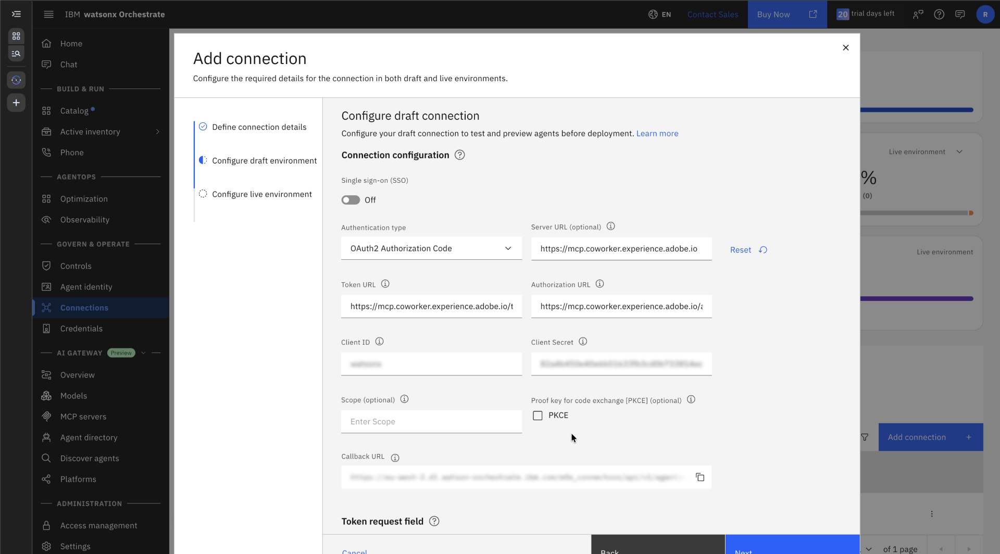

# 適用於AI平台的Adobe CX Enterprise Coworker

使用適用於AI平台的Adobe CX Enterprise Coworker ，從您已經使用的AI工具中獲得行銷見解。 以自然語言提出問題，而不需切換工具。 尋找每個平台中列為Adobe CX Enterprise Coworker的產品。

在[設定同事](#set-up-coworker)中尋找可用的平台及其設定指示。

在AI平台上使用Co-worker不需要額外付費。 它包含在您的CX Enterprise Coworker授權中，使用情況提取自與其他同事功能相同的AI積分。 如需詳細資訊，請參閱[Adobe Experience Platform代理程式工作和AI積分消耗](https://experienceleague.adobe.com/zh-hant/docs/cx-enterprise-ai/experience-cloud-ai/overview/ai-credit-consumption){target="_blank"}。

<!-- TODO: architecture diagram pending from engineering. KT page notes "to be provided on 8/28"; still outstanding as of 8/31. Insert here once received. -->

## 先決條件 {#prerequisites}

在AI平台中使用同事之前，請確認您具備下列條件。

* 為您的組織布建的Adobe CX Enterprise Coworker，以及您在Adobe中擁有該網站的存取權。
* Adobe Experience Platform以及Adobe Real-Time CDP、Adobe Journey Optimizer或Adobe Customer Journey Analytics中的至少一個。
* 存取[設定同事](#set-up-coworker)中列出的AI平台。

## 資料存取與許可權 {#data-access-and-permissions}

AI平台中的同事反映與您的Adobe身分繫結的相同資料和存取層級。 您可以查詢和檢視的內容符合您在Experience Platform及其相關解決方案中已有權使用的內容。 同事會繼承這些許可權，因此AI平台整合不需要個別的許可權設定。 Co-worker會傳回唯讀深入分析，而不會修改您的客戶資料。 檢閱任何產生的摘要和分析，再使用這些摘要和分析來做出業務決策。

<!-- Confirmed by PM (Siddhartha Srivastava) on 2026-09-02 for Microsoft 365 Copilot, Claude, and ChatGPT. Validate this permissions model for each additional platform before adding its setup section. -->

## 主要使用案例 {#key-use-cases}

在AI平台中使用同事，無需離開您的日常工具，即可加速常見行銷工作流程。

| 使用案例 | 說明 |
| --- | --- |
| 計畫和檢閱行銷活動 | 規劃行銷活動，包括合作夥伴行銷活動稽核和受眾預測。 比較一段時間內的行銷活動成效，並識別哪些接觸點可促進轉換。 |
| 監視歷程和行銷活動整備 | 檢閱和監控作用中行銷活動、分析客戶歷程及評估行銷活動整備。 追蹤歷程績效和下降情況，以找出最佳化的機會。 |
| 擷取營運分析 | 識別最大或最參與的受眾，以便您可以優先安排要集中努力的位置，並追蹤區段在一段時間內的成長或萎縮情況。 |
| 最佳化工作流程和內容 | 最佳化工作流程，並確定CX行銷活動的資產和內容需求。 無需手動建立查詢或控制面板，即可產生行銷活動績效的視覺化報表。 |
| 加速共同作業與決策 | 使用建議的提示來探索對象、行銷活動和網路流量。 在規劃會議期間與您的團隊分享見解，並在稽核計畫或平台時即時回答臨時問題。 |

<!-- Use cases approved by PM Siddhartha Srivastava on 2026-08-31 and confirmed for Microsoft 365 Copilot, Claude, and ChatGPT on 2026-09-02. Validate applicability for each additional platform before adding its setup section. -->

## 設定同事 {#set-up-coworker}

選取可用的平台以取得設定指示。 安裝之後，請嘗試[範例提示](#example-prompts)。

* [Microsoft 365 Copilot](#microsoft-365-copilot)
* [ChatGPT](#chatgpt)
* [克勞德](#claude)
* [Gemini Enterprise](#gemini-enterprise)
* [Amazon快速](#amazon-quick)
* [IBM watsonx Orchestrate](#ibm-watsonx-orchestrate)
* [Databricks](#databricks)

### [!DNL Microsoft 365 Copilot] {#microsoft-365-copilot}

使用[!DNL Adobe CX Enterprise Coworker for Copilot]在[!DNL Microsoft 365 Copilot]中取得行銷見解。

開始之前，請確認您擁有[!DNL Microsoft 365 Copilot]的存取權。

#### 設定組織存取權 {#copilot-organization-setup}

管理員必須先完成這些步驟，使用者才能在[!DNL Microsoft 365 Copilot]中存取同事。

1. 在[!DNL Microsoft 365 admin center]中，確認您的租使用者設定允許外部發行者建置的應用程式和代理程式。
1. 核准[!DNL Microsoft 365 admin center]和[!DNL Teams admin center]中的&#x200B;**[!UICONTROL Adobe CX Enterprise Coworker]**。 您通常可以透過[!DNL Microsoft Commercial Marketplace]或您組織的&#x200B;**[!UICONTROL 整合式應用程式]**&#x200B;清單找到代理程式。
1. 將代理程式部署給一般使用者。 您可以將它部署至特定使用者或群組，或部署至整個組織。 您啟用的使用者數目不會影響設定或成本。

>[!NOTE]
>
>如果[!DNL Microsoft]發行更新給需要新許可權的同事時，您的管理員必須先在[!DNL Agent Registry]核准更新，才能將其轉出給您的使用者。

#### 存取同事 {#copilot-access}

您的管理員啟用同事後，您就可以透過[!DNL Microsoft 365 Copilot]介面存取它，包括[!DNL Teams]、[!DNL Word]、[!DNL Excel]、[!DNL PowerPoint]和網頁聊天。

在[!DNL Microsoft 365 Copilot]中，選取&#x200B;**[!UICONTROL 代理程式]**，然後選取&#x200B;**[!UICONTROL 其他代理程式]**。

![Microsoft 365 Copilot的[代理程式]功能表已開啟，[其他代理程式]已反白顯示。](./assets/ai-platforms/copilot/copilot-agents.png)

接著，在代理程式目錄中選取&#x200B;**[!UICONTROL Adobe CX Enterprise Coworker]**。

最後，選取&#x200B;**[!UICONTROL 新增]**&#x200B;以將同事新增至您的代理程式。

![Microsoft 365 Copilot中的Adobe CX Enterprise Coworker詳細資料，並反白顯示[新增]按鈕。](./assets/ai-platforms/copilot/copilot-add-coworker.png)

### [!DNL ChatGPT] {#chatgpt}

使用[!DNL Adobe CX Enterprise Coworker for ChatGPT]在[!DNL ChatGPT]中取得行銷見解。

開始之前，請確認您擁有[!DNL ChatGPT]的存取權。

#### 設定組織存取權 {#chatgpt-organization-setup}

在新增同事之前，您的管理員必須先核准該同事。

* 請要求您的[!DNL ChatGPT]管理員核准所選使用者或整個組織的&#x200B;**[!UICONTROL Adobe CX Enterprise Coworker]**。

#### 存取同事 {#chatgpt-access}

在[!DNL ChatGPT]中，選取&#x200B;**[!UICONTROL 外掛程式]**。

接下來，在外掛程式目錄中尋找並選取&#x200B;**[!UICONTROL Adobe CX Enterprise Coworker]**。

在Adobe的搜尋結果中反白顯示Adobe CX Enterprise Coworker清單的

最後，選取&#x200B;**[!UICONTROL 安裝外掛程式]**&#x200B;以將同事新增至[!DNL ChatGPT]。

ChatGPT中的![Adobe CX Enterprise Coworker詳細資料，其中的[安裝外掛程式]按鈕反白顯示。](./assets/ai-platforms/chatgpt/gpt-install-coworker.png)

### [!DNL Claude] {#claude}

使用同事在[!DNL Claude]中取得行銷見解。

開始之前，請確認您擁有[!DNL Claude]的存取權。

#### 設定組織存取權 {#claude-organization-setup}

在新增同事之前，您的管理員必須先核准該同事。

* 請要求您的[!DNL Claude]管理員核准所選使用者或整個組織的&#x200B;**[!UICONTROL Adobe CX Enterprise Coworker]**。

#### 存取同事 {#claude-access}

1. 在[!DNL Claude]中，選取&#x200B;**[!UICONTROL 自訂]**。

   

1. 選取&#x200B;**[!UICONTROL 聯結器]**，然後選取&#x200B;**[!UICONTROL 探索]**，並使用&#x200B;**[!UICONTROL 搜尋]**&#x200B;尋找Adobe CX Enterprise Coworker。

   

1. 選取&#x200B;**[!UICONTROL Adobe CX Enterprise Coworker]**，然後選取&#x200B;**[!UICONTROL 連線到Claude]**。

   

1. 使用您的Adobe認證登入，以將同事連線到[!DNL Claude]。

### [!DNL Gemini Enterprise] {#gemini-enterprise}

使用同事在[!DNL Gemini Enterprise]中取得行銷見解。

開始之前，請確認您擁有[!DNL Gemini Enterprise]的存取權。

#### 設定組織存取權 {#gemini-organization-setup}

以[!DNL Gemini Enterprise]管理員的身分，完成這些步驟，讓您的組織可以使用同事。

1. 前往[Gemini Enterprise AI Agents市集](https://console.cloud.google.com/marketplace/browse?filter=solution-type:ai-agent-service)。
1. 搜尋Adobe CX Enterprise Coworker，然後選取&#x200B;**[!UICONTROL Adobe CX Enterprise Coworker]**&#x200B;代理程式卡片。
1. 在代理程式卡上，選取&#x200B;**[!UICONTROL 連絡銷售人員]**。

   ![Gemini Enterprise Marketplace代理程式清單與[聯絡銷售]按鈕。](./assets/ai-platforms/gemini-enterprise/gemini-contact-sales.png){width="700"}

1. 完成表單以將您的請求提交至Adobe。

   ![傳送電子郵件給Adobe Inc表單，其中包含連絡人和專案欄位、同意核取方塊以及[傳送電子郵件]按鈕。](./assets/ai-platforms/gemini-enterprise/gemini-contact-adobe.png){width="600"}

   Adobe會建立免費的私人優惠方案，並透過電子郵件傳送連結給您。

1. 開啟電子郵件連結並核准私人優惠方案。

   核准優惠方案後，Adobe會為您的[!DNL Gemini Enterprise]帳戶啟用代理程式。

1. 將代理程式發佈至您組織中的選定使用者或所有企業使用者。

#### 存取同事 {#gemini-access}

管理員將Co-worker發佈給您後，請在[!DNL Gemini Enterprise]中開啟它，以開始提出問題。

1. 在[!DNL Gemini Enterprise]中，移至&#x200B;**[!UICONTROL 代理程式]**&#x200B;目錄。
1. 搜尋Adobe CX Enterprise Coworker。
1. 選取&#x200B;**[!UICONTROL Adobe CX Enterprise Coworker]**&#x200B;並輸入提示以開始。

如需相關想法，請探索[主要使用案例](#key-use-cases)和[範例提示](#example-prompts)。

### [!DNL Amazon Quick] {#amazon-quick}

使用同事在[!DNL Amazon Quick]中取得行銷見解。

開始之前，請確認您擁有[!DNL Amazon Quick]和Adobe帳戶的存取權。

#### 連線同事 {#amazon-quick-connection}

使用模型內容通訊協定(MCP)連線[!DNL Amazon Quick]中的同事。 Adobe已核准此連線的[!DNL Amazon Quick]。

1. 在[!DNL Amazon Quick]中，移至&#x200B;**[!UICONTROL 聯結器]**。
1. 搜尋MCP並開啟聯結器設定。
1. 輸入`https://mcp.coworker.experience.adobe.io`作為MCP伺服器URL。

   請等候幾分鐘以完成連線並註冊。

1. 依照設定提示操作，使用您的Adobe憑證登入。
1. 在開始詢問問題之前，請確認連線成功。

#### 存取同事 {#amazon-quick-access}

連線同事後，請在[!DNL Amazon Quick]中使用它來詢問有關Adobe資料的問題。

如需相關想法，請探索[主要使用案例](#key-use-cases)和[範例提示](#example-prompts)。

### [!DNL IBM watsonx Orchestrate] {#ibm-watsonx-orchestrate}

使用同事在[!DNL IBM watsonx Orchestrate]中取得行銷見解。

開始之前，請確認您擁有[!DNL IBM watsonx Orchestrate]和Adobe帳戶的存取權。

您還需要管理連線、註冊MCP伺服器以及編輯代理程式的許可權。 在安裝之前，與您的Adobe代表確認您的OAuth使用者端設定。

#### 建立您的同事連線 {#ibm-connection}

使用OAuth連線同事，然後使用您的Adobe帳戶進行驗證。 下列步驟準備要在草稿環境中測試的連線。

1. 在[!DNL IBM watsonx Orchestrate]中，移至&#x200B;**[!UICONTROL 連線]**，然後選取&#x200B;**[!UICONTROL 新增連線]**。
1. 輸入&#x200B;**[!UICONTROL 連線ID]**、**[!UICONTROL 顯示名稱]**，以及選用的&#x200B;**[!UICONTROL 連線描述]**，然後選取&#x200B;**[!UICONTROL 儲存並繼續]**。
1. 在&#x200B;**[!UICONTROL 設定草稿環境]**&#x200B;中，選取&#x200B;**[!UICONTROL OAuth2授權代碼]**&#x200B;作為&#x200B;**[!UICONTROL 驗證型別]**。
1. 輸入連線設定。

   | 欄位 | 值 |
   | --- | --- |
   | [!UICONTROL 伺服器URL] | `https://mcp.coworker.experience.adobe.io` |
   | [!UICONTROL 權杖URL] | 已為您的OAuth使用者端確認權杖端點。 |
   | [!UICONTROL 授權URL] | 已為您的OAuth使用者端確認授權端點。 |
   | [!UICONTROL 使用者端識別碼] | 您核准的OAuth使用者端ID。 |
   | [!UICONTROL 使用者端密碼] | 您核准的OAuth使用者端密碼。 |

   {width="700"}

1. 選取&#x200B;**[!UICONTROL PKCE]**&#x200B;和&#x200B;**[!UICONTROL 成員認證]**，然後選取&#x200B;**[!UICONTROL 下一步]**。
1. 完成&#x200B;**[!UICONTROL 設定即時環境]**，然後選取&#x200B;**[!UICONTROL 完成]**&#x200B;以儲存連線。

<!-- Confirm the customer process for obtaining OAuth settings before publication. -->

#### 使用Adobe登入 {#ibm-sign-in}

新增您的成員認證，以驗證與您的Adobe身分的連線。

1. 移至&#x200B;**[!UICONTROL 設定]** > **[!UICONTROL 成員認證]**，然後選取&#x200B;**[!UICONTROL 新增成員認證]**。
1. 選取您的Co-worker連線，然後繼續進行&#x200B;**[!UICONTROL 設定認證]**。
1. 選取「**[!UICONTROL 連線並儲存]**」，然後在出現提示時使用您的Adobe認證登入。
1. 返回[!DNL IBM watsonx Orchestrate]並確認您的認證已成功新增。

#### 登入MCP伺服器 {#ibm-register-server}

透過模型內容通訊協定(MCP)註冊合作者，以將其工具匯入[!DNL IBM watsonx Orchestrate]。

1. 移至&#x200B;**[!UICONTROL AI閘道]** > **[!UICONTROL MCP伺服器]**，然後選取&#x200B;**[!UICONTROL 註冊伺服器]**。
1. 輸入伺服器設定。

   | 欄位 | 值 |
   | --- | --- |
   | [!UICONTROL 伺服器名稱] | 描述性名稱，例如`cx-coworker`。 |
   | [!UICONTROL 傳輸型別] | [!UICONTROL 可串流的HTTP] |
   | [!UICONTROL MCP伺服器URL] | `https://mcp.coworker.experience.adobe.io` |
   | [!UICONTROL Connection] | 您已驗證的同事連線。 |

1. 選取&#x200B;**[!UICONTROL 註冊]**，並等待伺服器註冊與工具匯入完成。

   {width="700"}

#### 將工具新增至代理程式 {#ibm-agent-tools}

將匯入的工具新增到代理程式，然後在部署代理程式之前測試連線。

1. 移至&#x200B;**[!UICONTROL 使用中詳細目錄]** > **[!UICONTROL 代理程式]**，然後開啟您要設定的代理程式。
1. 在&#x200B;**[!UICONTROL 建置]**&#x200B;中，選取&#x200B;**[!UICONTROL 工具]**，然後選取&#x200B;**[!UICONTROL 新增工具]**。
1. 選取&#x200B;**[!UICONTROL MCP伺服器]**，並從已註冊的Co-worker伺服器尋找工具。
1. 選取您需要的同事工具，然後選取&#x200B;**[!UICONTROL 新增至代理程式]**。
1. 在&#x200B;**[!UICONTROL 草稿預覽]**&#x200B;中輸入提示，並檢閱回應以確認連線是否有效。

如需相關想法，請探索[主要使用案例](#key-use-cases)和[範例提示](#example-prompts)。

### [!DNL Databricks] {#databricks}

使用同事在[!DNL Databricks Genie One]中取得行銷見解。

開始之前，請確認您擁有[!DNL Databricks Genie One]和Adobe帳戶的存取權。 您還需要許可權才能在所選的[!DNL Unity Catalog]目錄和結構描述中安裝MCP服務。

在安裝之前，與您的Adobe代表確認您的OAuth使用者端設定。

#### 安裝同事 {#databricks-install}

從[!DNL Databricks Marketplace]安裝Co-worker MCP服務。

1. 在[!DNL Databricks]中，前往&#x200B;**[!UICONTROL 市集]**&#x200B;並搜尋Adobe同事。
1. 選取&#x200B;**[!UICONTROL Adobe CX Enterprise Coworker]**，然後選取&#x200B;**[!UICONTROL 安裝]**。
1. 選取&#x200B;**[!UICONTROL 目錄]**&#x200B;和&#x200B;**[!UICONTROL 結構描述]**，然後輸入&#x200B;**[!UICONTROL MCP服務名稱]**。
1. 保留清單所提供的連線設定，包括下列值。

   | 欄位 | 值 |
   | --- | --- |
   | [!UICONTROL 主機] | `https://mcp.coworker.experience.adobe.io` |
   | [!UICONTROL 基底路徑] | `/mcp` |
   | [!UICONTROL 認證型別] | [!UICONTROL OAuth U2M] |

   {width="700"}

1. 輸入您的&#x200B;**[!UICONTROL 使用者端識別碼]**&#x200B;和&#x200B;**[!UICONTROL 使用者端密碼]**。
1. 檢閱並接受條款，然後選取[安裝]。****

<!-- Confirm the customer process for obtaining OAuth settings before publication. -->

#### 連線您的Adobe帳戶 {#databricks-adobe-connection}

每位使用者都使用其Adobe帳戶登入。 同事請求會使用該使用者的Adobe許可權。

1. 在&#x200B;**[!UICONTROL 目錄]**&#x200B;中，在選取的目錄和結構描述下開啟已安裝的Co-worker服務。
1. 出現提示時完成Adobe登入。
1. 確認服務&#x200B;**[!UICONTROL 狀態]**&#x200B;為&#x200B;**[!UICONTROL 作用中]**，且其工具已列出。
1. 在&#x200B;**[!UICONTROL 開始]**&#x200B;中，選取&#x200B;**[!UICONTROL Genie]**，然後選取&#x200B;**[!UICONTROL Genie One]**，然後選取&#x200B;**[!UICONTROL 新增至Genie One]**。

#### 存取同事 {#databricks-access}

在[!DNL Genie One]中提出問題之前，請確認您的聯結器可用。

1. 在[!DNL Genie One]中，移至&#x200B;**[!UICONTROL 自訂]** > **[!UICONTROL 聯結器]**&#x200B;並開啟您的Co-worker聯結器。
1. 確認聯結器顯示&#x200B;**[!UICONTROL 已連線]**。 根據您組織的原則檢閱工具核准設定。

   ![Databricks Genie One中的Co-worker聯結器顯示[已連線]狀態、可用工具及工具核准設定。](./assets/ai-platforms/databricks/databricks-connectors.png){width="700"}

1. 選取「**[!UICONTROL 新聊天]**」並輸入提示，例如「使用Adobe同事，列出已發佈的對象」。

如需相關想法，請探索[主要使用案例](#key-use-cases)和[範例提示](#example-prompts)。

<!-- Setup steps for Microsoft 365 Copilot, ChatGPT, and Claude reflect the real customer-facing flow confirmed by PM (Siddhartha Srivastava) on 2026-09-02: an org admin approves the connector or plugin, then end users find and add it in their platform's catalog and sign in. The previous version of this file described a manual MCP-connector setup for ChatGPT (Settings > Connectors > paste server URL) -- PM clarified that flow is for internal testing only, not the customer path, so it was removed here. -->

<!-- Amazon Quick setup follows PM guidance from the October 28, 2026 email, "Coworker in AI Platforms screenshots - Gemini / Amazon Quick." End users connect through MCP and sign in with Adobe credentials. -->

## 提示範例 {#example-prompts}

在支援的平台上設定Co-worker之後，請嘗試這些提示，或以自然語言撰寫您自己的提示。

* 顯示您的前五個對象。
* 顯示上個月的量度。
* 顯示您作用中的Workfront專案。
* 顯示與忠誠度對象相關的歷程。

## 已知限制 {#known-limitations}

AI平台中的Co-worker不支援Co-worker介面中提供的所有功能。

* 您無法將Co-worker連線至本檔案所列支援AI平台之外的自訂代理配線。 若要透過MCP請求對其他AI平台或代理程式通道的支援，請聯絡您的Adobe代表。
* 透過Claude存取同事時，無法使用Firefly影像產生技能。 此技能仍可在Co-worker介面及本檔案中描述的其他受支援AI平台中使用。 若要使用Firefly影像產生技能，請透過同事介面或其他支援的AI平台存取同事。

## 疑難排解AI平台中的同事 {#troubleshoot}

如果您在AI平台中使用同事時遇到問題，請嘗試這些步驟。

* 如果您看到錯誤，請登出並使用您的Adobe憑證重新登入。 重新驗證可解決大部分問題。
* 如果您無法存取同事或特定資料，請聯絡您的Adobe管理員，確認您的產品存取權和許可權。

<!--
Editorial maintenance, 2026-10-27:
Only approved platforms with validated setup guidance belong in the platform sections.
Databricks setup follows the supplied "Adobe Coworker in Genie One.mp4" walkthrough. Confirm marketplace availability and customer OAuth provisioning before publication.

To add an approved platform:
* Confirm approval and obtain access to the customer flow.
* Validate prerequisites, organization approval, catalog discovery, listing name, installation, and Adobe sign-in.
* Confirm the shared licensing, permissions, use cases, prompts, limitations, and troubleshooting guidance applies.
* Add an H3 platform section with an explicit anchor under Set up Coworker and add it to the linked platform list.
* Follow the existing order: introduction, platform prerequisites, setup tasks, and user access. Use H4 task headings with unique anchors.
* Document any platform-specific requirements or exceptions within that section.
* Preview the section and verify its links and image references.
Keep the article introduction, metadata, and shared prerequisites free of platform lists so adding a section does not require duplicate updates.

Gemini Enterprise follow-up:
Administrator setup and end user access steps are documented. Confirm applicability of the shared guidance before expanding the section.
-->
