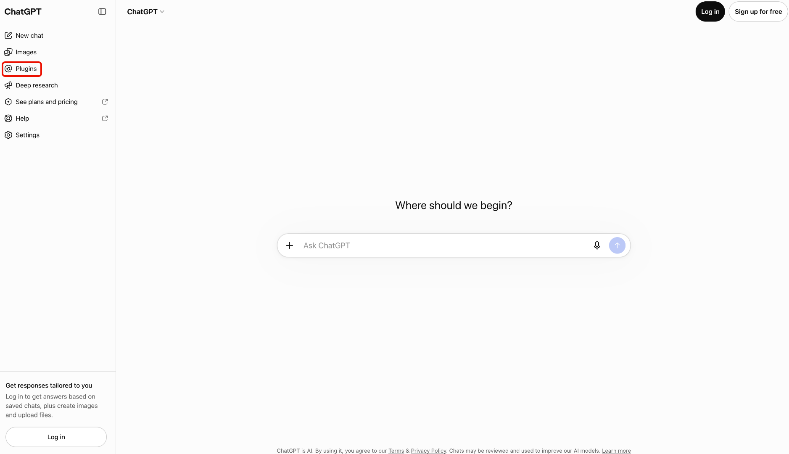
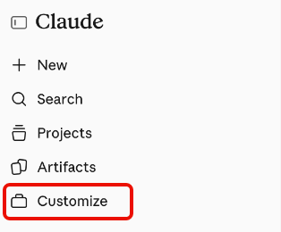

# 適用於AI平台的Adobe CX Enterprise Coworker

使用適用於AI平台的Adobe CX Enterprise Coworker ，從您已經使用的AI工具中獲得行銷見解。 以自然語言提出問題，而不需切換工具。 尋找每個平台中列為Adobe CX Enterprise Coworker的產品。

在[設定同事](#set-up-coworker)中尋找可用的平台及其設定指示。

在AI平台上使用Co-worker不需要額外付費。 它包含在您的CX Enterprise Coworker授權中，使用情況提取自與其他同事功能相同的AI積分。 如需詳細資訊，請參閱[Adobe Experience Platform代理程式工作和AI積分消耗](https://experienceleague.adobe.com/zh-hant/docs/cx-enterprise-ai/experience-cloud-ai/overview/ai-credit-consumption){target="_blank"}。

<!-- TODO: architecture diagram pending from engineering. KT page notes "to be provided on 8/28"; still outstanding as of 8/31. Insert here once received. -->

## 先決條件 {#prerequisites}

在AI平台中使用同事之前，請確認您具備下列條件。

* 為您的組織布建的Adobe CX Enterprise Coworker，以及您在Adobe中擁有該網站的存取權。
* Adobe Experience Platform以及Adobe Real-Time CDP、Adobe Journey Optimizer或Adobe Customer Journey Analytics中的至少一個。
* 存取[設定同事](#set-up-coworker)中列出的AI平台。

## 資料存取與許可權 {#data-access-and-permissions}

AI平台中的同事反映與您的Adobe身分繫結的相同資料和存取層級。 您可以查詢和檢視的內容符合您在Experience Platform及其相關解決方案中已有權使用的內容。 同事會繼承這些許可權，因此AI平台整合不需要個別的許可權設定。 Co-worker會傳回唯讀深入分析，而不會修改您的客戶資料。 檢閱任何產生的摘要和分析，再使用這些摘要和分析來做出業務決策。

<!-- Confirmed by PM (Siddhartha Srivastava) on 2026-09-02 for Microsoft 365 Copilot, Claude, and ChatGPT. Validate this permissions model for each additional platform before adding its setup tab. -->

## 主要使用案例 {#key-use-cases}

在AI平台中使用同事，無需離開您的日常工具，即可加速常見行銷工作流程。

| 使用案例 | 說明 |
| --- | --- |
| 計畫和檢閱行銷活動 | 規劃行銷活動，包括合作夥伴行銷活動稽核和受眾預測。 比較一段時間內的行銷活動成效，並識別哪些接觸點可促進轉換。 |
| 監視歷程和行銷活動整備 | 檢閱和監控作用中行銷活動、分析客戶歷程及評估行銷活動整備。 追蹤歷程績效和下降情況，以找出最佳化的機會。 |
| 擷取營運分析 | 識別最大或最參與的受眾，以便您可以優先安排要集中努力的位置，並追蹤區段在一段時間內的成長或萎縮情況。 |
| 最佳化工作流程和內容 | 最佳化工作流程，並確定CX行銷活動的資產和內容需求。 無需手動建立查詢或控制面板，即可產生行銷活動績效的視覺化報表。 |
| 加速共同作業與決策 | 使用建議的提示來探索對象、行銷活動和網路流量。 在規劃會議期間與您的團隊分享見解，並在稽核計畫或平台時即時回答臨時問題。 |

<!-- Use cases approved by PM Siddhartha Srivastava on 2026-08-31 and confirmed for Microsoft 365 Copilot, Claude, and ChatGPT on 2026-09-02. Validate applicability for each additional platform before adding its setup tab. -->

## 設定同事 {#set-up-coworker}

選取可用的平台以取得設定指示。 安裝之後，請嘗試[範例提示](#example-prompts)。

>[!BEGINTABS]

>[!TAB Microsoft 365 Copilot]

使用[!DNL Adobe CX Enterprise Coworker for Copilot]在[!DNL Microsoft 365 Copilot]中取得行銷見解。

開始之前，請確認您擁有[!DNL Microsoft 365 Copilot]的存取權。

**為您的組織設定同事**

管理員必須先完成這些步驟，使用者才能在[!DNL Microsoft 365 Copilot]中存取同事。

1. 在[!DNL Microsoft 365 admin center]中，確認您的租使用者設定允許外部發行者建置的應用程式和代理程式。
1. 核准[!DNL Microsoft 365 admin center]和[!DNL Teams admin center]中的&#x200B;**[!UICONTROL Adobe CX Enterprise Coworker]**。 您通常可以透過[!DNL Microsoft Commercial Marketplace]或您組織的&#x200B;**[!UICONTROL 整合式應用程式]**&#x200B;清單找到代理程式。
1. 將代理程式部署給一般使用者。 您可以將它部署至特定使用者或群組，或部署至整個組織。 您啟用的使用者數目不會影響設定或成本。

>[!NOTE]
>
>如果[!DNL Microsoft]發行更新給需要新許可權的同事時，您的管理員必須先在[!DNL Agent Registry]核准更新，才能將其轉出給您的使用者。

**存取[!DNL Copilot]**&#x200B;中的同事

您的管理員啟用同事後，您就可以透過[!DNL Microsoft 365 Copilot]介面存取它，包括[!DNL Teams]、[!DNL Word]、[!DNL Excel]、[!DNL PowerPoint]和網頁聊天。

在[!DNL Microsoft 365 Copilot]中，選取&#x200B;**[!UICONTROL 代理程式]**，然後選取&#x200B;**[!UICONTROL 其他代理程式]**。

![Microsoft 365 Copilot的[代理程式]功能表已開啟，[其他代理程式]已反白顯示。](./assets/ai-platforms/copilot/copilot-agents.png)

接著，在代理程式目錄中選取&#x200B;**[!UICONTROL Adobe CX Enterprise Coworker]**。

最後，選取&#x200B;**[!UICONTROL 新增]**&#x200B;以將同事新增至您的代理程式。

![Microsoft 365 Copilot中的Adobe CX Enterprise Coworker詳細資料，並反白顯示[新增]按鈕。](./assets/ai-platforms/copilot/copilot-add-coworker.png)

>[!TAB ChatGPT]

使用[!DNL Adobe CX Enterprise Coworker for ChatGPT]在[!DNL ChatGPT]中取得行銷見解。

開始之前，請確認您擁有[!DNL ChatGPT]的存取權。

**為您的組織設定同事**

* 請要求您的[!DNL ChatGPT]管理員核准所選使用者或整個組織的&#x200B;**[!UICONTROL Adobe CX Enterprise Coworker]**。

**存取[!DNL ChatGPT]**&#x200B;中的同事

在[!DNL ChatGPT]中，選取&#x200B;**[!UICONTROL 外掛程式]**。

接下來，在外掛程式目錄中尋找並選取&#x200B;**[!UICONTROL Adobe CX Enterprise Coworker]**。

在Adobe的搜尋結果中反白顯示Adobe CX Enterprise Coworker清單的

最後，選取&#x200B;**[!UICONTROL 安裝外掛程式]**&#x200B;以將同事新增至[!DNL ChatGPT]。

ChatGPT中的![Adobe CX Enterprise Coworker詳細資料，其中的[安裝外掛程式]按鈕反白顯示。](./assets/ai-platforms/chatgpt/gpt-install-coworker.png)

>[!TAB 克勞德]

使用同事在[!DNL Claude]中取得行銷見解。

開始之前，請確認您擁有[!DNL Claude]的存取權。

**為您的組織設定同事**

* 請要求您的[!DNL Claude]管理員核准所選使用者或整個組織的&#x200B;**[!UICONTROL Adobe CX Enterprise Coworker]**。

**存取[!DNL Claude]**&#x200B;中的同事

1. 在[!DNL Claude]中，選取&#x200B;**[!UICONTROL 自訂]**。

   

1. 選取&#x200B;**[!UICONTROL 聯結器]**，然後選取&#x200B;**[!UICONTROL 探索]**，並使用&#x200B;**[!UICONTROL 搜尋]**&#x200B;尋找Adobe CX Enterprise Coworker。

   

1. 選取&#x200B;**[!UICONTROL Adobe CX Enterprise Coworker]**，然後選取&#x200B;**[!UICONTROL 連線到Claude]**。

   

1. 使用您的Adobe認證登入，以將同事連線到[!DNL Claude]。

>[!ENDTABS]

<!-- Setup steps above reflect the real customer-facing flow confirmed by PM (Siddhartha Srivastava) on 2026-09-02: an org admin approves the connector or plugin, then end users find and add it in their platform's catalog and sign in. The previous version of this file described a manual MCP-connector setup for ChatGPT (Settings > Connectors > paste server URL) -- PM clarified that flow is for internal testing only, not the customer path, so it was removed here. -->

## 提示範例 {#example-prompts}

在支援的平台上設定Co-worker之後，請嘗試這些提示，或以自然語言撰寫您自己的提示。

* 顯示您的前五個對象。
* 顯示上個月的量度。
* 顯示您作用中的Workfront專案。
* 顯示與忠誠度對象相關的歷程。

## 已知限制 {#known-limitations}

AI平台中的同事並非支援所有整合模式。

* 您無法使用MCP將Co-worker連線到您自己的代理配線。

## 疑難排解AI平台中的同事 {#troubleshoot}

如果您在AI平台中使用同事時遇到問題，請嘗試這些步驟。

* 如果您看到錯誤，請登出並使用您的Adobe憑證重新登入。 重新驗證可解決大部分問題。
* 如果您無法存取同事或特定資料，請聯絡您的Adobe管理員，確認您的產品存取權和許可權。

<!--
Editorial maintenance, 2026-10-27:
Only approved platforms with validated setup guidance belong in the rendered tab set.
Remaining platforms to add: Gemini, Amazon Quick, IBM, and Databricks.

To add an approved platform:
* Confirm approval and obtain access to the customer flow.
* Validate prerequisites, organization approval, catalog discovery, listing name, installation, and Adobe sign-in.
* Confirm the shared licensing, permissions, use cases, prompts, limitations, and troubleshooting guidance applies.
* Add one tab before ENDTABS, following the existing order: introduction, platform prerequisites, organization setup, and user access.
* Document any platform-specific requirements or exceptions within that tab.
* Preview the tab and verify its links and image references.
Keep the introduction, metadata, and shared prerequisites free of platform lists so adding a tab does not require duplicate updates.

Gemini draft scope:
No setup steps are confirmed. Validate the complete customer flow and all shared guidance before adding the tab.
Do not infer the flow from another platform.
-->
