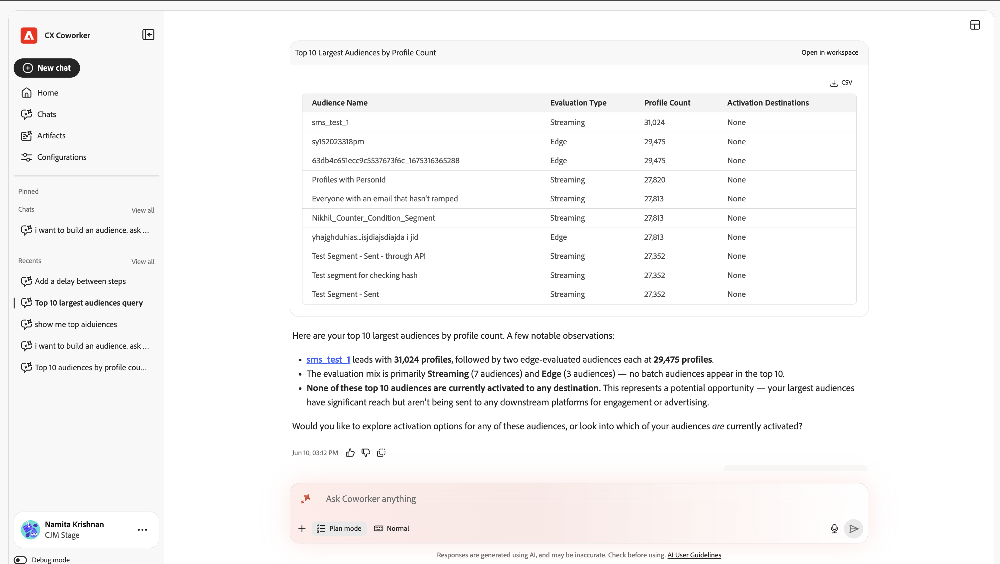
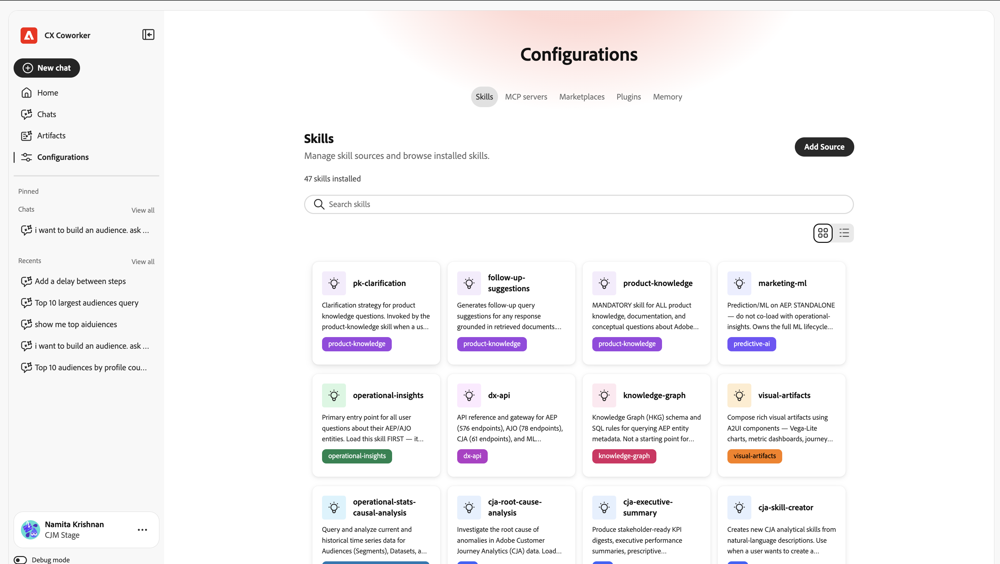

# 開始使用同事聊天 {#ui-guide}

Co-worker Chat可讓您透過簡單語言詢問您所需的內容，以使用Adobe CX Enterprise資料和工具。 使用此頁面來開啟「同事聊天」、傳送您的第一則訊息，並設定您的工作方式。

## 可用性

[!DNL Coworker] [!UICONTROL 聊天]可作為沈浸式體驗、整頁工作區以及某些[!DNL CX Enterprise]應用程式的產品內體驗。

下表顯示每個體驗的可用位置。

| CX Enterprise應用程式 | 沈浸式體驗 | 產品內體驗 |
|---|---|---|
| Real-Time CDP | 現在可用 | 即將推出 |
| Adobe Journey Optimizer | 現在可用 | 即將推出 |
| Customer Journey Analytics | 現在可用 | 即將推出 |
| Workfront | 現在可用 | 現在可用 |
| 目標 | 現在可用 | 現在可用 |
| AEM | 現在可用 | 現在可用 |
| Marketo Engage | 現在可用 | 即將推出 |

## 開啟[!DNL Coworker]聊天 {#immersive}

若要使用沈浸式體驗，請使用您的Adobe憑證登入。 您可以從直接連結或CX Enterprise中開啟它。

1. 移至[https://experience.adobe.com/#/coworker](https://experience.adobe.com/#/coworker)。
1. 使用您的 Adobe ID 登入。
1. 在[!DNL CX Enterprise]中，按一下應用程式選擇器功能表，然後按一下&#x200B;**[!DNL Coworker]**。
1. 若要開啟「聊天」（產品內體驗），請按一下&#x200B;**[!UICONTROL 聊天]** 。

## 影片 — [!DNL Coworker]聊天介面的基本知識

>[!VIDEO](https://video.tv.adobe.com/v/3498558?learn=on)

## 選擇您的組織

您的[組織](https://experienceleague.adobe.com/zh-hant/docs/core-services/interface/administration/organizations)和沙箱決定了對話可以觸及的資料、技能和連線工具。 開始前請先檢查這些專案。 您目前的上下文會顯示在左側導覽邊欄的底部，且位於您的名稱下方。

若要變更您的內容：

1. 按一下導覽邊欄底部的您的名稱，以開啟帳戶功能表。
1. 按一下「**[!UICONTROL 組織]**」並選擇您要使用的IMS組織。

   

1. Clidk **[!UICONTROL Sandbox]**&#x200B;並選擇您要使用的AEP沙箱。

   

帳戶功能表也包含下列選項：

| 選項 | 使用它可以 |
| --- | --- |
| **[!UICONTROL 佈景主題]** | 在淺色和深色主題之間切換。 |
| **[!UICONTROL 設定]** | 檢視帳戶詳細資料和工作區設定。 |
| **[!UICONTROL CX應用程式]** | 前往另一個連線至您帳戶的CX Enterprise應用程式。 |
| **[!UICONTROL 登出]** | 登出您的Adobe帳戶。 |

## 尋找您的方法

工作區有兩個區域：左側導覽邊欄和填滿視窗其餘部分的交談畫布。

使用導覽邊欄可在產品的各個部分之間移動並返回最近的工作。

| 選項 | 使用它可以 |
| --- | --- |
| **[!UICONTROL 新聊天]** | 開始對話。 同事聊天會將您目前的聊天內容儲存到您的歷程記錄中。 |
| **[!UICONTROL 首頁]** | 返回問候語、輸入方塊和建議的提示。 |
| **[!UICONTROL 聊天]** | 搜尋、釘選、封存或刪除過去的交談。 |
| **[!UICONTROL 組態]** | 管理技能、MCP伺服器、行銷場所、外掛程式和記憶體。 |
| **[!UICONTROL 已固定]** | 開啟您主持的交談。 按一下&#x200B;**[!UICONTROL 全部檢視]**，在[聊天]頁面上檢視它們。 |
| **[!UICONTROL 最近]** | 開啟您最新的交談。 按一下&#x200B;**[!UICONTROL 全部檢視]**&#x200B;以開啟[聊天]頁面。 |

## 傳送您的第一則訊息

Home畫面會根據同事聊天可在您的沙箱中執行的操作，顯示問候語、輸入（[!UICONTROL 聊天]）方塊以及建議的提示。 您可以從建議開始，或撰寫您自己的訊息。

若要傳送訊息：

1. 按一下導覽邊欄中的&#x200B;**[!UICONTROL 首頁]**。
1. 執行下列任一項項目：

   * 在「**[!UICONTROL 為您建議]**」下選取提示。 「同事聊天」會將其新增至輸入方塊，您可在其中編輯它。
   * 在&#x200B;**[!UICONTROL 詢問同事任何事項]**&#x200B;方塊中輸入您自己的要求。

1. （選擇性）新增內容、選擇「同事聊天」的回應方式，或指定您的訊息。 請參閱[新增內容並選擇回應樣式](#input-options)。
1. 按一下&#x200B;**[!UICONTROL 傳送]**。

>[!TIP]
>
>建議的提示會顯示Co-worker Chat支援的工作型別，例如在沙箱之間移動結構描述、在歷程中尋找異常以及驗證資料集。

若要將Co-worker Chat指向沙箱中的特定物件，請在輸入方塊中輸入&#x200B;**+**，然後按一下結構描述、歷程、資料集或其他物件。 這稱為實體提及。 它會告訴Co-worker Chat您指的是哪個物件。

## 新增內容並選擇回應樣式 {#input-options}

輸入方塊下方的工具列可控制您附加的內容、「同事聊天」處理工作的方式，以及您所看到的工作量。

| 控制 | 使用它可以 |
| --- | --- |
| **[!UICONTROL +]** （附加） | 新增檔案或沙箱物件至您的訊息。 |
| **[!UICONTROL 計畫模式]** | 在「同事聊天」動作之前，請檢閱逐步計畫。 |
| **[!UICONTROL 成績單檢視]** | 選擇您看到多少同事聊天活動。 |
| **[!UICONTROL 麥克風]** | 指定您的訊息。 再按一下以停止錄製。 |
| **[!UICONTROL 傳送]** | 傳送您的訊息。 Co-worker Chat回應時，此控制項會變成&#x200B;**[!UICONTROL 停止]**，這會中斷回應。 |

### 附加檔案或物件

當「同事聊天」需要更多資訊以進行工作時，附加檔案或物件。

1. 按一下輸入方塊中的&#x200B;**[!UICONTROL +]**。
1. 按一下下列其中一項：

   * **[!UICONTROL 附加檔案]**：上傳要讀取和參考的同事聊天檔案。
   * **[!UICONTROL 新增資料或物件]**：參考沙箱中的物件，例如資料集或結構描述，因此Co-worker Chat會針對您的即時資料運作。

### 在「同事聊天」動作前先檢閱計畫 {#plan-mode}

針對變更資料的複雜工作或工作，使用「計畫」模式。 當「計畫」模式開啟時，「同事聊天」會提出計畫並等待您的核准，然後才會執行。 當「計畫」模式關閉時，「同事聊天」會立即開始工作。

1. 按一下輸入工具列中的&#x200B;**[!UICONTROL 計畫模式]**&#x200B;以開啟它。
1. 傳送您的訊息。
1. 檢閱計畫並核准以繼續。

### 選擇成績單檢視

會議記錄檢視會控制同事聊天中的推理和工具活動出現在交談中的程度。

1. 按一下輸入工具列中的&#x200B;**[!UICONTROL 成績單檢視]**。
1. 按一下檢視：

   | 檢視 | 您所看到的內容 |
   | --- | --- |
   | **[!UICONTROL 一般]** | 主要思考步驟與工具活動的摘要。 |
   | **[!UICONTROL 焦點]** | 主要是答案。 同事聊天會隱藏大部分的中間步驟。 |
   | **[!UICONTROL 詳細資訊]** | 每個思考步驟、技能載入、檔案讀取和查詢。 |

## 檢閱回應

同事Chat會隨時顯示其工作，然後傳回答案。 回應可包括其推理、其所使用工具的記錄、成品和摘要。

### 追蹤活動

在「同事聊天」運作時，您可以追蹤並驗證其功能。 展開任何專案以檢視詳細資訊。

* **為**&#x200B;思考：包含同事聊天推理的可摺疊區塊，以及花費的時間。
* **已載入的技能**：用於工作的專門功能同事聊天。
* **讀取檔案**&#x200B;和&#x200B;**已執行1個查詢**： Co-worker Chat已讀取的檔案及其已執行的查詢，以及每個檔案所花費的時間。

>[!TIP]
>
>將&#x200B;**[!UICONTROL 成績單檢視]**&#x200B;設定為&#x200B;**[!UICONTROL 詳細資訊]**&#x200B;以檢視每個步驟，或設定為&#x200B;**[!UICONTROL 焦點]**&#x200B;以隱藏每個步驟。

### 使用成品

「同事聊天」會將結果（例如對象表格）顯示為回應中的成品卡。 您可以從表格成品卡片將其下載為CSV檔案。 當回應包含多個成品時，請使用&#x200B;**[!UICONTROL Previous]**&#x200B;和&#x200B;**[!UICONTROL Next]**&#x200B;在它們之間移動。

### 使用摘要

在成品下方，「同事聊天」會說明結果的意義、強調重要發現，並建議後續動作。 使用這些建議繼續交談。

### 評等和複製回應

每個回應都包含可用於提供意見或重複使用內容的控制項。

* 按一下&#x200B;**[!UICONTROL 向上縮圖]**&#x200B;或&#x200B;**[!UICONTROL 向下縮圖]**&#x200B;以評等回應。 您的評等有助於改善未來的答案。
* 按一下&#x200B;**[!UICONTROL 複製]**，然後選擇&#x200B;**[!UICONTROL 復製為Markdown]**&#x200B;以保留格式設定，或選擇&#x200B;**[!UICONTROL 復製為純文字]**&#x200B;以移除格式。

## 管理您的聊天

您的聊天記錄會保留過去的交談，以便您返回交談。 按一下導覽邊欄中的&#x200B;**[!UICONTROL 聊天]**&#x200B;以開啟。 對話會依日期分組，每一列會顯示標題和輪次數目。

您可以在「聊天」頁面執行下列作業：

* 在&#x200B;**[!UICONTROL 依標題搜尋]**&#x200B;中輸入名稱以尋找交談。
* 按一下[顯示&#x200B;**[!UICONTROL 已釘選]**]，只檢視您已釘選的交談。
* 按一下[顯示&#x200B;**[!UICONTROL 封存的]**]以檢視封存的交談。
* 按一下&#x200B;**[!UICONTROL 新增聊天]**&#x200B;開始交談。

若要釘選、重新命名、封存或刪除交談，請按一下列上的列功能表(**[!UICONTROL ...]**)，然後選擇選項。

## 自訂同事聊天

[!UICONTROL 自訂]是您控制[!UICONTROL 同事聊天]能做的事情的地方。 按一下導覽邊欄中的&#x200B;**[!UICONTROL 自訂]**，然後選擇標籤： **[!UICONTROL 技能]**、**[!UICONTROL 整合]**、**[!UICONTROL 行銷場所]**、**[!UICONTROL 外掛程式]**&#x200B;或&#x200B;**[!UICONTROL 記憶體]**。

### 新增和檢視技能

技能是Co-worker Chat在應用時自動使用的專業功能。 您也可以在聊天中輸入&#x200B;**/**，自己開始一項技能。 「**[!UICONTROL 技能]**」索引標籤會列出所有已安裝的技能。

1. 在&#x200B;**[!UICONTROL 技能]**&#x200B;索引標籤上，按一下&#x200B;**[!UICONTROL 新增技能]**&#x200B;以從新來源安裝技能。
1. 在&#x200B;**[!UICONTROL 搜尋]**中輸入名稱以尋找技能。
使用檢視切換可在格點和清單配置之間切換。
1. 選取技能，以檢視「同事聊天」使用外掛程式時，該技能所屬的外掛程式及其包含的檔案。

   

1. （選擇性）按一下&#x200B;**[!UICONTROL 檢視SKILL.md]**&#x200B;以讀取完整的技能定義，或按一下&#x200B;**[!UICONTROL 移除Source]**&#x200B;以解除安裝技能。

   

### 連線伺服器

伺服器整合可將Co-worker Chat連線至外部工具和服務，例如Adobe Journey Optimizer、Real-Time CDP、Target和Workfront。 「**[!UICONTROL 自訂]**」>「**[!UICONTROL 使用者]**」>「**[!UICONTROL 整合]**」索引標籤會列出您連線的伺服器和使用中連線的數目。 每個卡片都會顯示伺服器名稱、其端點，以及描述其所提供內容的標籤。

1. 瀏覽至&#x200B;**[!UICONTROL 自訂]** > **[!UICONTROL 使用者]** > **[!UICONTROL 整合]**

   

1. 在自訂上，按一下&#x200B;**[!UICONTROL 新增伺服器]**。

   

1. 填入下列欄位和選項：

   * **[!UICONTROL 伺服器名稱]** （必要）：輸入可在整合清單中識別伺服器的名稱，例如`github`或`slack`。
   * **[!UICONTROL Source URL或命令]** （必要）：輸入Co-worker Chat連線到的位址，例如`https://mcp.example.com/sse`。
   * **[!UICONTROL 連線型別]**：選取伺服器用來與Co-worker Chat通訊的通訊協定： **[!UICONTROL SSE]** （伺服器傳送的事件）或&#x200B;**[!UICONTROL HTTP]**。 預設值為&#x200B;**[!UICONTROL SSE]**。
   * **[!UICONTROL 工具逾時（秒）]**：設定Co-worker Chat在停止要求之前，等待此伺服器上的工具回應的時間。 預設值為60秒。
   * **[!UICONTROL 驗證]**：選取Co-worker Chat向伺服器證明其身分的方式。 預設值為&#x200B;**[!UICONTROL 無]**，不會傳送任何認證。 如果伺服器需要認證，請選取其他方法。
   * **[!UICONTROL 標頭]**：按一下&#x200B;**[!UICONTROL 新增標頭]**，將每個要求傳送至伺服器的額外HTTP標頭（例如API金鑰）。 此選項為選用。

1. 按一下&#x200B;**[!UICONTROL 新增]**。

### 新增市集

Marketplace是外掛程式的登入，您可以從中瀏覽及安裝。 在&#x200B;**[!UICONTROL Marketplaces]**&#x200B;標籤上，按一下&#x200B;**[!UICONTROL 新增Marketplace]**&#x200B;以註冊新市場。 使用&#x200B;**[!UICONTROL 搜尋]**&#x200B;或依群組篩選以縮小清單。 具有&#x200B;**就緒**&#x200B;狀態的市集可從安裝。

### 管理外掛程式

外掛程式將技能和伺服器整合在一起，讓您能夠一起安裝和管理它們。 **[!UICONTROL 外掛程式]**&#x200B;索引標籤會顯示您已安裝的外掛程式。

* 按一下&#x200B;**[!UICONTROL 瀏覽市集]**&#x200B;以尋找新的外掛程式。
* 依Marketplace篩選，檢視每個外掛程式的來源。
* 按一下&#x200B;**[!UICONTROL 解除安裝]**，移除外掛程式及其所套裝的所有專案。

### 管理記憶體

記憶體可讓「同事聊天」記住您在不同交談中的偏好設定，因此回應會隨著時間而保持相關性。 使用&#x200B;**[!UICONTROL 記憶體]**&#x200B;索引標籤來控制它保留的內容。

1. 按一下[組態]頁面上的&#x200B;**[!UICONTROL 記憶體]**。
1. 開啟&#x200B;**[!UICONTROL 啟用記憶體]**。 關閉此功能可停止跨工作階段記憶同事聊天。
1. 在&#x200B;**[!UICONTROL 已儲存的偏好設定]**&#x200B;下，檢閱已儲存的同事聊天。 您可以編輯、刪除或檢查每個專案，並依類別篩選專案。
1. 使用&#x200B;**[!UICONTROL 儲存的記憶記錄]**&#x200B;檢視記憶變更的時間表。

