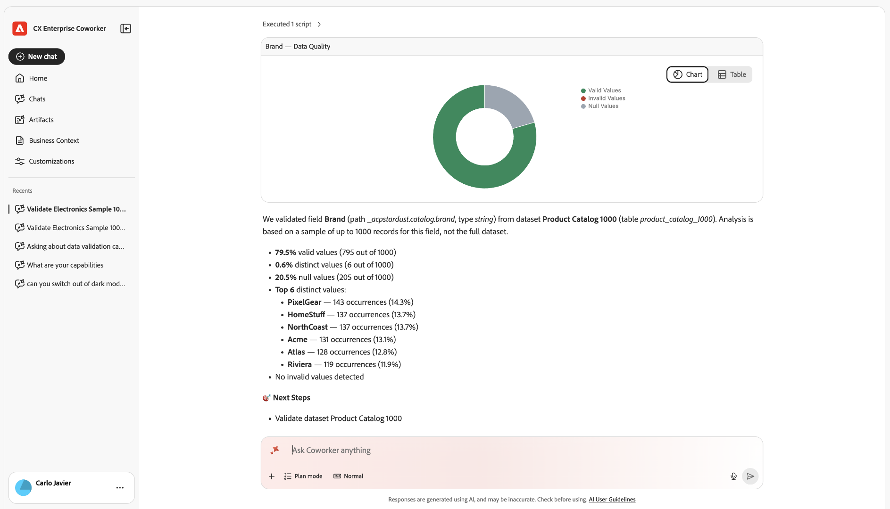

# 資料控管和驗證概觀

使用Adobe CX Enterprise Coworker Chat設定、移轉及管理您的分析實作，並確定您可以信任每個答案背後的資料。 同事可以規劃您的實施、將計畫轉換為檢查清單，讓您的團隊可以追蹤，並在收集後驗證您的資料。

資料治理和驗證是Co-worker Chat中的數個分析網域之一。 若要檢視所有網域，請參閱「使用同事聊天分析資料」中的[開始在同事聊天中分析](/help/chat/use-cases/data-insights/analytics-overview.md#start-analyzing-in-coworker-chat)。

**最佳對象：**&#x200B;管理員

## 實施工作流程如何整合

本頁的使用案例會依循選用的三階段工作流程。 您可以自行使用任何階段。 例如，您無需先產生計畫或檢查清單即可驗證資料。

1. **計畫：**&#x200B;取得個人化、有序的實作或升級計畫。 請參閱[與同事一起規劃您的實作](/help/chat/use-cases/data-insights/implementation-guide.md)。
1. **實作：**&#x200B;將您的計畫轉換為團隊可指派及追蹤的同事專案檢查清單。 請參閱[與同事專案產生實作檢查清單](/help/chat/use-cases/data-insights/intelligent-checklist.md)。
1. **驗證：**&#x200B;確認您的資料已正確設定並收集。 檢視[使用案例](#use-cases)表格中的驗證使用案例。

## 先決條件

<!-- FLAG: Confidence: Medium for the shared bullets. They differ from the other domain pages on purpose: planning doesn't query your data, and Experience Platform validation uses Experience Platform datasets rather than data views or report suites. The permission inheritance for Experience Platform is inferred. High for the "Additional prerequisite" notes in the Use cases table, which are sourced from the "Before you begin" section of each linked article. Some of those articles flag their own prerequisites as unconfirmed (implementation-guide.md, intelligent-checklist.md, streaming-media-validation.md), so verify those rows when those flags are resolved. Validate dataset quality for Customer Journey Analytics is a video page with no stated prerequisites, so it isn't listed. -->

若要使用此頁面上的使用案例，您需要：

* 存取同事聊天。 請參閱[開始使用同事聊天](/help/chat/use-cases/data-insights/analytics-chat.md)分析資料。
* 檢視您要驗證之資料的存取權。 Co-worker Chat會從其連線到的Adobe應用程式繼承您的許可權。

## 使用案例

| 使用案例 | 函數 |
| --- | --- |
| [規劃您的實作](/help/chat/use-cases/data-insights/implementation-guide.md)

 | 建立實施Customer Journey Analytics、從Adobe Analytics升級，或在Edge上設定Content Analytics、Marketing Campaign Analytics或串流媒體集合的個人化逐步計畫。 計畫包含如擁有者、工作量估算、相依性和驗證步驟等詳細資訊。
**範例提示：** 「協助我規劃Customer Journey Analytics的實作」

**其他先決條件：**&#x200B;除了[一般先決條件](#prerequisites)之外，此使用案例也要求您知道哪些實作路徑適用於您，以及您目前環境的基本詳細資訊，例如您的授權狀態或計畫的資料擷取路徑。

如需詳細資訊，請參閱[與同事一起規劃實作](/help/chat/use-cases/data-insights/implementation-guide.md)。
 |
| [產生實作檢查清單](/help/chat/use-cases/data-insights/intelligent-checklist.md)

 
實驗性
 | 將您的Customer Journey Analytics實作計畫轉換為同事專案中的檢查清單，您的團隊可以在其中指派步驟、追蹤狀態和新增核准閘門。
**其他先決條件：**&#x200B;除了[一般先決條件](#prerequisites)之外，此使用案例還需要完成實作指南對話，以及存取您組織中的同事專案。

如需詳細資訊，請參閱[與同事專案產生實作檢查清單](/help/chat/use-cases/data-insights/intelligent-checklist.md)。
 |
| [從Adobe Analytics升級至Customer Journey Analytics時驗證資料](/help/chat/use-cases/data-insights/data-validation-aa-cja.md)

 | 比較Adobe Analytics報表套裝與Customer Journey Analytics資料檢視之間的維度、量度和趨勢，標示差異，然後建議支援升級的修正。
**最佳對象：**&#x200B;管理員、分析師

**範例提示：**
<ul><li>「將我的AA報告套裝與CJA資料檢視進行比較」</li><li>「AA和CJA之間哪些量度不相符？」</li></ul>
**其他先決條件：**&#x200B;除了[一般先決條件](#prerequisites)之外，此使用案例還需要您要驗證的Adobe Analytics報表套裝，以及包含相同資料的Customer Journey Analytics資料檢視。

如需詳細資訊，請參閱[從Adobe Analytics升級至Customer Journey Analytics時，與同事驗證資料](/help/chat/use-cases/data-insights/data-validation-aa-cja.md)。
 |
| [驗證您的串流媒體實作](/help/chat/use-cases/data-insights/streaming-media-validation.md)

 
實驗性
 | 檢查您的資料流、結構、資料集、資料檢視和工作階段資料，確認已正確設定串流媒體追蹤並收集資料。
**範例提示：** 「我的串流媒體實施整體狀況如何？」

**其他先決條件：**&#x200B;除了[一般先決條件](#prerequisites)之外，此使用案例也要求您組織的Experience Platform和Customer Journey Analytics資料連線到同事。 對於某些驗證模式，您還需要視訊工作階段ID或記錄檔。

如需詳細資訊，請參閱[與同事驗證您的串流媒體實作](/help/chat/use-cases/data-insights/streaming-media-validation.md)。
 |
| [驗證Customer Journey Analytics的資料集品質](/help/chat/use-cases/data-insights/validate-dataset-quality-for-cja.md)

 
實驗性（下週）
 | 識別摘要提供Customer Journey Analytics報告的資料集，然後檢查結構描述、身分品質和欄位品質，以便在建立儀表板之前解決問題。
如需詳細資訊，請參閱[在同事中使用資料驗證技能驗證Customer Journey Analytics資料](/help/chat/use-cases/data-insights/validate-dataset-quality-for-cja.md)。
 |
| [擷取到Experience Platform後驗證資料](/help/chat/use-cases/data-insights/data-validation-aep.md)

 | 在Experience Platform資料集和欄位上執行統計和語意檢查，以找出新實作後或持續資料管理過程中的資料品質問題，例如無效值或對應問題。
**範例提示：**
<ul><li>「驗證資料集[資料集名稱]」</li><li>「驗證資料集[資料集名稱]中的[資料欄位]」</li></ul>
**其他必要條件：**&#x200B;除了[一般必要條件](#prerequisites)之外，此使用案例還需要您要驗證之資料集的名稱或ID。 您可以選擇提供特定欄位的名稱來驗證。

如需詳細資訊，請參閱[與同事驗證您的Experience Platform資料](/help/chat/use-cases/data-insights/data-validation-aep.md)。
 |
| [加速資料深入分析](/help/chat/use-cases/data-insights/accelerate-data-insights.md) | 在影片中顯示Co-worker如何規劃您的實施、執行支援的動作，以及在Adobe Experience Manager、Experience Platform、Web SDK和Customer Journey Analytics中引導產品和開發步驟，直到您的網站參與資料準備好分析為止。
如需詳細資訊，請參閱[與同事、AEM和CJA加速資料深入分析](/help/chat/use-cases/data-insights/accelerate-data-insights.md)。
 |

## 使用的技能

<!-- FLAG: Confidence: High for `aa-cja-validation` (listed in the Skills and limitations table and in workflows.md). Medium for `data-validation`: workflows.md lists it, but with a TODO to confirm the skill ID with engineering. Medium for the implementation guide skills and the Streaming Media Validation skill: the articles name them but don't give technical skill IDs, so they're listed by display name. Only `aa-cja-validation` currently appears in the Skills and limitations table on analytics-overview.md. Add the others there so the link below covers them. -->

Co-worker會針對本文所述的使用案例使用下列技能。 如需所有分析技能的清單，包括所需許可權及未涵蓋的內容，請參閱「使用同事聊天分析資料」中的[技能與限制](/help/chat/use-cases/data-insights/analytics-overview.md#skills-and-limitations)。

| 技能 | 用於 |
| --- | --- |
| 實作指南技能（Customer Journey Analytics、Adobe Analytics升級至Customer Journey Analytics、Content Analytics、Marketing Campaign Analytics和串流媒體各一個） | 規劃您的實作 |
| `aa-cja-validation` | 從Adobe Analytics升級至Customer Journey Analytics時驗證資料 |
| 串流媒體驗證技能 | 驗證您的串流媒體實作 |
| 資料驗證技能(`data-validation`) | 驗證Customer Journey Analytics的資料集品質 擷取到Experience Platform後驗證資料 |

## 取得更好結果的秘訣

* 為驗證資料時您想要比較的特定報表套裝和資料檢視命名。
* 使用驗證結果作為您自己的變更的指南。 串流媒體驗證和資料驗證技能可識別問題，但不會變更您的設定或資料。
* 在每次實作變更後重新執行串流媒體驗證。 它會隨選執行，不提供持續監控。
* 僅將實作指南技能用於規劃。 他們不會存取您的Adobe系統或執行實作。

## 後續步驟

* 如需使用「同事聊天」進行資料分析的概觀，包括其他分析網域和最佳實務，請參閱[使用同事聊天分析資料](/help/chat/use-cases/data-insights/analytics-overview.md)。
* 若要設定同事聊天並逐步瀏覽工作範例，請參閱[開始使用同事聊天分析資料](/help/chat/use-cases/data-insights/analytics-chat.md)。
