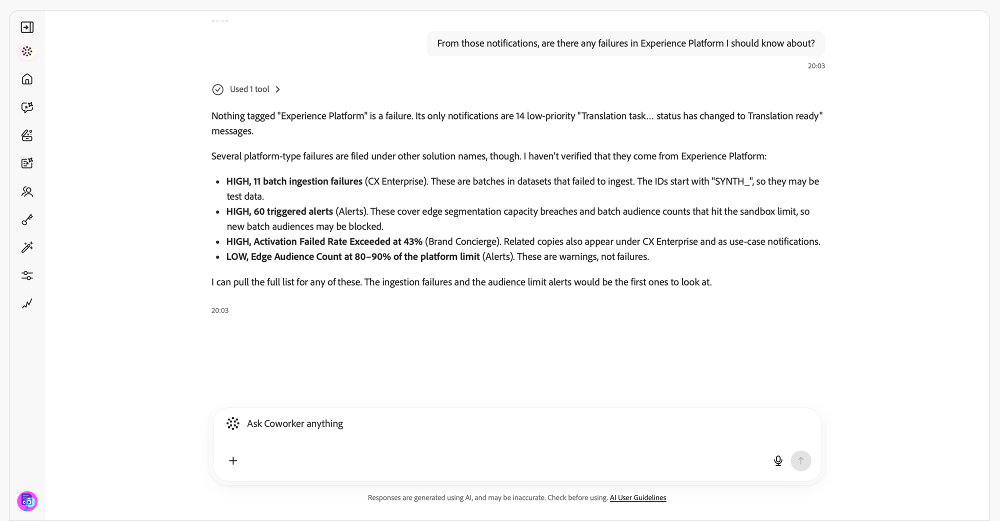

# 通知技能 {#notification-skills}

使用Adobe CX Enterprise Coworker中的通知技能來檢閱通知、識別行動專案，以及透過對話管理通知偏好設定。 使用您在Adobe CX Enterprise應用程式通知面板中收到的通知。

彙總通知、尋找特定專案，並將重複通知分組為不同問題。 在其應用程式中開啟通知、將其標示為已讀取或未讀取，或設定提醒。

>[!AVAILABILITY]
>
>所有有權存取Adobe CX Enterprise Coworker的客戶皆可使用通知技能。 使用技能不需要額外的設定。
>
>若要在[!DNL Slack]中接收通知，您的組織必須有已連線的[!DNL Slack]工作區。

## 開始之前 {#before-you-begin}

開始之前，請確定您擁有：

* 存取Adobe CX Enterprise Coworker。
* 存取一或多個傳送通知給您的Adobe CX Enterprise應用程式。
* 如果您想要在[!DNL Slack]中接收通知，則為貴組織的已連線[!DNL Slack]工作區。

## 檢閱通知並採取行動 {#review-and-act}

從摘要開始，然後調整您的請求並對特定通知採取行動。

1. 開啟同事聊天。 如需指示，請參閱[開始使用同事聊天](/help/chat/ui-guide.md)。
1. 在&#x200B;**[!UICONTROL 詢問同事任何事項]**&#x200B;方塊中輸入請求，然後選取&#x200B;**[!UICONTROL 傳送]**。 例如：

   *「今天需要我注意什麼？」*

1. 檢閱需要動作的通知以及提供來引起注意的通知。

   

1. 輸入後續問題以縮小結果範圍。 例如：

   *&quot;從這些通知中，我應該瞭解Experience Platform中是否有任何失敗？&quot;*

   

1. 詢問有關通知的詳細資訊，或在其應用程式中開啟通知以進行調查。
1. 要求將通知標示為已讀取或設定提醒。 例如：

   *「明天提醒我高優先順序的傳入事件速率警示。」*

   

繼續交談，不重複先前要求的內容。 如果您的請求可套用至多個通知、應用程式或設定，請先回答澄清問題再繼續。

您會在變更前收到確認請求，該變更會超出您的請求。

## 支援的使用案例 {#supported-use-cases}

使用「通知技能」來檢閱傳送給您的通知、處理通知並管理接收通知的方式。

>[!NOTE]
>
>通知技能不會傳送、共用或刪除通知。

### 識別行動專案 {#identify-action-items}

詢問您在Adobe CX Enterprise應用程式中需要注意哪些通知。

提示範例：

* 「今天有什麼需要我注意的？」
* 「趕上我。」
* 「有任何等待處理的專案嗎？」

### 摘要通知 {#summarize-notifications}

要求某個時段或應用程式的摘要。 檢閱行動專案，與提供以引起注意的通知分開。 重複的通知會分組為不同的問題，而不是單獨列出。

提示範例：

* 「摘要我過去一週的通知。」
* 「提供我最後一天的通知概覽。」
* &quot;摘要我的Adobe Journey Optimizer通知。&quot;

### 尋找特定通知 {#find-specific-notifications}

依未讀取狀態、核准請求、失敗、錯誤或產品版本等條件篩選通知。

提示範例：

* 「只顯示未讀取的通知。」
* 「顯示我的核准要求。」
* 「我是否應該知道任何嚴重失敗警示？」
* 「顯示Experience Platform的發行通知。」

### 檢閱通知詳細資料 {#review-notification-details}

詢問傳送通知時的完整詳細資料。 如果多個通知符合您的請求，請指定您想要的通知。

提示範例：

* 「告訴我關於歷程通知的更多資訊。」
* 「這個警示對我有何意義？」

### 對通知採取行動 {#act-on-notifications}

在其應用程式中開啟通知、將通知標示為已讀取或未讀取，或設定提醒。 選擇五分鐘、十五分鐘、一小時或明天的提醒。

提示範例：

* 「將通知標示為已讀取。」
* &quot;將通知標示為未讀取。&quot;
* 「一小時後再提醒我這個通知。」
* 「將我的所有通知標示為已讀取。」

### 管理通知偏好設定 {#manage-notification-preferences}

在變更接收通知的方式之前，請先詢問您目前的設定。 指定您要更新的應用程式或通知類別。

| 偏好設定 | 可用變更 |
| --- | --- |
| 傳遞管道 | 針對應用程式或類別開啟或關閉應用程式內的通知、電子郵件通知或[!DNL Slack]通知。 |
| 電子郵件頻率 | 選擇立即電子郵件傳遞，或每日或每週摘要。 |
| 類別優先順序 | 選擇哪些通知類別有高優先順序。 |
| 快顯通知 | 選擇顯示快顯警示的通知類別。 |

提示範例：

* 「我對於Adobe Journey Optimizer的通知設定是什麼？」
* 「停用Experience Platform的[!DNL Slack]通知。」
* 「將我的每日摘要切換為每週。」
* &quot;將版本更新通知設為靜音。&quot;
* 「僅透過電子郵件傳送Adobe Journey Optimizer通知。」

如果「同事聊天」要求排程詳細資料，請指定每週摘要的日期、時間和時區。

## 有關此主題的更多說明 {#more-help}

使用這些指南以開始進行同事聊天或調查Experience Platform警報活動。

* [開始使用同事聊天](/help/chat/ui-guide.md)
* [客戶警示技能](/help/chat/use-cases/customer-alerts/customer-alerts.md)
