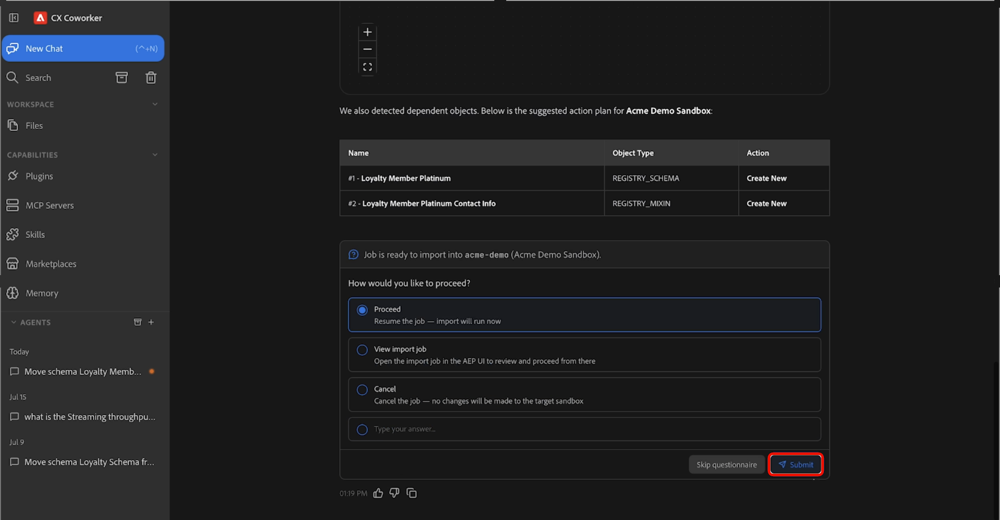

# 沙箱工具代理程式技能

>[!AVAILABILITY]
>
>所有具有Adobe CX Enterprise Coworker存取權的客戶皆可使用沙箱工具代理程式技能。 若要使用所有可用功能，您需要下列許可權：
>
>**Manage-sandbox**&#x200B;或&#x200B;**View-sandbox**：這些許可權可讓您使用沙箱工具代理程式技能直接在同事中檢視沙箱。
>
>**Manage-package**：此許可權可讓您使用沙箱工具代理程式技能，直接在同事中建立套件。

使用沙箱工具代理技巧，以自然語言描述您要完成的動作，在Adobe Experience Platform環境中移動支援的物件型別。 使用Co-worker，您可以透過對話式體驗來探索所需的中繼資料、自動識別相依性、建立移轉套件及移轉物件。

>[!VIDEO](https://video.tv.adobe.com/v/3496717?captions=chi_hant&learn=on)

## 先決條件 {#prerequisites}

在開始之前，請確定您已：

- 存取Adobe Experience Platform以及適當的組織和沙箱。
- 存取您要探索或移轉的物件。
- 安裝在同事中的Adobe CXO外掛程式。

如需有關安裝外掛程式的說明，請參閱[Co-worker UI指南](https://experienceleague.adobe.com/zh-hant/docs/cx-enterprise-ai/experience-cloud-ai/coworker/chat/ui-guide)。

## 使用沙箱工具代理技能 {#use-sandbox-tooling-agentic-skills}

透過同事使用自然語言與沙箱工具代理技能互動。 儘可能清楚描述您的目標。 特定請求會產生最佳結果，而模糊或過於簡短的提示可能會傳回品質較低的結果，或無法叫用代理程式。

若要使用沙箱工具代理程式技能：

1. 導覽至&#x200B;**[!UICONTROL CX Coworker]**。
1. 輸入您要完成之作業的明確說明。 例如：

   *「將結構描述忠誠度會員白金從目前的沙箱移至Acme示範沙箱。」*

1. 檢閱結果表格，其中顯示來源和目標沙箱。 當您準備好要繼續時，請選取&#x200B;**[!UICONTROL 繼續]**，然後選取&#x200B;**[!UICONTROL 提交]**&#x200B;以進行確認。

   ![已選取[繼續]的請求結果，強調顯示[提交]。](./assets/sandbox-tooling/results-proceed.png)

1. 選取一或多個要移轉的物件，然後選取&#x200B;**[!UICONTROL 提交]**。

   

1. 檢閱代理程式識別的物件與相依性，並確認作業動作 — *建立新的*&#x200B;或&#x200B;*使用現有的*。 當您準備開始移轉時，請選取&#x200B;**[!UICONTROL 繼續]**，然後選取&#x200B;**[!UICONTROL 提交]**&#x200B;以進行確認。 移轉可能需要幾分鐘的時間才能完成。

   

1. 移轉完成時，所選物件可在目標沙箱中使用。

   

如需有關使用同事的詳細資訊，請參閱[同事使用者介面指南](https://experienceleague.adobe.com/zh-hant/docs/cx-enterprise-ai/experience-cloud-ai/coworker/chat/ui-guide)。

## 支援的使用案例 {#supported-use-cases}

探索使用沙箱工具代理技能的常見方法，以簡化沙箱管理和中繼資料移轉。

### 在沙箱間移動物件中繼資料

作為管理多個Adobe Experience Platform沙箱的沙箱管理員，您可以使用自然語言請求移轉物件中繼資料，而不是手動導覽使用者介面。

您可以使用Co-worker，透過以自然語言描述移轉，將受支援的Adobe Experience Platform物件及其關聯的中繼資料從一個沙箱移轉至另一個沙箱。 沙箱工具代理技能會自動識別相依性、封裝所需物件，並幫助確保跨環境的可靠移轉。

例如：

- 「將方案Luma忠誠度會員白金從目前沙箱移至生產沙箱。」

### 將物件升級為多個沙箱(Beta)

>[!NOTE]
>
>多沙箱管理目前在Beta中，僅支援結構描述和資料集。

作為沙箱管理員，您可以在單一工作流程中將受支援的物件從來源沙箱提升至多個目標沙箱。 使用Co-worker來選取目標沙箱、檢閱建議的變更，以及在各個環境中以一致的方式部署設定，而不是將套件個別匯入每個沙箱。 多沙箱管理會自動解析相依性，並在升級開始之前提供變更的預覽。

例如：

- 「將忠誠度成員結構描述促銷至所有區域沙箱。」

### 在沙箱之間提升對象

作為沙箱管理員，您可以在環境之間提升對象，而無需手動重新建立或重新設定。

例如：

- 「將『對象名稱』對象升級至測試沙箱。」

沙箱工具代理技能識別指定的對象、驗證其相依性，並將所有必要物件移轉至目標沙箱。

## 提示範例 {#example-prompts}

使用下列提示作為與沙箱工具代理技能互動的範例。

### 結構描述提示

當您知道結構描述名稱和目的地沙箱時，請使用這些提示。

- 「將結構描述「結構描述名稱」從目前的沙箱移至生產沙箱。」

### 對象提示

當您知道對象名稱時，請使用這些提示。

- 「將『對象名稱』對象升級至測試沙箱。」

## 後續步驟 {#next-steps}

閱讀本指南後，您應該瞭解如何使用沙箱工具代理技巧，在沙箱之間探索、封裝和移轉支援的物件。

如需沙箱工具的詳細資訊，請參閱[沙箱工具指南](https://experienceleague.adobe.com/zh-hant/docs/experience-platform/sandbox/ui/sandbox-tooling)。

