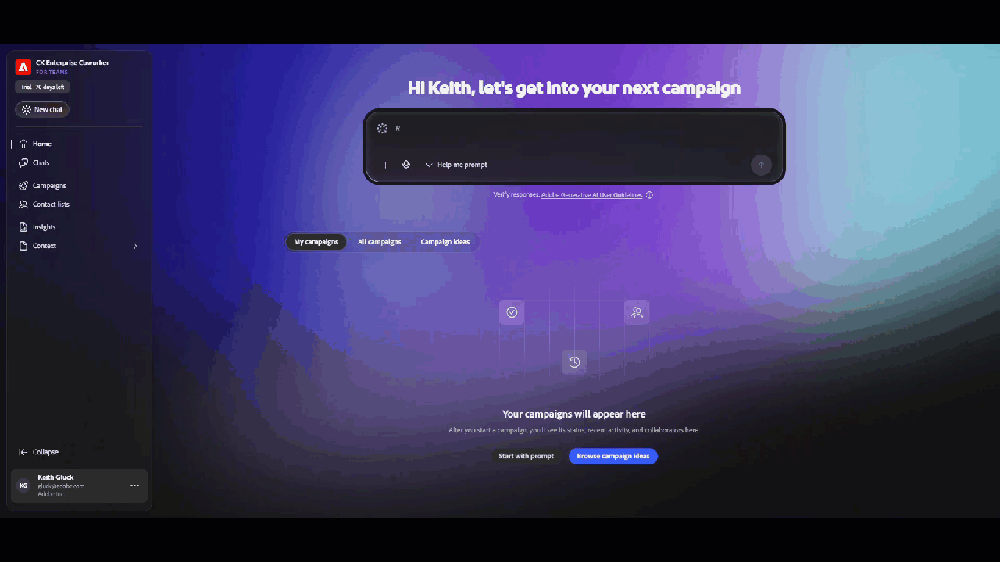

# 團隊的同事概觀 {#overview}

適用於團隊的同事是專為具有更敏捷行銷團隊的小型組織所設計，這些團隊需要在單一工具中產生內容、建立歷程及分析。

目前，與AI的所有互動都會將您導向產生[行銷活動](/help/coworker-for-teams/create-an-email-campaign.md)。 即將推出更多功能。

## 如何存取

>[!NOTE]
>
>適用於團隊的同事可在2026年12月31日之前透過免費試用取得。 在試用期間，所有資產和活動都是使用者專屬的。

1. 請前往coworker-campaigns.experience.adobe.com。

1. 如果您有現有的Adobe帳戶，請按一下&#x200B;**登入**。 如果沒有的話，請按一下&#x200B;**加入免費試用版**，並使用您的商務電子郵件建立帳戶。

   現有的Adobe客戶會自動獲得核准，並直接連線至試用環境以接受條款。

   如果您不是現有客戶，請選取&#x200B;**建立帳戶**&#x200B;以要求存取權。 Adobe會稽核要求並核准業務電子郵件。 您的請求獲得核准後，您將會收到電子郵件（請務必檢視您的「垃圾訊息」資料夾）。

1. 接受試用條款。

1. 在&#x200B;**您的資料** > **品牌**&#x200B;下設定您的品牌。 團隊的同事會使用此值，作為您產生之每個行銷活動的預設值。

1. （選用）在&#x200B;**電子郵件範本**&#x200B;下上傳HTML電子郵件範本，以供團隊在產生內容時套用您的設計的同事。

   {width="800" zoomable="yes"}

您已準備好產生您的第一個行銷活動。

## 介面導覽

團隊的Co-worker介面會圍繞左側導覽來整理。

| 左側導覽功能表 | 目的 |
|---|---|
| 新增聊天 | 開始新交談以產生行銷活動。 |
| 首頁 | 您的起點：提示列、最近的行銷活動，以及現成的行銷活動範本。 |
| 聊天 | 您已開始的每一個交談尚未產生至行銷活動討論區。 |
| 行銷活動 | 您所有草稿和即時行銷活動的詳細目錄。 |
| 您的內容 | 您的品牌套件和電子郵件範本（團隊合作者用來讓一切維持在品牌上的資產）。 |
| 自訂 | 聯結器（啟動時的Marketo Engage）和技能（可套用至各行銷活動的自訂行為）。 |

>[!NOTE]
>
>在啟動時，團隊合作中的每個交談都會著重於產生行銷活動。 構思、分析和支援風格的對話將逐步展開。

## 您可以使用團隊同事做什麼

團隊合作提供五種工作流程，通常橫跨五種不同工具，構成一種對話體驗：

- **將簡報轉換為行銷活動計畫**。 按下提示或上傳簡報，團隊的同事會傳回結構化的端對端計畫。
- **建置並調整對象**。 上傳CSV或連線資料，然後在對話中調整區段。
- **產生品牌內內容**。 團隊的同事會撰寫符合您品牌語調、參照和範本的電子郵件。
- **設計多步驟歷程**。 團隊的同事會組合培養序列，而不僅僅是單次傳送。
- **傳送證明電子郵件**。 啟動前預覽您收件匣中的所有郵件。
- **啟動並分析**。 _（即將推出）_&#x200B;傳送行銷活動並取得下一個最佳步驟的深入分析，而不需要離開團隊的同事。

## AI的運作方式

適用於團隊的同事遵循簡單的多圈對話回圈：

**輸入**。 您可以提供行銷活動目標、對象（已上傳或已連線）以及選用的品牌內容。

**正在處理**。 Teams agentic AI的同事會產生行銷活動計畫、建置歷程並草稿個人化內容。 所有這些功能都可以在對話中更新。

**輸出**。 行銷活動草稿會出現在您的行銷活動展示板上，可供檢閱、反複和最終啟動。

您可以隨時與團隊的同事交談（例如「讓第二封電子郵件更緊急」、「縮短主旨列」或「將對象調換為第三季的失效客戶」），而這會更新既有的成品。

>[!CAUTION]
>
>傳送前請務必檢查輸出。

## 快速入門秘訣

早期使用者發現的一些事情可帶來實際差異：

- **從特定實際使用案例開始**。 「為90天內未訂購的客戶建立回饋系列」會比「讓我成為行銷活動」好。 如需特定範例，請參閱&#x200B;_使用案例_。
- **清除您的對象資料**。 團隊的同事只能個人化您的CSV允許。 在上傳前，排除任何不應寄送電子郵件的連絡人。
- **投資您的品牌設定**。 團隊的同事會在您註冊時擷取品牌詳細資料。 快速檢閱&#x200B;**您的資料** > **品牌**，即可獲益於您產生的每個行銷活動。
- **傳送證明電子郵件**。 啟動之前，請先傳送校樣，並在您自己的收件匣中檢閱。
- **重複，不要重新啟動**。 將團隊第一次輸出的同事視為起點。 最快速的提升路徑是幾輪細分，而不是全新的提示。
- **當您需要紙張軌跡時匯出**。 將個別電子郵件匯出為HTML，或將整個行銷活動匯出為Word檔案或PDF，以供團隊檢閱。
- **逸出索引鍵**。 在「行銷活動同事」編輯器或對話方塊（行銷活動、歷程等）中，隨時按ESC鍵 以快速結束。

## 試用版須知事項

團隊的同事是進行中開發中的產品。 以下為進入時的須知事項：

- **試用期**：現在到2026年12月31日。
- **需要接受**：存取產品前，您必須先檢閱並接受試用條款。
- **地區**：目前僅限北美使用者免費試用。
- **對象**：對象是透過CSV上傳。 所有受眾都特定於其各自的促銷活動（目前未儲存在您環境的其他任何位置）。
- **資料指引**：請勿上傳敏感或規範的資料。 團隊合作目前不適用於HIPAA管制的產業。
- **法規遵循**：您有責任遵循電子郵件規範（取消訂閱連結、隱私權政策等）。
- **傳送限制**： （_即將推出_）當啟動可用時，您每月最多可傳送5,000封電子郵件。

## 影片概觀

>[!VIDEO](https://video.tv.adobe.com/v/3492816?captions=chi_hant&learn=on){transcript=true}

新功能將在試用期間提供。 您的意見反應有助於規劃未來發展。 透過標題中的產品內意見回饋圖示提交意見回饋。
