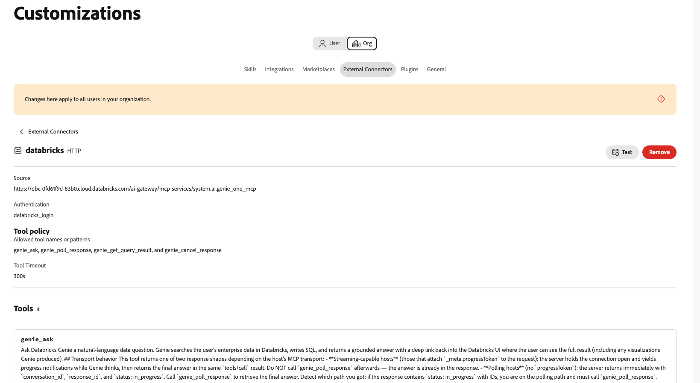
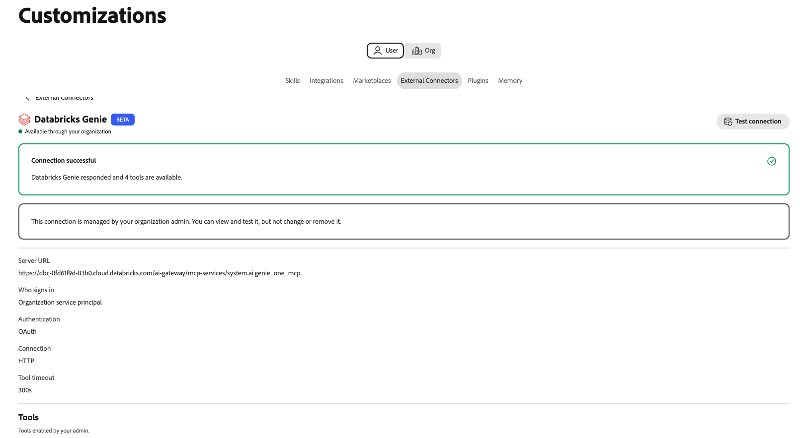

# Databricks Genie外部聯結器 {#databricks-genie}

使用[!DNL Databricks Genie]外部聯結器以簡單語言在Adobe CX Enterprise Coworker中詢問有關[!DNL Databricks]資料的問題。 [!DNL Genie]會撰寫SQL並在聊天中傳回答案。 聯結器會將同事連結至[!DNL Databricks]工作區中的[!DNL Genie One]模型內容通訊協定(MCP)伺服器。

>[!AVAILABILITY]
>
>[!DNL Databricks Genie]外部聯結器為Beta版。 文件和功能可能會有所變更。

## 聯結器設定 {#connector-configuration}

聯結器組態程式有兩個獨立的部分：

* **組織設定：**&#x200B;管理員將同事連線至[!DNL Databricks]工作區，選擇人員登入的方式，並選取成員可以使用的工具。
* **成員存取：**&#x200B;成員使用具有共用組織身分或他們自己的[!DNL Databricks]身分的連線，視登入選項而定。

管理員可選擇下列其中一個登入選項：

| 選項 | 管理員提供的內容 | 存取的運作方式 |
| --- | --- | --- |
| **[!UICONTROL 組織服務主體]** | [!DNL Databricks]服務主體的使用者端識別碼和使用者端密碼。 | 所有成員都使用服務主體的許可權。 成員未登入[!DNL Databricks]。 |
| **[!UICONTROL 每個人登入]** | [!DNL Databricks] OAuth應用程式連線的使用者端識別碼，以及選用的使用者端密碼。 | 每個成員都使用自己的[!DNL Databricks]身分登入，而且存取遵循其[!DNL Databricks]許可權。 |

這兩個選項都不會授與所選識別尚未擁有的[!DNL Databricks]許可權。 [!DNL Databricks]會針對每個請求強制執行[!DNL Unity Catalog]許可權。

## 先決條件 {#prerequisites}

此聯結器可與[!DNL Databricks Genie One]搭配使用。 它不支援舊版[!DNL Genie]空間MCP URL。 若要連線其他[!DNL Databricks] MCP伺服器（例如[!DNL Databricks SQL]伺服器），請將其個別新增為整合。

開始之前，請確定您具備下列條件：

* **對於組織設定：**&#x200B;具有在同事中管理組織聯結器的許可權的帳戶。
* **對於[!DNL Databricks]工作區：**&#x200B;可使用[!DNL Genie One]的工作區的HTTPS URL。
* **對於服務主體選項：** [!DNL Databricks]服務主體的使用者端ID和使用者端密碼。
* **針對個人登入選項：** [!DNL Databricks] OAuth應用程式連線及其使用者端識別碼。 您還需要一位可以註冊Co-worker重新導向URL的[!DNL Databricks]管理員。
* **針對[!DNL Databricks]存取：** Workspace、[!DNL Genie]，以及將會使用之身分識別的資料許可權。 同事未授予這些許可權。

>[!IMPORTANT]
>
>切勿在熒幕擷圖、聊天或支援票證中分享使用者端秘密、存取權杖或其他認證。

如需指示，請參閱下列[!DNL Databricks]檔案：

* [Genie One MCP](https://docs.databricks.com/aws/en/agents/mcp-tools/genie-mcp){target="_blank"}
* [啟用或停用合作夥伴OAuth應用程式](https://docs.databricks.com/aws/en/integrations/enable-disable-oauth){target="_blank"}
* [使用OAuth授權服務主體存取Databricks](https://docs.databricks.com/aws/en/dev-tools/auth/oauth-m2m){target="_blank"}

## 為您的組織設定聯結器 {#configure-organization}

管理員可讓組織中的所有人使用[!DNL Databricks Genie]聯結器。 組織頁面上的變更會套用至組織中的所有使用者。 只有組織管理員可以新增此連線。 成員無法從&#x200B;**[!UICONTROL 使用者]**&#x200B;檢視設定它。

1. 開啟&#x200B;**[!UICONTROL 自訂]**，選取&#x200B;**[!UICONTROL 組織]**，然後選取&#x200B;**[!UICONTROL 外部聯結器]**。 在&#x200B;**[!UICONTROL Databricks Genie]**&#x200B;卡片上，選取&#x200B;**[!UICONTROL 設定]**。

1. 在&#x200B;**[!UICONTROL 連線資料庫精靈]**&#x200B;對話方塊中，在&#x200B;**[!UICONTROL 伺服器URL]**&#x200B;中輸入您的工作區URL或[!DNL Genie One] MCP URL。 同事會以下列格式儲存來源：

   ```text
   https://<workspace-host>/ai-gateway/mcp-services/system.ai.genie_one_mcp
   ```

   將URL用於您自己的工作區。 Co-worker會拒絕未使用HTTPS或使用不支援路徑的URL。 不支援舊版[!DNL Genie]空間URL，例如`/api/2.0/mcp/genie/<space-id>`。

1. 在&#x200B;**[!UICONTROL 誰登入？]**&#x200B;下，選取登入選項，然後完成其設定。

   ![已選取組織服務主體的[連線資料庫程式精靈]對話方塊，顯示服務主體使用者端ID與服務主體使用者端密碼欄位，以及[使用者可用的工具]區段。](./assets/databricks-genie/org-service-principal.png){width="500" zoomable="yes"}

   * **[!UICONTROL 組織服務主體]：**&#x200B;要求使用服務主體的許可權。 使用此選項進行集中管理或自動存取。 成員未登入[!DNL Databricks]。

     | 設定 | 說明 |
     | --- | --- |
     | **[!UICONTROL 服務主要使用者端識別碼]** | 必填。 [!DNL Databricks]服務主體的使用者端識別碼。 若要設定服務主體，請在對話方塊中選取&#x200B;**[!UICONTROL 如何設定服務主體OAuth]**。 |
     | **[!UICONTROL 服務主體使用者端密碼]** | 必填。 服務主體的使用者端密碼。 同事安全地儲存機密，並將其用於組織服務主體。 |

   * **[!UICONTROL 每個登入者都會使用]：**&#x200B;要求使用每個使用者的[!DNL Databricks]許可權。 使用此選項進行受管理、使用者導向的存取。 每個成員都使用自己的[!DNL Databricks]身分來授權應用程式。

     | 設定 | 說明 |
     | --- | --- |
     | **[!UICONTROL 重新導向URL]** | 唯讀。 複製此URL，並在您在[!DNL Databricks]帳戶主控台中將Co-worker註冊為OAuth應用程式連線時將其新增。 如需指示，請選取&#x200B;**[!UICONTROL 如何在對話方塊中新增OAuth應用程式連線]**。 重新導向URL在不同環境中會有所不同，因此請一律從對話方塊複製。 |
     | **[!UICONTROL OAuth應用程式使用者端識別碼]** | 必填。 建立應用程式連線後[!DNL Databricks]顯示的使用者端ID。 同事使用它來將每個人傳送到[!DNL Databricks]登入頁面。 |
     | **[!UICONTROL OAuth應用程式使用者端密碼]** | 選填。 只有在您將應用程式連線建立為機密使用者端時，才輸入密碼。 若沒有使用者端密碼，應用程式會使用公開的使用者端設定。 |

   同事從工作區衍生OAuth URL和範圍。 驗證型別和連線通訊協定是固定的且唯讀。 依照您組織的核准程式，使用OAuth應用程式並存取其要求。

   >[!IMPORTANT]
   >
   >使用組織服務主體時，使用此連線的所有使用者都會使用服務主體的許可權。

1. 在&#x200B;**[!UICONTROL 使用者可用的工具]**&#x200B;下，選擇成員可以使用的工具。 聯結器提供下列工具，預設情況下所有工具皆可使用：

   | 工具 | 說明 |
   | --- | --- |
   | `genie_ask` | 詢問[!DNL Genie]問題。 |
   | `genie_poll_response` | 檢查仍在進行中的回應狀態。 |
   | `genie_get_query_result` | 擷取查詢結果。 |
   | `genie_cancel_response` | 取消回應。 |

   若要封鎖組織中每個人的工具，請移除其標籤。 同事會將移除的工具儲存為組織的排除專案。 至少要有一個工具保持啟用狀態。 移除工具之後，會顯示&#x200B;**[!UICONTROL 還原所有工具]**&#x200B;選項。 選取它以清除排除專案，並讓所有工具再次可用。

   ![連線Databricks Genie對話方塊，顯示[可供使用者使用的工具]、[存取和許可權通知]以及[驗證]、[連線]和[工具逾時]摘要下的四個工具標籤。](./assets/databricks-genie/org-tools.png){width="500" zoomable="yes"}

   成員只能看見和使用您保持已啟用狀態的工具，且無法變更工具選擇。 啟用工具並不會給予成員額外的[!DNL Databricks]許可權。 工具逾時已修正為300秒。

1. 檢閱&#x200B;**[!UICONTROL 存取和許可權]**，然後選取&#x200B;**[!UICONTROL 儲存連線]**。 **[!UICONTROL Databricks Genie]**&#x200B;卡片顯示&#x200B;**[!UICONTROL 已儲存的組態]**。

   選取&#x200B;**[!UICONTROL 檢視組態]**&#x200B;以檢閱工作區、驗證、啟用的工具和工具逾時。 然後選取&#x200B;**[!UICONTROL 測試]**&#x200B;以檢查連線。

   {width="700" zoomable="yes"}

成功的測試不會確認選取的身分具有所需的[!DNL Databricks]許可權。

## 使用聯結器作為成員 {#use-as-member}

管理員設定聯結器後，從您自己的&#x200B;**[!UICONTROL 自訂]**&#x200B;檢視開啟它。 成員可以檢視及測試連線，但無法變更或移除連線。

1. 開啟&#x200B;**[!UICONTROL 自訂]**，選取&#x200B;**[!UICONTROL 使用者]**，然後選取&#x200B;**[!UICONTROL 外部聯結器]**。

1. 尋找&#x200B;**[!UICONTROL Databricks Genie]**&#x200B;卡片。 如果您的組織尚未設定聯結器，卡片會顯示&#x200B;**[!UICONTROL 未設定]**&#x200B;和&#x200B;**[!UICONTROL 尚無法使用。 您的管理員需要設定此專案。]** 成員沒有&#x200B;**[!UICONTROL 設定]**&#x200B;按鈕，因此請要求您的管理員[設定聯結器](#configure-organization)。

1. 如果您的組織使用服務主體，卡片會顯示&#x200B;**[!UICONTROL 可透過您的組織使用]**。 您不需要登入。 若要檢查連線，請開啟聯結器詳細資料，然後選取&#x200B;**[!UICONTROL 測試連線]**。

   成功的測試顯示&#x200B;**[!UICONTROL 連線成功]**&#x200B;以及可用的工具數目。

   {width="700" zoomable="yes"}

1. 如果您的組織使用個人登入，卡片會顯示&#x200B;**[!UICONTROL 需要登入]**。 開啟聯結器、開始登入，然後使用預期的帳戶登入[!DNL Databricks]。 完成任何必要的單一登入(SSO)或多重驗證(MFA)步驟。

1. 回到同事之後，請確認聯結器顯示&#x200B;**[!UICONTROL 已連線]**。 檢閱管理員啟用的工具，並視需要選取&#x200B;**[!UICONTROL 測試連線]**。

成員檢視是唯讀的。 它會顯示連線狀態以及管理員啟用的工具。 您沒有輸入組織的OAuth使用者端密碼，或變更工具選擇。 如果連線失敗，聯結器詳細資料會顯示錯誤和技術詳細資訊。 複製技術詳細資料並與管理員共用。

連線狀態無法保證存取特定資料。 [!DNL Databricks]工作區、[!DNL Genie]和資料許可權仍適用。

## 疑難排解存取權 {#troubleshoot-access}

如果設定、登入或存取失敗，請向您的管理員檢查下列專案：

| 問題 | 檢查內容 |
| --- | --- |
| 已拒絕伺服器URL | URL使用HTTPS，是工作區來源或確切的[!DNL Genie One] MCP URL。 移除舊版[!DNL Genie]空間路徑和其他不支援的路徑。 |
| OAuth登入失敗或重新導向URL不相符 | [!DNL Databricks] OAuth應用程式連線具有來自相同同事環境的正確重新導向URL。 使用者端ID和使用者端密碼（若已使用）均正確。 |
| 服務主要連線失敗 | 使用者端ID和使用者端密碼屬於預期的服務主體，使用者端密碼有效，且服務主體可存取工作區。 |
| 登入成功，但[!DNL Genie]個要求失敗 | 成員或服務主體具有必要的工作區、[!DNL Genie]和資料許可權。 您的管理員可以檢閱技術詳細資料和啟用的工具。 |
| 成員無法看見或設定聯結器 | 管理員必須先在&#x200B;**[!UICONTROL 組織]**&#x200B;檢視中設定[!DNL Databricks Genie]。 成員無法建立此連線。 |
