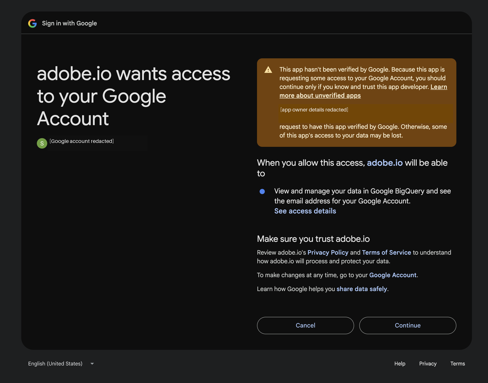
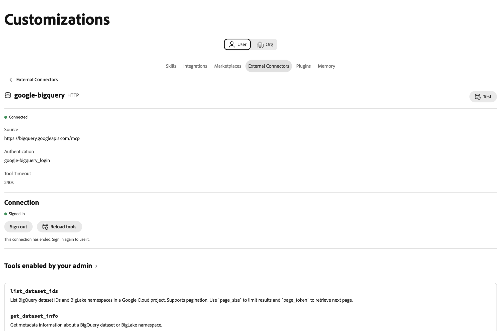

# Google BigQuery外部聯結器 {#google-bigquery}

使用[!DNL Google BigQuery]外部聯結器在Adobe CX Enterprise Coworker中探索及查詢您的[!DNL BigQuery]資料。 設定聯結器後，請要求Co-worker列出資料集和表格、說明表格結構描述，並執行唯讀SQL查詢。 聯結器是[!DNL Google]於`https://bigquery.googleapis.com/mcp`所裝載的模型內容通訊協定(MCP)伺服器。

>[!AVAILABILITY]
>
>[!DNL Google BigQuery]外部聯結器為Beta版。 文件和功能可能會有所變更。

## 聯結器設定 {#connector-configuration}

聯結器組態程式有三個獨立的部分：

* **[!DNL Google Cloud]準備：** [!DNL Google Cloud]管理員準備查詢專案、啟用[!DNL BigQuery] API，並授與成員必要的識別與存取管理(IAM)角色。
* **組織設定：**&#x200B;同事管理員會為整個組織設定一次聯結器。 管理員會連線組織的[!DNL Google] OAuth應用程式，並選取成員可以使用的工具。
* **成員登入：**&#x200B;每個成員都使用自己的[!DNL Google]帳戶登入。 成員只能存取其[!DNL Google]身分可以存取的專案和資料集。

聯結器會使用您組織擁有的OAuth應用程式。 Adobe未提供此聯結器的[!DNL Google] OAuth應用程式。 儲存組織組態不會登入任何成員或授予[!DNL BigQuery]許可權。 成功的[!DNL Google]登入也不會授與資料集存取權，因為[!DNL Google Cloud] IAM會控制您資料的存取權。

## 先決條件 {#prerequisites}

開始之前，請確定您具備下列條件：

* **針對[!DNL Google Cloud]準備：**&#x200B;可在[!DNL Google Auth Platform]中啟用API、授與IAM角色及建立OAuth使用者端的[!DNL Google Cloud]系統管理員。
* **對於組織設定：**&#x200B;具有在同事中管理組織聯結器的許可權的帳戶。 您還需要[!DNL Google] OAuth Web應用程式使用者端的使用者端ID和使用者端密碼，或包含它們的現有組織密碼。
* **對於成員登入：** OAuth應用程式對象允許且具有必要IAM角色的[!DNL Google]身分。

知道查詢專案的ID和成員應讀取的資料集。 查詢專案會執行查詢工作並支付報酬。 資料可以位於不同的專案中，而OAuth使用者端也可以屬於不同的專案。 若是試行方案，一個專案可容納OAuth使用者端、查詢作業和資料集。

## 準備[!DNL Google Cloud] {#prepare-google-cloud}

在Co-worker中設定聯結器之前，請在[!DNL Google Cloud]中準備專案和成員存取權。 建立OAuth應用程式和授與資料存取權是不同的工作。 使用聯結器的成員不需要編輯OAuth應用程式的許可權。

### 準備查詢專案 {#prepare-query-project}

[!DNL Google Cloud]管理員已準備執行查詢工作的專案：

1. 在[Google雲端主控台](https://console.cloud.google.com/)中，選取或建立專案。
1. 啟用[!DNL BigQuery] API （如果尚未啟用）。 啟用API也會啟用[!DNL BigQuery]遠端MCP伺服器。
1. 選擇帳單或[BigQuery沙箱](https://docs.cloud.google.com/bigquery/docs/sandbox)，然後在查詢專案上設定適當的每日[自訂查詢配額](https://docs.cloud.google.com/bigquery/docs/custom-quotas)。

>[!IMPORTANT]
>
>唯讀查詢仍會產生費用。 [!DNL BigQuery]成本取決於查詢掃描的位元組，而不是它傳回的列數。 `LIMIT`子句控制傳回的資料列，但通常不會減少掃描的位元組。 使用試執行、明確欄、分割篩選器和每日查詢配額來控制成本。

如需詳細資訊，請參閱[!DNL Google Cloud]檔案中的[使用BigQuery遠端MCP伺服器](https://docs.cloud.google.com/bigquery/docs/use-bigquery-mcp)。

### 授予IAM角色 {#grant-iam-roles}

將下列角色授與您成員的[!DNL Google]身分識別。 儘可能使用Managed群組，偏好資料集層級的資料存取。

| 角色 | 授與位置 | 目的 |
| --- | --- | --- |
| [!UICONTROL MCP工具使用者] (`roles/mcp.toolUser`) | 用於MCP呼叫的專案 | 進行MCP工具呼叫。 |
| [!UICONTROL BigQuery工作使用者] (`roles/bigquery.jobUser`) | 查詢專案 | 執行查詢工作。 |
| [!UICONTROL BigQuery資料檢視器] (`roles/bigquery.dataViewer`) | 授權的資料集或資料專案 | 讀取資料和中繼資料。 |

請勿僅授予[!UICONTROL BigQuery資料編輯器]、[!UICONTROL BigQuery資料擁有者]或[!UICONTROL BigQuery管理員]使用此唯讀聯結器。 作為額外的保護措施，請考慮針對讀寫MCP工具[&#128279;](https://docs.cloud.google.com/mcp/prevent-read-write-tool-use)的拒絕原則。 要求您的[!DNL Google Cloud]系統管理員先檢閱拒絕原則的範圍，因為它可能會影響其他[!DNL Google]個MCP使用者端和服務。 如需詳細資訊，請參閱[BigQuery IAM角色與許可權](https://docs.cloud.google.com/bigquery/docs/access-control)。

## 為您的組織設定聯結器 {#configure-organization}

管理員可讓組織中的所有人使用[!DNL Google BigQuery]聯結器。 組織頁面上的變更會套用至組織中的所有使用者。

1. 開啟&#x200B;**[!UICONTROL 自訂]**，選取&#x200B;**[!UICONTROL 組織]**，然後選取&#x200B;**[!UICONTROL 外部聯結器]**。 在&#x200B;**[!UICONTROL Google BigQuery]**&#x200B;卡片上，選取&#x200B;**[!UICONTROL 設定]**。

   如果已設定聯結器，則卡片會顯示&#x200B;**[!UICONTROL 檢視設定]**。

1. 在&#x200B;**[!UICONTROL 為您的組織設定Google BigQuery]**&#x200B;對話方塊中，複製&#x200B;**[!UICONTROL 您的Google應用程式]**&#x200B;下的&#x200B;**[!UICONTROL 重新導向URL]**。

   重新導向URL在環境和地區之間有所不同，因此請一律複製對話方塊中的確切值。 請勿在瀏覽器中使用Co-worker頁面的URL或[!DNL BigQuery] MCP伺服器URL。 如果一個OAuth使用者端提供多個環境，請個別註冊每個必要的重新導向URL。

1. 在[Google驗證平台](https://console.cloud.google.com/auth/overview)中，準備您組織的OAuth使用者端：

   1. 設定&#x200B;**[!UICONTROL 品牌]**&#x200B;和&#x200B;**[!UICONTROL 對象]**。 對於測試中的外部應用程式，新增預期成員作為測試使用者。 先完成[!DNL Google]的發佈與驗證需求，再擴大使用範圍。
   1. 在&#x200B;**[!UICONTROL 資料存取]**&#x200B;中，新增`https://www.googleapis.com/auth/bigquery`範圍。
   1. 在&#x200B;**[!UICONTROL 使用者端]**&#x200B;下，建立或選取具有&#x200B;**[!UICONTROL Web應用程式]**&#x200B;應用程式型別的OAuth使用者端。
   1. 新增您複製到&#x200B;**[!UICONTROL 授權的重新導向URI]**&#x200B;的重新導向URL。
   1. 透過您組織的核准密碼處理程式，取得&#x200B;**[!UICONTROL 使用者端識別碼]**&#x200B;和&#x200B;**[!UICONTROL 使用者端密碼]**。

   成員會授權您組織擁有的此應用程式，而非Adobe提供的應用程式。 在熒幕擷圖、聊天和檔案中隱藏使用者端秘密。

1. 在&#x200B;**[!UICONTROL 認證來自]**&#x200B;之下，選取下列其中一個選項：

   * **[!UICONTROL 輸入新的]：**&#x200B;輸入&#x200B;**[!UICONTROL Google OAuth使用者端識別碼]**&#x200B;和&#x200B;**[!UICONTROL Google OAuth使用者端密碼]**。 同事會將您輸入的值儲存為組織機密。
   * **[!UICONTROL 使用現有的密碼]：** Select包含使用者端ID和使用者端密碼的已儲存組織密碼。

   請勿將個人機密用於組織聯結器。

   ![設定您組織的Google BigQuery對話方塊，其中會顯示[連線詳細資料]區段，其中包含編輯的[重新導向URL]與認證欄位、選取的七種[探索]與[查詢]工具，以及三種[存取與許可權]通知。](./assets/google-bigquery/org-configure.png){width="500" zoomable="yes"}

1. 展開&#x200B;**[!UICONTROL 探索及查詢]**&#x200B;工具群組。 保持選取所有七種工具，或僅選取成員需要的工具。 您必須至少選取一個工具。 如需詳細資訊，請參閱[可用的工具](#available-tools)。

   檢閱&#x200B;**[!UICONTROL 存取與許可權]**&#x200B;下的通知：

   * **[!UICONTROL 唯讀工具]：** OAuth範圍很廣，無法自行防止變更。 將成員的IAM角色維持為唯讀。
   * **[!UICONTROL 唯讀查詢可能會產生費用]：**&#x200B;使用試執行及查詢配額。 `LIMIT`子句控制傳回的資料列，不一定是掃描的位元組。
   * **[!UICONTROL 每個使用者都需個別登入]：**&#x200B;每個成員都需要必要的IAM角色。

   Select **[!UICONTROL 儲存連線]**。 組織卡片顯示&#x200B;**[!UICONTROL 已儲存的組態]**&#x200B;和&#x200B;**[!UICONTROL 檢視組態]**。

儲存設定不會將您或任何成員登入[!DNL Google]。 儲存也無法確認任何人都能查詢資料集。 若要自行使用聯結器，請依照[登入為成員](#sign-in-as-a-member)中的步驟操作。

### 可用的工具 {#available-tools}

[!DNL Google BigQuery]聯結器提供下列唯讀工具：

| 工具 | 說明 |
| --- | --- |
| `list_dataset_ids` | 列出您指定專案中的資料集。 |
| `get_dataset_info` | 讀取資料集的中繼資料。 |
| `list_table_ids` | 列出資料集中的表格和檢視。 |
| `get_table_info` | 讀取表格的結構和中繼資料。 |
| `execute_sql_readonly` | 執行唯讀SQL查詢，或試執行以估計查詢掃描的位元組。 |
| `get_query_results` | 擷取查詢的結果，或檢查長時間執行的查詢。 |
| `get_job` | 檢查查詢工作的狀態、錯誤和統計資料。 |

對於查詢工作流程，請同時選取`execute_sql_readonly`、`get_query_results`和`get_job`，讓同事可以追蹤長期執行的查詢工作。 Co-worker未從[!DNL BigQuery] MCP伺服器提供`execute_sql`和`cancel_job`工具。 不會自動啟用[!DNL Google]稍後新增至伺服器的工具。 如需工具詳細資訊，請參閱[BigQuery MCP參考](https://docs.cloud.google.com/bigquery/docs/reference/mcp)。

使用工具時，請考量下列限制：

* [!DNL Google]會針對查詢結果記錄3,000列的限制，以及三分鐘的預設查詢逾時。 請勿使用聯結器匯出完整的表格。
* 工具無法列出專案。 在您的請求中提供已知的專案ID。
* 唯讀SQL不支援在[!DNL Google Drive]外部資料表上變更資料或資源或查詢的敘述句。
* 查詢結果、結構描述、資料集存取清單和SQL可以出現在聊天中。 請確定存取權遵循您組織的資料處理原則。

## 以成員身分登入 {#sign-in-as-a-member}

管理員設定聯結器後，每個成員都會使用自己的[!DNL Google]帳戶登入。 您不需要OAuth使用者端密碼即可登入。

1. 開啟&#x200B;**[!UICONTROL 自訂]**，選取&#x200B;**[!UICONTROL 使用者]**，然後選取&#x200B;**[!UICONTROL 外部聯結器]**。 在&#x200B;**[!UICONTROL Google BigQuery]**&#x200B;卡片（顯示&#x200B;**[!UICONTROL 未登入]**）上，選取&#x200B;**[!UICONTROL 登入]**。

   如果卡片指出管理員需要設定聯結器，請要求您的管理員[設定聯結器](#configure-organization)。

1. 在[!DNL Google] **[!UICONTROL 選擇帳戶]**&#x200B;畫面上，選取具有必要IAM存取權的帳戶，或選取&#x200B;**[!UICONTROL 使用其他帳戶]**。 然後完成貴組織所需的任何登入步驟，例如單一登入(SSO)或多重驗證(MFA)。

   此帳戶可能與您用於同事的帳戶不同。

   ![Google選擇具有三個密文帳戶的帳戶熒幕，以及[使用其他帳戶]選項。](./assets/google-bigquery/member-choose-account.png){width="500" zoomable="yes"}

1. 如果[!DNL Google]顯示&#x200B;**[!UICONTROL Google尚未驗證此應用程式]**，請向管理員確認應用程式及其擁有者。 只有在測試應用程式的組織原則允許時，才繼續。 否則，請選取&#x200B;**[!UICONTROL 返回安全性]**，並要求應用程式擁有者解決對象、出版物或驗證需求。

   {width="500" zoomable="yes"}

   在同意畫面上檢閱應用程式名稱和要求的存取權。 然後選取&#x200B;**[!UICONTROL 繼續]**&#x200B;以完成[!DNL Google]同意流程。

   [!DNL Google]要求許可權以檢視及管理您的[!DNL BigQuery]資料，以及檢視您[!DNL Google]帳戶的電子郵件地址。 這是標準的[!DNL BigQuery]範圍，即使同事僅提供唯讀工具。

   在熒幕擷取畫面中，應用程式名為adobe.io。 您組織的應用程式會顯示其專屬名稱。 此名稱並不表示Adobe提供OAuth應用程式。

   >[!IMPORTANT]
   >
   >只有在您識別應用程式且您的組織核准所要求的存取權時，才繼續。

   {width="500" zoomable="yes"}

1. 返回同事，然後在聯結器詳細資料中檢閱您的管理員啟用的&#x200B;**[!UICONTROL 工具]**。 成員可以檢視工具，但無法變更工具選擇。 若要檢查連線，請選取&#x200B;**[!UICONTROL 測試]**。

   {width="700" zoomable="yes"}

成功的登入、測試或工具清單不會確認您可以查詢特定資料集。 若要確認您的存取權，[請檢查您的BigQuery存取權](#check-bigquery-access)。 如果同事指出連線已結束，請重新登入。

## 檢查您的[!DNL BigQuery]存取權 {#check-bigquery-access}

若要確認您可以讀取資料，請開始新的聊天並輸入唯讀提示。 將預留位置取代為[!DNL Google]身分可以存取的專案和表格。

提示範例：

* 「列出專案`YOUR_PROJECT_ID`中的資料集。」
* 「使用`YOUR_QUERY_PROJECT_ID`進行查詢工作，檢查`YOUR_DATA_PROJECT.YOUR_DATASET.YOUR_TABLE`的結構描述，預估掃描並試執行，然後傳回彙總摘要。」

確認結果包含您預期的資料集或資料。 與原始表格內容的要求相比，偏向明確的資料行、彙總及分割區篩選。 在要求中命名專案不會變更您的登入身分或授予您存取該專案的許可權。

## 疑難排解存取權 {#troubleshoot-access}

如果登入或存取失敗，請向您的管理員檢查下列專案：

| 問題 | 檢查內容 |
| --- | --- |
| 卡片指出聯結器尚未設定，或管理員需要設定聯結器 | 系統會為您使用中的組織儲存組織設定。 |
| `redirect_uri_mismatch` | Co-worker對話方塊中的確切&#x200B;**[!UICONTROL 重新導向URL]**&#x200B;已在Web應用程式使用者端上的&#x200B;**[!UICONTROL 授權重新導向URI]**&#x200B;中註冊。 |
| `invalid_client` | 使用者端ID和使用者端密碼屬於Web應用程式使用者端，而且選取的組織密碼正確。 |
| `access_denied`，或[!DNL Google]尚未驗證應用程式的警告 | 應用程式擁有者會檢查對象、測試使用者資格和驗證狀態。 請勿核准您不認識的應用程式。 |
| 連線已結束，或權杖已過期 | 以成員身分再次登入。 |
| `mcp.tools.call`的許可權遭拒 | [!UICONTROL MCP工具使用者]角色和任何適用的IAM拒絕原則。 |
| `bigquery.jobs.create`的許可權遭拒 | 查詢專案上的[!UICONTROL BigQuery工作使用者]角色。 |
| 資料表的存取遭拒 | 資料集上的[!UICONTROL BigQuery資料檢視器]角色，以及您用來登入的[!DNL Google]帳戶。 |
| `SERVICE_DISABLED` | 已在錯誤識別的專案中啟用[!DNL BigQuery] API。 |
| 超出每日查詢配額 | 專案的查詢配額，與專案管理員。 |
| 插入、更新、刪除、建立或刪除資料的要求失敗 | 聯結器為唯讀，不支援資料或資源的變更。 |

當您聯絡支援時，請勿共用使用者端秘密、存取權杖、授權代碼或客戶資料。
