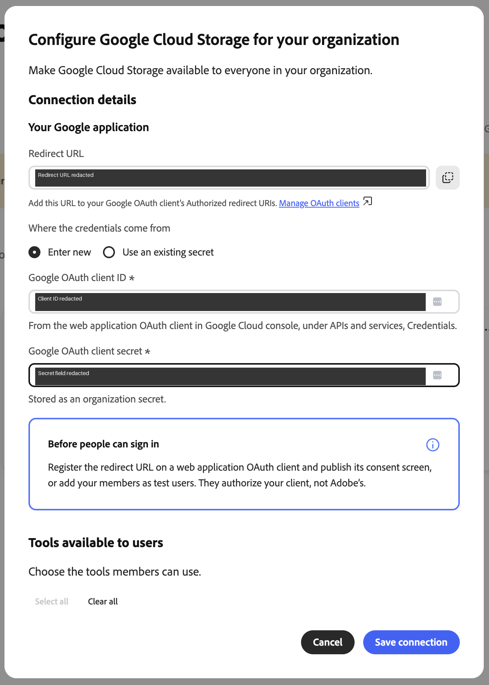

# Google雲端儲存空間外部聯結器 {#google-cloud-storage}

使用[!DNL Google Cloud Storage]外部聯結器讀取Adobe CX Enterprise Coworker中的[!DNL Cloud Storage]資料。 設定聯結器後，請要求Co-worker列出已知專案中的貯體、依字首列出物件、檢查貯體和物件中繼資料，以及讀取已核准的檔案。 聯結器是由[!DNL Google]裝載的模型內容通訊協定(MCP)伺服器。

>[!AVAILABILITY]
>
>[!DNL Google Cloud Storage]外部聯結器為Beta版。 文件和功能可能會有所變更。

## 聯結器設定 {#connector-configuration}

聯結器組態程式有三個獨立的部分：

* **[!DNL Google Cloud]準備：** [!DNL Google Cloud]管理員為成員準備帳單、[!DNL Cloud Storage] API以及識別與存取管理(IAM)角色。 管理員也會準備您的組織擁有的OAuth使用者端。
* **組織設定：**&#x200B;同事管理員會為整個組織設定一次聯結器。 管理員會註冊Co-worker重新導向URL、輸入OAuth使用者端認證，並選取成員可以使用的工具。
* **成員登入：**&#x200B;每個成員都使用自己的[!DNL Google]帳戶登入。 成員只能存取[!DNL Google Cloud] IAM允許其帳戶使用的貯體和物件。

聯結器是唯讀的。 它要求`https://www.googleapis.com/auth/devstorage.read_only`範圍並僅提供讀取工具。 您的組織提供自己的[!DNL Google] OAuth應用程式。 此聯結器沒有Adobe管理的OAuth應用程式。

儲存組織組態不會登入任何成員或授予[!DNL Cloud Storage]許可權。 每個成員都必須擁有必要的IAM存取權，而且必須個別登入。

## 先決條件 {#prerequisites}

開始之前，請確定您具備下列條件：

* **為[!DNL Google Cloud]準備：**&#x200B;已啟用[!DNL Cloud Storage] API且有計費的專案、包含已核准資料的貯體、成員的IAM授權，以及&#x200B;**[!UICONTROL 網頁應用程式]**&#x200B;型別的[!DNL Google] OAuth使用者端。
* **對於組織設定：**&#x200B;具有在同事中管理組織聯結器的許可權的帳戶。 您也需要OAuth使用者端ID和使用者端密碼，或包含它們的現有組織密碼。
* **對於成員登入：** OAuth應用程式對象和[!DNL Google Cloud] IAM都允許的[!DNL Google]帳戶。

知道專案ID和成員計畫讀取的貯體。 聯結器沒有工具可列出專案。 OAuth使用者端可屬於儲存貯體以外的不同專案。

## 準備Google Cloud {#prepare-google-cloud}

在Co-worker中設定聯結器之前，請先準備您的[!DNL Google Cloud]專案和成員存取權。 成功的[!DNL Google]登入不會授與存放裝置許可權。

### 準備專案和IAM {#prepare-project-iam}

[!DNL Google Cloud]管理員完成下列步驟：

1. Select或在[Google Cloud Console](https://console.cloud.google.com/)中建立專案。
1. 在包含貯體的每個專案上連結計費帳戶。

   唯讀存取權不是免費的。 儲存、操作、擷取及網路費用仍可適用。 如需詳細資訊，請參閱[雲端儲存空間價格](https://cloud.google.com/storage/pricing)。

1. 在每個相關專案中啟用&#x200B;**[!UICONTROL 雲端儲存空間API]**。 如果OAuth使用者端屬於個別專案，請同時啟用該專案中的API。
1. 在下表中授予成員最低許可權的角色。 較之個別帳戶，偏好使用受管理的群組。

| 角色 | 授與位置 | 目的 |
| --- | --- | --- |
| [!UICONTROL MCP工具使用者] (`roles/mcp.toolUser`) | 用於MCP呼叫的專案 | 進行MCP工具呼叫(`mcp.tools.call`)。 |
| [!UICONTROL 儲存貯體檢視器] (`roles/storage.bucketViewer`)或自訂唯讀角色 | 包含值區的專案 | 列出貯體和讀取貯體中繼資料（`storage.buckets.list`和`storage.buckets.get`）。 |
| [!UICONTROL 儲存物件檢視器] (`roles/storage.objectViewer`) | 每個授權值區，或專案（如果成員可以讀取其所有值區） | 列出物件、讀取物件中繼資料，以及讀取物件內容（`storage.objects.list`和`storage.objects.get`）。 |

請勿僅將[!UICONTROL 儲存體管理員]授與清單值區。 沒有列出儲存貯體許可權的成員在提供名稱時，仍可讀取授權儲存貯體。 如需詳細資訊，請參閱[!DNL Google Cloud]檔案中的[雲端儲存空間IAM角色](https://docs.cloud.google.com/storage/docs/access-control/iam-roles)。

[!DNL Google]也提供選擇性的IAM拒絕原則，可封鎖其他MCP使用者端的讀寫MCP工具。 Co-worker聯結器已使用唯讀工具選項和唯讀範圍。 在套用原則之前，請先與您的[!DNL Google Cloud]管理員檢閱專案範圍的影響。 如需詳細資訊，請參閱[防止讀寫MCP工具使用](https://docs.cloud.google.com/mcp/prevent-read-write-tool-use)。

### 連線設定 {#connection-settings}

Co-worker使用下列連線設定。 您無法在設定對話方塊中輸入這些值。

| 設定 | 值 |
| --- | --- |
| MCP伺服器URL | `https://storage.googleapis.com/storage/mcp` （僅限全域端點） |
| 傳輸 | 可串流的HTTP |
| 授權伺服器 | `https://accounts.google.com/` |
| 要求的範圍 | `https://www.googleapis.com/auth/devstorage.read_only` |

如需詳細資訊，請參閱[!DNL Google Cloud]檔案中的[使用雲端儲存空間遠端MCP伺服器](https://docs.cloud.google.com/storage/docs/use-cloud-storage-mcp)和[向Google MCP伺服器驗證](https://docs.cloud.google.com/mcp/authenticate-mcp)。

## 為您的組織設定聯結器 {#configure-organization}

管理員可讓組織中的所有人使用[!DNL Google Cloud Storage]聯結器。 組織頁面上的變更會套用至組織中的所有成員。

1. 開啟&#x200B;**[!UICONTROL 自訂]**，選取&#x200B;**[!UICONTROL 組織]**，然後選取&#x200B;**[!UICONTROL 外部聯結器]**。 在&#x200B;**[!UICONTROL Google Cloud Storage]**&#x200B;卡上，選取&#x200B;**[!UICONTROL 設定]**。

   如果聯結器已設定，請開啟其儲存的設定。

1. 在&#x200B;**[!UICONTROL 為您的組織設定Google雲端儲存空間]**&#x200B;對話方塊中，在&#x200B;**[!UICONTROL 您的Google應用程式]**&#x200B;底下，複製完整的&#x200B;**[!UICONTROL 重新導向URL]**。

   重新導向URL會因環境和地區而異。 永遠從對話方塊複製精確的值。 請勿使用瀏覽器中Co-worker頁面的URL、MCP伺服器URL或來自其他環境的重新導向URL。

1. 在[Google驗證平台](https://console.cloud.google.com/auth/overview)中為您的組織準備OAuth使用者端：

   1. 為您的組織設定&#x200B;**[!UICONTROL 品牌]**&#x200B;和&#x200B;**[!UICONTROL 對象]**。 對於測試中的外部應用程式，新增預期成員作為測試使用者。 請先完成適用的[!DNL Google]發佈與驗證需求，再擴大使用範圍。
   1. 在&#x200B;**[!UICONTROL 資料存取]**&#x200B;中，包含`https://www.googleapis.com/auth/devstorage.read_only`範圍。 聯結器不需要讀寫或完整控制範圍。
   1. 在&#x200B;**[!UICONTROL 使用者端]**&#x200B;下，建立或選取&#x200B;**[!UICONTROL 應用程式型別]**&#x200B;設定為&#x200B;**[!UICONTROL 網頁應用程式]**&#x200B;的OAuth使用者端。
   1. 新增您複製到&#x200B;**[!UICONTROL 授權的重新導向URI]**&#x200B;的重新導向URL。 如果一個使用者端提供多個環境，請註冊每個環境的重新導向URL。
   1. 透過您組織的核准密碼處理程式，取得&#x200B;**[!UICONTROL 使用者端識別碼]**&#x200B;和&#x200B;**[!UICONTROL 使用者端密碼]**。

   成員會授權您組織擁有的此OAuth應用程式。 避免聊天、票證和檔案中使用認證。

1. 在&#x200B;**[!UICONTROL 認證來自]**&#x200B;之下，選取下列其中一個選項：

   * **[!UICONTROL 輸入新的]：**&#x200B;輸入&#x200B;**[!UICONTROL Google OAuth使用者端識別碼]**&#x200B;和&#x200B;**[!UICONTROL Google OAuth使用者端密碼]**。 同事會將您輸入的值儲存為組織機密。
   * **[!UICONTROL 使用現有的密碼]：** Select儲存的組織密碼，其中包含使用者端識別碼與使用者端密碼。

   請勿將個人機密用於組織聯結器。

   {width="500" zoomable="yes"}

1. 展開&#x200B;**[!UICONTROL 瀏覽並讀取（5之5）]**。 保持選取全部五個工具，或僅選取成員需要的工具。 您必須至少選取一個工具。 如需詳細資訊，請參閱[可用的工具](#available-tools)。

   在&#x200B;**[!UICONTROL 存取與許可權]**&#x200B;底下，檢閱&#x200B;**[!UICONTROL 唯讀存取權]**&#x200B;和&#x200B;**[!UICONTROL 每個人分別登入]**&#x200B;通知。 然後選取&#x200B;**[!UICONTROL 儲存連線]**。

   {width="500" zoomable="yes"}

1. 檢閱已儲存的&#x200B;**[!UICONTROL google-cloud-storage]**&#x200B;聯結器詳細資料。

   | 設定 | 說明 |
   | --- | --- |
   | **[!UICONTROL Source]** | MCP伺服器URL `https://storage.googleapis.com/storage/mcp`。 |
   | **[!UICONTROL 驗證]** | 驗證方法，`google-cloud-storage_login`。 |
   | **[!UICONTROL Connection]** | 您自己的登入狀態。 |
   | **[!UICONTROL 工具]** | 為成員選取的工具，具有&#x200B;**[!UICONTROL 選取全部]**&#x200B;和&#x200B;**[!UICONTROL 清除]**&#x200B;控制項以及選取的工具計數。 |

   {width="700" zoomable="yes"}

聯結器詳細資料上的&#x200B;**[!UICONTROL 未登入]**&#x200B;狀態是指您自己的連線，而不是組織的連線。 儲存組織設定不會登入您或任何成員，也不會確認儲存貯體的存取權。 若要自行使用聯結器，請依照[登入為成員](#sign-in-as-a-member)中的步驟操作。

若要變更成員以後可用的工具，請更新聯結器詳細資訊頁面上的選取專案，然後選取&#x200B;**[!UICONTROL 儲存工具選取專案]**。 成員無法變更工具選擇。

若要停止提供聯結器給您的組織，請在聯結器詳細資訊頁面上選取&#x200B;**[!UICONTROL 移除]**。

### 可用的工具 {#available-tools}

[!DNL Google Cloud Storage]聯結器在&#x200B;**[!UICONTROL 瀏覽和讀取]**&#x200B;群組中提供下列唯讀工具：

| 工具 | 說明 | 必要許可權 |
| --- | --- | --- |
| `list_buckets` | 在已知的[!DNL Google Cloud]專案中列出貯體，並使用前置詞篩選和分頁。 | 專案上的`storage.buckets.list` |
| `list_objects` | 列出授權儲存貯體中的物件和首碼。 清單預設為不遞回。 | 貯體上的`storage.objects.list` |
| `get_bucket_metadata` | 讀取儲存貯體設定，例如，位置、儲存類別、保留和版本設定。 | `storage.buckets.get` |
| `get_object_metadata` | 讀取物件大小、內容型別、時間戳記、層代和自訂中繼資料。 | `storage.objects.get` |
| `read_object` | 讀取文字或支援的二進位內容，每個物件最多8 MiB。 | `storage.objects.get` |

每個工具呼叫也需要`mcp.tools.call`許可權，通常透過相關專案上的[!UICONTROL MCP工具使用者]角色進行。

聯結器不提供已棄用的`read_text`工具或`write_text`、`create_bucket`、`delete_object`和`delete_bucket`工具。 沒有開啟寫入工具的選項。 即使您選取了全部五個工具，[!DNL Google]稍後新增至伺服器的工具也不會自動變成可用。

## 以成員身分登入 {#sign-in-as-a-member}

管理員設定聯結器後，每個成員都會使用自己的[!DNL Google]帳戶登入。 您不需要OAuth使用者端密碼即可登入。

1. 開啟&#x200B;**[!UICONTROL 自訂]**，選取&#x200B;**[!UICONTROL 使用者]**，然後選取&#x200B;**[!UICONTROL 外部聯結器]**。 在&#x200B;**[!UICONTROL Google Cloud Storage]**&#x200B;卡上，選取&#x200B;**[!UICONTROL 登入]**。

   在您登入之前，卡片顯示&#x200B;**[!UICONTROL 未登入]**。 如果卡片顯示&#x200B;**[!UICONTROL 未設定]**，請要求您的管理員[設定聯結器](#configure-organization)。

1. 在[!DNL Google] **[!UICONTROL 選擇帳戶]**&#x200B;畫面上，選取具有必要IAM存取權的帳戶，或選取&#x200B;**[!UICONTROL 使用其他帳戶]**。 完成貴組織所需的任何登入步驟，例如單一登入(SSO)或多重驗證(MFA)。

   此帳戶可能與您用於同事的帳戶不同。

   ![Google選擇含有密文帳戶的帳戶熒幕，並使用[使用其他帳戶]選項。](./assets/google-cloud-storage/member-choose-account.png){width="500" zoomable="yes"}

1. 如果[!DNL Google]顯示&#x200B;**[!UICONTROL Google尚未驗證此應用程式]**，請向管理員確認應用程式及其擁有者。

   如果您的組織核准使用此應用程式，請選取&#x200B;**[!UICONTROL 繼續]**。 否則，請選取&#x200B;**[!UICONTROL 返回安全性]**，並要求應用程式擁有者解決對象、出版物或驗證需求。

   ![Google熒幕顯示Google尚未驗證此應用程式，因為它正在測試，且有[繼續]和[返回安全]選項。](./assets/google-cloud-storage/member-unverified-app.png){width="500" zoomable="yes"}

   檢閱同意畫面上的應用程式名稱和要求的存取權，然後選取&#x200B;**[!UICONTROL 繼續]**。 聯結器要求&#x200B;**[!UICONTROL 在Google雲端儲存空間]**&#x200B;中檢視您的資料，此儲存空間符合唯讀範圍。

   在熒幕擷取畫面中，應用程式名為adobe.io。 您組織的應用程式會顯示其專屬名稱。 此名稱並不表示Adobe提供OAuth應用程式。

   >[!IMPORTANT]
   >
   >只有在您識別應用程式且您的組織核准所要求的存取權時，才繼續。

   {width="500" zoomable="yes"}

1. 返回同事並確認登入已完成。 檢閱聯結器詳細資料中管理員啟用的&#x200B;**[!UICONTROL 工具]**。 您只能使用管理員啟用的工具。

如果連線結束或工作階段過期，請重新登入。 管理員登入時，其他成員未登入。

## 檢查您的儲存貯體存取權 {#check-bucket-access}

成功的登入或工具清單無法確認您可存取特定儲存貯體。 [!DNL Google]不需要驗證即可列出伺服器工具。 若要確認您的存取權，請開始新的聊天並輸入唯讀提示。 以核准的資源取代預留位置。

提示範例：

* 「列出專案`YOUR_PROJECT_ID`中的貯體。」
* 「在貯體`YOUR_BUCKET`中，列出`reports/`下最多25個物件。 檢查`reports/example.txt`的大小和內容型別，然後讀取其前4096個位元組並加以摘要。」

確認結果包含您期望的貯體或物件。 若要以巢狀字首列出物件，請明確要求遞回清單。 在讀取物件之前檢查物件中繼資料。

## 限制和資料處理 {#limits-data-handling}

使用聯結器時，請謹記下列限制和資料處理考量事項：

* **專案識別碼：**&#x200B;在您的要求中提供專案識別碼。 聯結器無法列出專案。
* **首碼：**&#x200B;物件首碼是常值名稱，不是真正的資料夾。 清單預設不會遞回，而是以頁面傳回結果。
* **頁面大小：**&#x200B;清單頁面最多可包含1,000個專案。 請使用較小的頁面大小（例如25到100）和窄的前置詞。
* **物件大小：**&#x200B;讀取的物件大小上限為8 MiB。 僅讀取較大物件的一部分並不會略過此限制。 對二進位檔案的支援取決於模型和使用者端。
* **成本和配額：**&#x200B;可以收取儲存、要求、擷取和網路費用。 [!DNL Google]也會將配額套用至MCP伺服器。 如需詳細資訊，請參閱[雲端儲存空間MCP配額](https://docs.cloud.google.com/storage/quotas#gcs-mcp)。
* **資料處理：**&#x200B;物件內容、名稱和自訂中繼資料進入您與同事的交談。 僅使用已核准的資料。
* **稽核記錄：** [!DNL Cloud Storage]讀取只有在啟用適用的資料存取記錄時才出現在[!DNL Cloud Audit Logs]中。

聯結器無法上傳、覆寫、建立或刪除檔案或貯體。 它也無法儲存摘要至[!DNL Cloud Storage]。

## 疑難排解存取權 {#troubleshoot-access}

如果登入或存取失敗，請向您的管理員檢查下列專案：

| 問題 | 檢查內容 |
| --- | --- |
| 卡片顯示&#x200B;**[!UICONTROL 未設定]** | 儲存使用中組織的組織連線。 |
| `redirect_uri_mismatch` | 從&#x200B;**[!UICONTROL Web應用程式]** OAuth使用者端上的Co-worker對話方塊註冊確切的&#x200B;**[!UICONTROL 重新導向URL]**。 |
| `invalid_client` | 檢查使用者端型別、使用者端ID和使用者端密碼，以及選取的組織密碼。 |
| `access_denied`或未驗證的應用程式警告 | 與應用程式擁有者一起檢查應用程式對象、測試使用者資格和驗證狀態。 請勿核准未知的應用程式。 |
| HTTP 401，或您的工作階段已結束 | 再次登入。 |
| `mcp.tools.call`被拒絕 | 檢查[!UICONTROL MCP工具使用者]角色和任何適用的IAM拒絕原則。 |
| 貯體清單被拒絕，但已知貯體是可讀的 | 檢查專案的`storage.buckets.list`許可權。 僅物件許可權不允許您在專案中列出貯體。 |
| 貯體中繼資料遭拒 | 檢查`storage.buckets.get`許可權。 |
| 物件清單或讀取遭拒 | 檢查儲存貯體上的[!UICONTROL 儲存物件檢視器]角色，以及您用來登入的[!DNL Google]帳戶。 |
| `SERVICE_DISABLED` | 啟用錯誤中命名的專案中的[!DNL Cloud Storage] API。 |
| 需要計費的HTTP 403 | 檢查包含貯體的專案上的帳單，包括您`list_buckets`請求中的專案。 |
| `OutOfRange`正在讀取 | 物件超過8個MiB的限制。 在此聯結器之外使用已核准的替代方案。 |
| 缺少工具 | 檢查您的管理員儲存的工具選擇。 已棄用和寫入工具無法使用。 |
| 上傳、覆寫、建立或刪除的請求失敗 | 聯結器是唯讀的，不支援這些動作。 |
