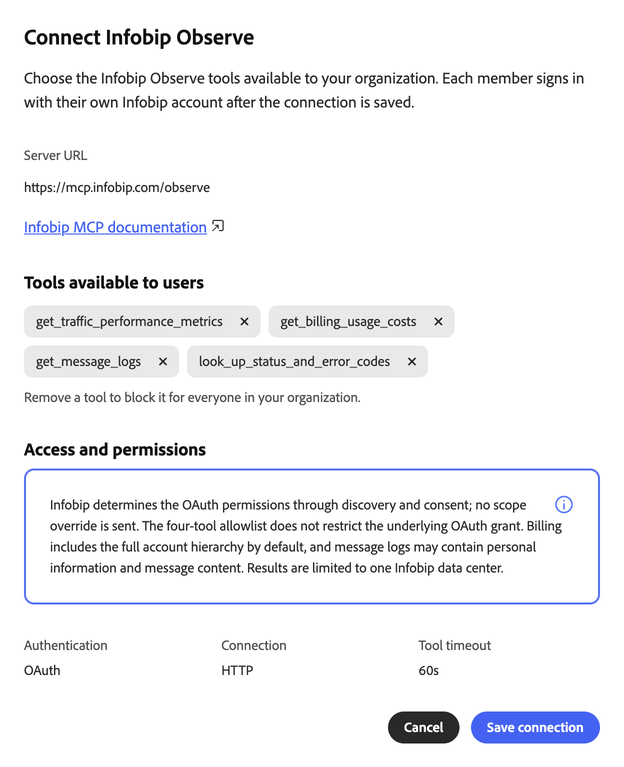

# Infobip Observe外部聯結器 {#infobip-observe}

使用[!DNL Infobip Observe]外部聯結器檢閱您在Adobe CX Enterprise Coworker中的[!DNL Infobip]流量和成本。 設定聯結器後，請向同事詢問流量量度、計費使用情況、訊息記錄檔，以及狀態和錯誤代碼。 聯結器是[!DNL Infobip]所託管的[!DNL Observe]模型內容通訊協定(MCP)伺服器。

>[!AVAILABILITY]
>
>[!DNL Infobip Observe]外部聯結器為Beta版。 文件和功能可能會有所變更。

## 聯結器設定 {#connector-configuration}

聯結器組態程式有兩個獨立的部分：

* **組織設定：**&#x200B;管理員會為整個組織設定一次聯結器，並核准成員可以使用的工具。
* **成員登入：**&#x200B;每個成員都使用自己的[!DNL Infobip]帳戶登入。 成員只能存取其[!DNL Infobip]帳戶有使用許可權的資料。

聯結器沒有共用組織登入。 每個使用聯結器的成員都會個別登入。 儲存組織設定不會登入任何成員或授予其他[!DNL Infobip]許可權。

## 先決條件 {#prerequisites}

聯結器僅能與[!DNL Infobip] [!DNL Observe] MCP伺服器搭配使用。 它未連線至[!DNL Infobip]傳訊、布建或帳戶管理MCP伺服器。

開始之前，請確定您具備下列條件：

* **同事存取：**&#x200B;在有[!DNL Infobip Observe]聯結器可用的組織中，具有管理組織聯結器的許可權的帳戶。
* **[!DNL Infobip]帳戶：**&#x200B;已核准的[!DNL Infobip]帳戶，可存取預定資料中心中的[!DNL Observe]。 [!DNL Infobip]提供[!DNL Observe] MCP作為早期存取功能。 透過[!DNL Infobip]確認您的權益和帳戶適用性。
* **成員身分：**&#x200B;具有自己[!DNL Infobip]帳戶和存取預定資料許可權的成員。
* **已核准的測試範圍：**&#x200B;在您查詢帳單、流量或訊息記錄檔之前，已核准的測試範圍和非敏感資料。

若要測試聯結器，您可以註冊免費的[!DNL Infobip]試用帳戶。 試用帳戶無法保證資料隔離或零成本。 如需詳細資訊，請參閱[!DNL Infobip]檔案中的[使用Infobip MCP伺服器](https://www.infobip.com/docs/mcp/using-mcp){target="_blank"}和[觀察MCP](https://www.infobip.com/docs/mcp/observe-mcp){target="_blank"}。

>[!IMPORTANT]
>
>切勿在熒幕擷圖、聊天或支援票證中共用密碼、API金鑰、權杖、授權代碼或同意與回呼URL。

## 連線和登入模式 {#connection-model}

Co-worker會自動套用下列設定。 您沒有建立OAuth應用程式或輸入應用程式認證。

| 設定 | 值 |
| --- | --- |
| 伺服器URL | `https://mcp.infobip.com/observe` |
| 傳輸 | 可串流的HTTP |
| 授權伺服器探索 | `https://mcp.infobip.com/observe/.well-known/oauth-authorization-server` |
| 登入 | 每個成員都會使用動態使用者端註冊透過OAuth登入 |
| OAuth設定 | 自動探索。 管理員不會輸入使用者端ID、使用者端密碼、範圍或OAuth端點。 |
| 工具選取 | 四個已核准的工具。 管理員可以縮小選取範圍。 |

[!DNL Infobip]探索及每個成員的同意會決定同事收到的存取權。 [!DNL Infobip]會記錄[!DNL Observe] MCP的`billing:usage:view`、`metrics:manage`、`messages-api:manage`和`error-codes:read`範圍。 核准之前，請先檢閱同意畫面上的要求存取權。

[!DNL Infobip]也支援其他MCP使用者端中[!DNL Observe] MCP的API金鑰驗證。 Co-worker未對此聯結器使用API金鑰。 成員僅使用OAuth登入。

## 為您的組織設定聯結器 {#configure-organization}

管理員可讓組織中的所有人使用[!DNL Infobip Observe]聯結器。 組織頁面上的變更會套用至組織中的所有使用者。 成員無法設定組織連線。

1. 開啟&#x200B;**[!UICONTROL 自訂]**，選取&#x200B;**[!UICONTROL 組織]**，然後選取&#x200B;**[!UICONTROL 外部聯結器]**。

1. 尋找&#x200B;**[!UICONTROL Infobip Observe]**，然後選取&#x200B;**[!UICONTROL 設定]**。

1. 在&#x200B;**[!UICONTROL 連線Infobip Observe]**&#x200B;對話方塊中，檢閱固定的&#x200B;**[!UICONTROL 伺服器URL]**，`https://mcp.infobip.com/observe`。

   您不需要輸入OAuth使用者端ID、使用者端密碼或範圍。

1. 在&#x200B;**[!UICONTROL 使用者可用的工具]**&#x200B;下，檢閱最初選取的四個工具。 移除組織成員不應使用的任何工具。 至少必須保留一個工具。

   如需詳細資訊，請參閱[可用的工具](#available-tools)。

   {width="500" zoomable="yes"}

1. Select **[!UICONTROL 儲存連線]**。 然後重新開啟設定，以確認您的工具選擇持續存在。

儲存不會將您或任何成員登入[!DNL Infobip]。 若要自行檢查連線，請依照[中的說明登入，以成員身分登入](#sign-in-as-a-member)。

若要在移除所有工具後讓所有四個工具再次可用，請選取&#x200B;**[!UICONTROL 還原所有工具]**。 此選項僅會還原四個已核准的工具。 同事未啟用[!DNL Infobip]稍後新增的工具。 您無法在未選取工具的情況下儲存組態。

### 可用的工具 {#available-tools}

[!DNL Infobip Observe]聯結器提供下列工具。 [!DNL Infobip]可以變更每個工具的限制，因此請於依賴[!DNL Infobip]檔案之前先檢查這些檔案。

| 工具 | 目的 | 限制 |
| --- | --- | --- |
| `get_traffic_performance_metrics` | 彙總的流量、傳送和參與量度。 | 最多366天的資料量。 每小時視窗最多可涵蓋14天，每日視窗最多可涵蓋93天。 依預設會傳回登入帳戶的資料。 明確包含附屬帳戶。 |
| `get_billing_usage_costs` | 與商業發票一致的使用與成本。 | 目前和之前兩個日曆月。 依預設包含完整的科目階層。 一個月的資料是暫時性的，直到下個月的第五天為止。 |
| `get_message_logs` | 個別訊息的記錄。 | 過去48小時。 記錄檔可包含收件者識別碼、個人資訊及訊息內容。 |
| `look_up_status_and_error_codes` | 已知狀態和錯誤碼名稱的說明。 | 每個請求最多50個名稱。 [!DNL Infobip]可以從結果中省略未知的名稱。 |

結果僅限於一個[!DNL Infobip]資料中心。 工具選擇可控制哪些工具成員可在Co-worker中使用。 它不會縮小成員在登入時所授予的[!DNL Infobip]存取權、帳戶階層或[!DNL Infobip]所執行的許可權。

>[!IMPORTANT]
>
>訊息記錄檔可包含個人資料，例如收件者識別碼和訊息內容。 帳單資訊是敏感的，依預設會涵蓋完整的帳戶階層。 只有當您的組織核准使用這些工具時，才啟用這些工具。 使用明確、核准的帳戶篩選器和有限查詢。

## 以成員身分登入 {#sign-in-as-a-member}

管理員設定聯結器後，每個成員都會使用自己的[!DNL Infobip]帳戶登入。 您的登入僅屬於您。 其他成員不使用您的認證。

1. 開啟&#x200B;**[!UICONTROL 自訂]**，選取&#x200B;**[!UICONTROL 使用者]**，然後選取&#x200B;**[!UICONTROL 外部聯結器]**。 尋找&#x200B;**[!UICONTROL Infobip Observe]**。

   如果卡片顯示&#x200B;**[!UICONTROL 未設定]**&#x200B;且&#x200B;**[!UICONTROL 尚無法使用。 您的管理員需要設定此專案。]**，請要求您的管理員[設定聯結器](#configure-organization)。

1. Select **[!UICONTROL 登入]**&#x200B;並使用預期的[!DNL Infobip]帳戶。 完成單一登入(SSO)、多重驗證(MFA)，並自行提示同意。 核准之前，請先檢閱要求的存取權、帳戶和資料中心。

1. 返回Co-worker並開啟聯結器詳細資料。 檢閱管理員啟用的工具。

   成員可以檢視工具，但無法變更組織組態。

1. 選取&#x200B;**[!UICONTROL 測試連線]**。

   成功的測試會確認Co-worker可以連線並列出工具。 它無法確認每個工具是否都成功執行。

1. 如果您已獲得授權，且您的管理員已啟用`look_up_status_and_error_codes`工具，請在[中執行查詢](#check-connection)檢查您的連線。

1. 若要中斷您的[!DNL Infobip]帳戶與聯結器的連線，請選取&#x200B;**[!UICONTROL 登出]**。

   登出不一定會撤銷您在[!DNL Infobip]中授與的存取權。

## 檢查您的連線 {#check-connection}

若要確認聯結器是否可與您的帳戶搭配使用，請執行唯讀查閱。 請確定您的管理員已啟用`look_up_status_and_error_codes`工具。 然後開始聊天並輸入提示。

範例提示：

* 「使用Infobip Observe，查詢狀態碼NO_ERROR並說明其意義。 請勿查詢流量量度、帳單或訊息記錄檔。」

確認結果包含`NO_ERROR`的描述，且沒有錯誤訊息。 成功的查詢不會確認流量、帳單或訊息記錄工具適用於您的帳戶。 請勿僅為了測試連線而查詢帳單或訊息記錄檔。

## 疑難排解存取權 {#troubleshoot-access}

如果您無法存取您的[!DNL Infobip]資料，請向管理員檢查下列專案：

| 問題 | 檢查內容 |
| --- | --- |
| 缺少&#x200B;**[!UICONTROL Infobip Observe]**&#x200B;聯結器 | 確認聯結器可供您的組織使用，且您具有管理組織聯結器的許可權。 如有需要，請聯絡您的Adobe代表。 |
| 同意或登入失敗 | 檢查您使用的[!DNL Infobip]帳戶、[!DNL Observe]權益以及資料中心。 當您要求協助時，請勿共用同意URL、回撥URL或授權碼。 |
| 登入成功，但工具失敗 | 檢查有效的[!DNL Infobip]許可權、您用來登入的帳戶和資料中心，以及[!DNL Infobip]傳回的錯誤。 成功的登入無法確認工具是否成功執行。 |
| 工具無法使用 | 檢查管理員啟用的工具。 同事未自動啟用新的[!DNL Infobip]工具。 |
| 您無法儲存設定 | 至少要選取一個工具。 若要停止提供聯結器，請改為移除聯結器。 |
| 計費結果包含未預期的帳戶 | 依預設，帳單結果包含完整的帳戶階層。 停止，然後檢閱核准的帳戶篩選器和許可權。 |
| 訊息記錄檔顯示敏感資料 | 停止查詢，並將之後的查詢限製為已核准的非敏感資料。 請勿將原始記錄貼到聊天或支援票證中。 |
| 狀態代碼查詢成功，但另一個請求失敗 | 分別調查失敗的請求。 成功的查詢不會確認每個工具或帳戶皆可運作。 |
