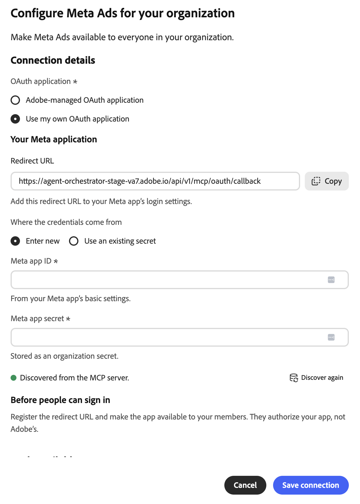
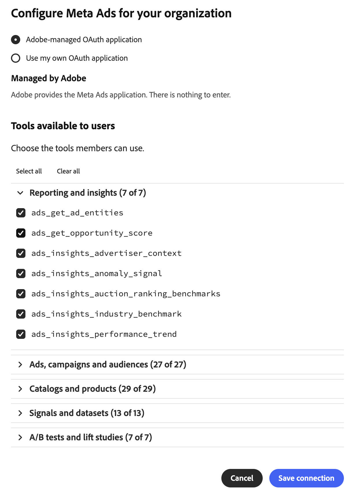

# Meta Ads外部聯結器 {#meta-ads}

使用[!DNL Meta Ads]外部聯結器在Adobe CX Enterprise Coworker中使用您的[!DNL Meta]廣告資料。 設定聯結器後，請要求同事報告廣告成效、管理行銷活動和對象、使用產品目錄等。 聯結器是由[!DNL Meta]裝載的模型內容通訊協定(MCP)伺服器。

>[!AVAILABILITY]
>
>[!DNL Meta Ads]外部聯結器為Beta版。 文件和功能可能會有所變更。

## 聯結器設定 {#connector-configuration}

聯結器組態程式有兩個獨立的部分：

* **組織設定：**&#x200B;管理員會為整個組織設定一次聯結器。 管理員會選擇OAuth應用程式，並選取成員可以使用的工具。
* **成員登入：**&#x200B;每個成員都使用自己的[!DNL Facebook]帳戶登入。 成員只能存取其[!DNL Facebook]身分識別與授權應用程式允許的[!DNL Meta]資產。

儲存組織設定不會登入任何成員或授予廣告帳戶的存取權。 每個成員必須個別登入。

## 先決條件 {#prerequisites}

開始之前，請確定您具備下列條件：

* **對於組織設定：**&#x200B;具有在同事中管理組織聯結器的許可權的帳戶。
* **對於成員登入：**&#x200B;具有廣告帳戶、企業、頁面或您計畫使用的其他[!DNL Meta]資產存取權的[!DNL Facebook]帳戶。
* **針對您自己的OAuth應用程式（選用）：**&#x200B;您組織管理的[!DNL Meta]應用程式，以及其應用程式ID和應用程式機密。

## 為您的組織設定聯結器 {#configure-organization}

管理員可讓組織中的所有人使用[!DNL Meta Ads]聯結器。 組織頁面上的變更會套用至組織中的所有使用者。

1. 開啟&#x200B;**[!UICONTROL 自訂]**，選取&#x200B;**[!UICONTROL 組織]**，然後選取&#x200B;**[!UICONTROL 外部聯結器]**。 在&#x200B;**[!UICONTROL Meta Ads]**&#x200B;卡片上，選取&#x200B;**[!UICONTROL 設定]**。

1. 在&#x200B;**[!UICONTROL 為您的組織設定Meta廣告]**&#x200B;對話方塊中，檢閱&#x200B;**[!UICONTROL 連線詳細資料]**，然後選取&#x200B;**[!UICONTROL OAuth應用程式]**：

   * **[!UICONTROL Adobe管理的OAuth應用程式]：** Adobe提供[!DNL Meta Ads]應用程式，因此您不需要輸入應用程式認證。 在您儲存後，每個成員仍會使用自己的[!DNL Facebook]帳戶登入。

     {width="500" zoomable="yes"}

   * **[!UICONTROL 使用我自己的OAuth應用程式]：**&#x200B;您的組織提供自己的[!DNL Meta]應用程式。 成員會授權您的應用程式，而非Adobe應用程式。 在&#x200B;**[!UICONTROL 您的Meta應用程式]**&#x200B;下，完成下列步驟：

     1. 複製&#x200B;**[!UICONTROL 重新導向URL]**，並將其新增至[!DNL Meta]應用程式的登入設定。 使用對話方塊中顯示的確切值，因為重新導向URL在不同環境中會有所不同。
     1. 在&#x200B;**[!UICONTROL 認證來自]**&#x200B;的位置，選取&#x200B;**[!UICONTROL 輸入新的]**，然後輸入&#x200B;**[!UICONTROL Meta應用程式識別碼]**&#x200B;和&#x200B;**[!UICONTROL Meta應用程式密碼]**。 在[!DNL Meta]應用程式的基本設定中尋找應用程式ID。 同事會將應用程式密碼儲存為組織密碼。 若要改用相同應用程式的已儲存認證，請選取&#x200B;**[!UICONTROL 使用現有的密碼]**。
     1. 讓即將登入的成員可以使用應用程式。 請要求您的[!DNL Meta]應用程式管理員確認您預期用途的必要許可權及任何應用程式檢閱需求。

     從MCP伺服器&#x200B;**探索到的**&#x200B;指標會確認Co-worker找到聯結器。 無法確認您的應用程式認證是否有效或成員是否已登入。 若要重新整理探索，請再次選取&#x200B;**[!UICONTROL 探索]**。

     {width="500" zoomable="yes"}

1. 在&#x200B;**[!UICONTROL 使用者可用的工具]**&#x200B;下，展開每個工具群組並選取貴組織所需的工具。 若要一次變更所有工具，請使用&#x200B;**[!UICONTROL 全部選取]**&#x200B;或&#x200B;**[!UICONTROL 全部清除]**。 如需詳細資訊，請參閱[工具群組](#tool-groups)。 然後選取&#x200B;**[!UICONTROL 儲存連線]**。

   {width="500" zoomable="yes"}

1. 檢閱儲存的&#x200B;**[!UICONTROL 中繼廣告]**&#x200B;聯結器詳細資料。 選擇性地選取&#x200B;**[!UICONTROL 測試]**，以檢查同事是否可以探索聯結器工具。

   | 設定 | 說明 |
   | --- | --- |
   | **[!UICONTROL Source]** | [!DNL Meta Ads] MCP伺服器`https://mcp.facebook.com/ads`。 |
   | **[!UICONTROL 驗證]** | 驗證方法，`meta-ads_login`。 |
   | **[!UICONTROL Connection]** | 使用中的OAuth應用程式以及您自己的登入狀態。 |
   | **[!UICONTROL 工具]** | 為成員選取的工具，具有&#x200B;**[!UICONTROL 選取全部]**&#x200B;和&#x200B;**[!UICONTROL 清除]**&#x200B;控制項以及選取的工具計數。 |

   {width="700" zoomable="yes"}

聯結器詳細資料上的&#x200B;**[!UICONTROL 未登入]**&#x200B;狀態是指您自己的連線，而不是組織的連線。 若要自行使用聯結器，請選取&#x200B;**[!UICONTROL 登入]**，並依照[登入為成員](#sign-in-as-a-member)中的步驟操作。

若要停止提供聯結器給您的組織，請在聯結器詳細資訊頁面上選取&#x200B;**[!UICONTROL 移除]**。

### 工具群組 {#tool-groups}

[!DNL Meta Ads]聯結器將其工具組織成下列群組：

* [!UICONTROL 報告和深入分析]
* [!UICONTROL 廣告、行銷活動和對象]
* [!UICONTROL 目錄與產品]
* [!UICONTROL 訊號和資料集]
* [!UICONTROL A/B測試和提升度研究]
* [!UICONTROL 活動記錄]
* [!UICONTROL 說明及疑難排解]

例如，[!UICONTROL 報表和深入分析]群組包含`ads_insights_performance_trend`和`ads_insights_industry_benchmark`之類的工具。 隨著[!DNL Meta]更新聯結器，每個群組中的工具都可以變更。

>[!IMPORTANT]
>
>並非每個工具都是唯讀的。 有些工具可以變更行銷活動、預算、對象、目錄或其他廣告資產。 僅選取貴組織希望成員使用的工具。

儲存之後，成員將無法使用您未選取的工具，除非您選取它們。 若要確認成員可以使用哪些工具，請檢閱聯結器詳細資訊頁面上的&#x200B;**[!UICONTROL 可用工具]**&#x200B;區段。

## 以成員身分登入 {#sign-in-as-a-member}

管理員設定聯結器後，每個成員都會使用自己的[!DNL Facebook]帳戶登入。 您不需要應用程式密碼或存取權杖即可登入。

1. 開啟&#x200B;**[!UICONTROL 自訂]**，選取&#x200B;**[!UICONTROL 使用者]**，然後選取&#x200B;**[!UICONTROL 外部聯結器]**。

1. 在&#x200B;**[!UICONTROL Meta Ads]**&#x200B;卡片上，選取&#x200B;**[!UICONTROL 登入]**。

   如果卡片顯示&#x200B;**[!UICONTROL 未設定]**&#x200B;或聯結器無法使用，請要求您的管理員[設定聯結器](#configure-organization)。

1. 登入[!DNL Facebook]並完成任何必要的提示，例如單一登入(SSO)、多重驗證(MFA)、同意或身分驗證。

   這些提示的順序取決於您的帳戶和組織原則。 首次使用者也可能看到授予許可權和選取資產的提示。

1. 請檢閱[!DNL Facebook]帳戶和您授權的應用程式，然後執行下列任一項作業：

   * 若要保留先前的設定，請選取[繼續]。**&#x200B;**
   * 若要檢閱或變更授權，請選取&#x200B;**[!UICONTROL 編輯設定]**。
   * 若要使用其他[!DNL Facebook]帳戶，請選取&#x200B;**[!UICONTROL 登入其他帳戶]**。

   使用Adobe管理的應用程式，您授權[!DNL Adobe Experience Cloud]。 使用您自己的組織應用程式時，應用程式名稱和提示會有所不同。

   {width="400" zoomable="yes"}

   >[!IMPORTANT]
   >
   >應用程式會持續存取您共用的資訊，並在應用程式存取該資訊時收到[!DNL Meta]筆記錄。 只有當您的組織核准了請求的存取權時，才繼續。

1. 在[!DNL Facebook]將您傳回同事之後，請開啟&#x200B;**[!UICONTROL meta-ads]**&#x200B;聯結器詳細資料。 確認聯結器顯示&#x200B;**[!UICONTROL 已連線]**&#x200B;且&#x200B;**[!UICONTROL 已登入]**。

   {width="700" zoomable="yes"}

1. 檢閱管理員啟用的&#x200B;**[!UICONTROL 工具]**&#x200B;以檢視您可以使用的工具。

聯結器詳細資料也顯示&#x200B;**[!UICONTROL 工具逾時]**&#x200B;設定和下列控制項：

* **[!UICONTROL 重新載入工具]：**&#x200B;重新整理工具清單。
* **[!UICONTROL 測試]：**&#x200B;檢查同事是否可以探索聯結器工具。
* **[!UICONTROL 登出]：**&#x200B;中斷您的[!DNL Facebook]帳戶與聯結器的連線。

**[!UICONTROL 已連線]**&#x200B;狀態無法確認存取特定廣告帳戶或每個工具是否成功執行。 若要確認您的存取權，[請檢查您的廣告帳戶存取權](#check-ad-account-access)。

## 檢查您的廣告帳戶存取權 {#check-ad-account-access}

若要確認您可以使用哪些廣告帳戶，請開始聊天並輸入唯讀提示。

範例提示：

* 「我可以存取哪些Meta廣告帳戶？ 列出它們而不變更任何內容。」

如果您的管理員已啟用`ads_get_ad_accounts`工具，同事會列出您可以存取的廣告帳戶。 對於每個帳戶，「同事」會顯示所屬企業、MCP資格及報表可用性。 請求報表或採取動作前，請先選擇可存取的帳戶。

## 疑難排解存取權 {#troubleshoot-access}

如果您無法存取您的[!DNL Meta]資產，請檢查下列專案：

| 區域圖 | 檢查內容 |
| --- | --- |
| [!DNL Facebook]帳戶 | 您使用可存取廣告帳戶的[!DNL Facebook]帳戶登入。 |
| 資產許可權 | 您的[!DNL Facebook]帳戶擁有您要使用之廣告帳戶、企業或頁面的許可權。 |
| 應用程式授權 | 您已授權應用程式並共用必要的資產。 若要檢閱授權，請登出並再次登入，然後選取&#x200B;**[!UICONTROL 編輯設定]**。 |
| 啟用的工具 | 您的管理員已在&#x200B;**[!UICONTROL 使用者可用的工具]**&#x200B;下啟用您需要的工具。 |
| 您自己的OAuth應用程式 | 重新導向URL完全符合，應用程式ID和應用程式密碼正確，成員可存取應用程式。 向您的[!DNL Meta]應用程式管理員確認必要的許可權。 |
