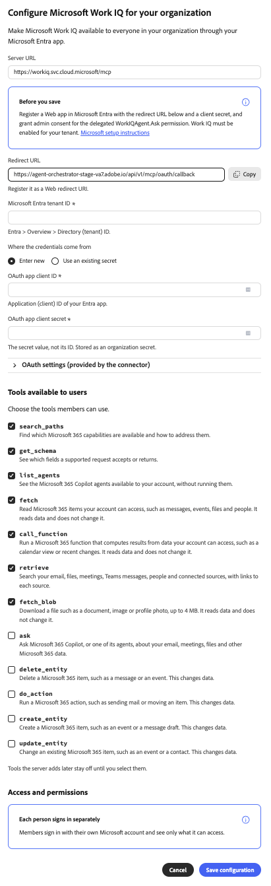
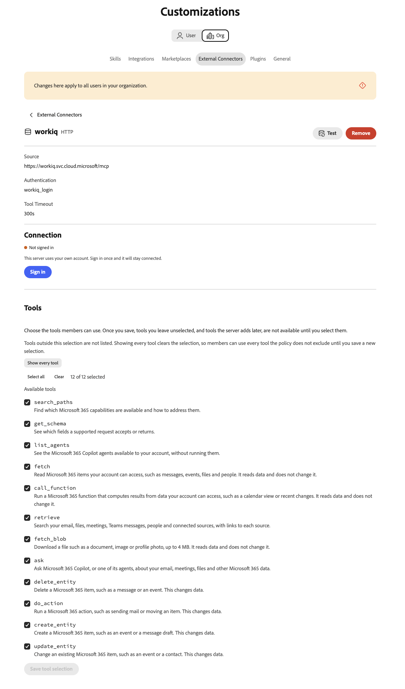

# Microsoft Work IQ外部聯結器 {#microsoft-work-iq}

使用[!DNL Microsoft Work IQ]外部聯結器在Adobe CX Enterprise Coworker中處理您的[!DNL Microsoft 365]資料。 在您設定聯結器後，請要求同事搜尋您的電子郵件、檔案、會議和[!DNL Microsoft Teams]封郵件、檢閱行事曆活動等。 聯結器是由[!DNL Microsoft]裝載的模型內容通訊協定(MCP)伺服器。

>[!AVAILABILITY]
>
>[!DNL Microsoft Work IQ]外部聯結器為Beta版。 文件和功能可能會有所變更。

## 聯結器設定 {#connector-configuration}

聯結器組態程式有兩個獨立的部分：

* **組織設定：**&#x200B;管理員會為整個組織設定一次聯結器。 管理員連線[!DNL Microsoft Entra]應用程式並選取成員可以使用的工具。
* **成員登入：**&#x200B;每個成員使用自己的[!DNL Microsoft]工作帳戶登入。 成員只能存取其帳戶可存取的資料。

儲存組織設定不會登入任何成員或授予其他[!DNL Microsoft 365]許可權。 每個成員必須個別登入。

**[!UICONTROL Microsoft Work IQ]**&#x200B;卡會提及共用的OAuth應用程式，只有在您的部署設定了此應用程式時才能使用。 請勿假設已提供應用程式。 此頁面說明如何連線您自己的[!DNL Microsoft Entra]應用程式。

## 先決條件 {#prerequisites}

開始之前，請確定您具備下列條件：

* **對於組織設定：**&#x200B;具有在同事中管理組織聯結器的許可權的帳戶。
* **對於[!DNL Microsoft Entra]應用程式：**&#x200B;可以註冊網頁應用程式並授予管理員同意的[!DNL Microsoft Entra]管理員。
* **對於您的[!DNL Microsoft]租使用者：** [!DNL Work IQ]已為租使用者啟用。
* **對於成員登入：**&#x200B;符合資格的[!DNL Microsoft]工作帳戶，具有您計畫使用之資料的存取權。

## 為您的組織設定聯結器 {#configure-organization}

管理員可讓組織中的所有人使用[!DNL Microsoft Work IQ]聯結器。 組織頁面上的變更會套用至組織中的所有使用者。

1. 開啟&#x200B;**[!UICONTROL 自訂]**，選取&#x200B;**[!UICONTROL 組織]**，然後選取&#x200B;**[!UICONTROL 外部聯結器]**。 在&#x200B;**[!UICONTROL Microsoft Work IQ]**&#x200B;卡片上，選取&#x200B;**[!UICONTROL 設定]**。

1. 在&#x200B;**[!UICONTROL 設定您組織的Microsoft工作IQ]**&#x200B;對話方塊中，檢閱&#x200B;**[!UICONTROL 伺服器URL]**，`https://workiq.svc.cloud.microsoft/mcp`。 然後準備您的[!DNL Microsoft Entra]應用程式。 針對[!DNL Microsoft]需求，請在對話方塊中選取&#x200B;**[!UICONTROL Microsoft設定指示]**。

   1. 在[!DNL Microsoft Entra]中註冊網頁應用程式，或使用現有的網頁應用程式。
   1. 從對話方塊複製&#x200B;**[!UICONTROL 重新導向URL]**，並在應用程式上將此精確值註冊為Web重新導向URI。 重新導向URL在不同環境中會有所不同，因此請一律從對話方塊複製。
   1. 建立使用者端密碼，或確認現有的使用者端密碼仍然有效。 您需要機密值，而不是機密ID。
   1. 授與委派之`WorkIQAgent.Ask`許可權的管理者同意，並確認您的租使用者已啟用[!DNL Work IQ]。

   在&#x200B;**[!UICONTROL Microsoft Entra租使用者識別碼]**&#x200B;中，輸入您的租使用者識別碼。 在[!DNL Microsoft Entra]中，在&#x200B;**[!UICONTROL 總覽]** > **[!UICONTROL 目錄（租使用者） ID]**&#x200B;中找到此值。

   ![針對您的組織設定Microsoft Work IQ對話方塊，其中顯示伺服器URL、[儲存要求之前]、[重新導向URL]、[Microsoft Entra租使用者ID]欄位以及[新認證]欄位。](./assets/microsoft-work-iq/org-configure.png){width="500" zoomable="yes"}

1. 在&#x200B;**[!UICONTROL 認證來自]**&#x200B;之下，選取下列其中一個選項：

   * **[!UICONTROL 輸入新的]：**&#x200B;在&#x200B;**[!UICONTROL OAuth應用程式使用者端識別碼]**&#x200B;中，輸入您[!DNL Microsoft Entra]應用程式的應用程式（使用者端）識別碼。 在&#x200B;**[!UICONTROL OAuth應用程式使用者端密碼]**&#x200B;中，輸入密碼值。 同事會將密碼值儲存為組織密碼。
   * **[!UICONTROL 使用現有的密碼]：**&#x200B;在儲存使用者端識別碼&#x200B;]**的**[!UICONTROL &#x200B;密碼和儲存使用者端密碼&#x200B;]**的**[!UICONTROL &#x200B;密碼中，選取應用程式中已儲存的組織密碼。 如果沒有正確的密碼，請選取&#x200B;**[!UICONTROL 改為輸入新的]**。 您仍需個別輸入租使用者ID。

   租使用者ID、使用者端ID和使用者端密碼都必須屬於相同的應用程式和租使用者。 如果您重複使用已儲存的密碼，請確認使用者端密碼尚未過期。 這些應用程式認證與成員用來登入的[!DNL Microsoft]密碼不同。

   {width="500" zoomable="yes"}

1. 在&#x200B;**[!UICONTROL 使用者可用的工具]**&#x200B;下，選取貴組織需要的工具。 如需詳細資訊，請參閱[可用的工具](#available-tools)。 檢閱&#x200B;**[!UICONTROL 存取和許可權]**，確認每個人都可個別登入，然後選取&#x200B;**[!UICONTROL 儲存組態]**。

   {zoomable="yes"}

1. 檢閱已儲存的&#x200B;**[!UICONTROL workiq]**&#x200B;聯結器詳細資料。 選擇性地選取&#x200B;**[!UICONTROL 測試]**，以檢查同事是否可以探索聯結器工具。 若要在儲存後變更工具，請參閱[變更工具選擇](#change-tool-selection)。

   | 設定 | 說明 |
   | --- | --- |
   | **[!UICONTROL Source]** | [!DNL Work IQ] MCP伺服器`https://workiq.svc.cloud.microsoft/mcp`。 |
   | **[!UICONTROL 驗證]** | 驗證方法，`workiq_login`。 |
   | **[!UICONTROL 工具逾時]** | 聯結器的工具逾時。 |
   | **[!UICONTROL Connection]** | 您自己的登入狀態。 |

   {width="500" zoomable="yes"}

聯結器詳細資料上的&#x200B;**[!UICONTROL 未登入]**&#x200B;狀態是指您自己的連線，而不是組織的連線。 若要自行使用聯結器，請選取&#x200B;**[!UICONTROL 登入]**，並依照[登入為成員](#sign-in-as-a-member)中的步驟操作。

若要停止提供聯結器給您的組織，請在聯結器詳細資訊頁面上選取&#x200B;**[!UICONTROL 移除]**。

### 可用的工具 {#available-tools}

[!DNL Microsoft Work IQ]聯結器提供下列工具：

| 工具 | 說明 |
| --- | --- |
| `search_paths` | 尋找可用的[!DNL Microsoft 365]功能以及如何解決這些功能。 |
| `get_schema` | 查看受支援的要求會接受或傳回哪些欄位。 |
| `list_agents` | 檢視您的帳戶可用的[!DNL Microsoft 365 Copilot]代理程式，而不需執行它們。 |
| `fetch` | 讀取您的帳戶可以存取的[!DNL Microsoft 365]個專案，例如訊息、事件、檔案和人員。 不會變更資料。 |
| `call_function` | 從您的帳戶可存取的資料計算結果，例如行事曆檢視或最近的變更。 不會變更資料。 |
| `retrieve` | 搜尋包含每個來源連結的電子郵件、檔案、會議、[!DNL Microsoft Teams]訊息、人員及連線來源。 |
| `fetch_blob` | 下載檔案（例如檔案、影像或設定檔像片），大小上限為4 MB。 不會變更資料。 |
| `ask` | 請向[!DNL Microsoft 365 Copilot]或其代理程式詢問您的電子郵件、會議、檔案和其他[!DNL Microsoft 365]資料。 |
| `delete_entity` | 刪除[!DNL Microsoft 365]專案，例如訊息或事件。 變更資料。 |
| `do_action` | 執行[!DNL Microsoft 365]動作，例如傳送郵件或移動專案。 變更資料。 |
| `create_entity` | 建立[!DNL Microsoft 365]專案，例如事件或訊息草稿。 變更資料。 |
| `update_entity` | 變更現有的[!DNL Microsoft 365]專案，例如事件或連絡人。 變更資料。 |

>[!IMPORTANT]
>
>`delete_entity`、`do_action`、`create_entity`和`update_entity`工具變更了[!DNL Microsoft 365]中的資料。 請仔細檢閱這些工具，並僅選取貴組織希望成員使用的工具。

伺服器稍後新增的工具會在您選取它們之前停用。

### 變更工具選取範圍 {#change-tool-selection}

若要變更儲存後成員可用的工具，請使用聯結器詳細資訊頁面上的&#x200B;**[!UICONTROL 工具]**&#x200B;區段。

1. 選取或清除個別工具，或使用&#x200B;**[!UICONTROL 選取全部]**&#x200B;或&#x200B;**[!UICONTROL 清除]**。

1. 選取&#x200B;**[!UICONTROL 儲存工具選取專案]**。

>[!CAUTION]
>
>選取「**[!UICONTROL 顯示每個工具]**」會清除目前的選取專案。 然後，成員可以使用原則不排除的每個工具，直到您儲存新的選取專案為止。 不要選取&#x200B;**[!UICONTROL 只顯示每個工具]**&#x200B;來檢視工具清單。

## 以成員身分登入 {#sign-in-as-a-member}

管理員設定聯結器後，每個成員都會使用自己的[!DNL Microsoft]工作帳戶登入。 您不需要應用程式使用者端密碼即可登入。

1. 開啟&#x200B;**[!UICONTROL 自訂]**，選取&#x200B;**[!UICONTROL 使用者]**，然後選取&#x200B;**[!UICONTROL 外部聯結器]**。

1. 在&#x200B;**[!UICONTROL Microsoft Work IQ]**&#x200B;卡上，選取&#x200B;**[!UICONTROL 登入]**。

   如果卡片顯示&#x200B;**[!UICONTROL 未設定]**&#x200B;或聯結器無法使用，請要求您的管理員[設定聯結器](#configure-organization)。

1. 在[!DNL Microsoft] **[!UICONTROL 挑選帳戶]**&#x200B;畫面上，選取您組織的工作帳戶，或選取&#x200B;**[!UICONTROL 使用其他帳戶]**。

   您的瀏覽器可能會記住多個帳戶，包括其他租使用者的帳戶。 已登入的帳戶不一定都是正確的帳戶。 選擇您需要[!DNL Microsoft 365]存取權的帳戶。

   ![Microsoft選取一個帳戶熒幕，其中列出兩個名稱與電子郵件地址模糊的帳戶，以及[使用其他帳戶]選項。](./assets/microsoft-work-iq/member-pick-account.png){width="400" zoomable="yes"}

1. 完成您帳戶的登入步驟，例如密碼、單一登入(SSO)、無密碼登入、多重驗證(MFA)或其他驗證。

   請僅在貴組織核准的登入流程中輸入您的[!DNL Microsoft]認證。 切勿在聯結器的OAuth應用程式欄位中輸入它們。

   ![Microsoft輸入電子郵件地址模糊的工作帳戶的密碼畫面，以及[登入]按鈕。](./assets/microsoft-work-iq/member-password.png){width="400" zoomable="yes"}

1. 如果[!DNL Microsoft]要求同意，請檢閱要求。

   >[!IMPORTANT]
   >
   >只有在您識別應用程式且您的組織核准所要求的存取權時，才繼續。

1. [!DNL Microsoft]將您傳回同事後，請開啟&#x200B;**[!UICONTROL workiq]**&#x200B;聯結器詳細資料。 確認聯結器顯示&#x200B;**[!UICONTROL 已連線]**&#x200B;且&#x200B;**[!UICONTROL 已登入]**。

   {width="700" zoomable="yes"}

1. 檢閱管理員啟用的&#x200B;**[!UICONTROL 工具]**&#x200B;以檢視您可以使用的工具。

從聯結器詳細資訊中，您還可以執行下列操作：

* **[!UICONTROL 測試]：**&#x200B;檢查同事是否可以探索聯結器工具。
* **[!UICONTROL 登出]：**&#x200B;中斷您的[!DNL Microsoft]帳戶與聯結器的連線。

聯結器詳細資料也顯示&#x200B;**[!UICONTROL 工具逾時]**&#x200B;設定和&#x200B;**[!UICONTROL 重新整理]**&#x200B;控制項。

**[!UICONTROL 已連線]**&#x200B;狀態無法確認您可以存取每個[!DNL Microsoft 365]資源，或每個工具都成功執行。 若要確認您的存取權，[請檢查您的Microsoft 365存取權](#check-access)。

## 檢查您的Microsoft 365存取權 {#check-access}

若要確認聯結器可以讀取您的資料，請開始聊天並輸入唯讀提示。

範例提示：

* 「尋找我明天的會議，並加入來源連結。 請勿建立、更新、傳送或刪除任何內容。」

為了讓此提示生效，您的管理員必須啟用可讀取行事曆資料的工具，且您的帳戶必須擁有該資料的存取權。

## 疑難排解存取權 {#troubleshoot-access}

如果登入或存取失敗，請向您的管理員檢查下列專案：

| 區域圖 | 檢查內容 |
| --- | --- |
| [!DNL Microsoft]帳戶 | 您已使用目標租使用者的正確工作帳戶登入。 |
| [!DNL Work IQ]可用性 | 已為您的[!DNL Microsoft]租使用者啟用[!DNL Work IQ]。 |
| 重新導向URI | [!DNL Microsoft Entra]應用程式從註冊為Web重新導向URI的對話方塊中，擁有正確的重新導向URL。 |
| 管理員同意 | 管理員已授與委派之`WorkIQAgent.Ask`許可權的管理員同意。 |
| 用戶端密碼 | 使用者端密碼尚未過期，且聯結器會使用密碼值，而非密碼ID。 |
| 已儲存的密碼 | 兩個選取的組織密碼都屬於預期的[!DNL Microsoft Entra]應用程式。 |
| 工具選取 | 如果只有一個工具失敗，您的管理員會啟用該工具。 |
| [!DNL Microsoft 365]許可權 | 您的帳戶擁有存取請求資料的許可權。 |
