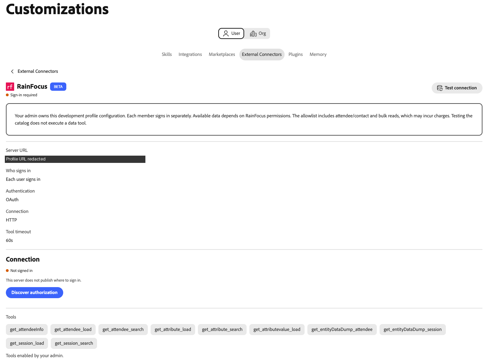

# RainFocus外部聯結器 {#rainfocus}

使用[!DNL RainFocus]外部聯結器在Adobe CX Enterprise Coworker中使用您的[!DNL RainFocus]事件資料。 設定聯結器後，請向同事詢問您的[!DNL RainFocus]帳戶可存取的工作階段、出席者和自訂屬性。 聯結器使用[!DNL RainFocus] MCP設定檔，這是由[!DNL RainFocus]代管的模型內容通訊協定(MCP)伺服器。

>[!AVAILABILITY]
>
>[!DNL RainFocus]外部聯結器為Beta版。 文件和功能可能會有所變更。

## 聯結器設定 {#connector-configuration}

聯結器組態程式有三個獨立的部分：

* **[!DNL RainFocus]準備：** [!DNL RainFocus]系統管理員布建MCP設定檔、啟用其工具，以及提供設定檔URL。 每個成員都需要具有正確角色的[!DNL RainFocus]帳戶。
* **組織設定：**&#x200B;同事管理員會為整個組織儲存一次MCP設定檔URL。 聯結器會啟用讀取工具的固定清單。
* **成員登入：**&#x200B;每個成員都使用自己的[!DNL RainFocus]帳戶登入。 成員只能存取其[!DNL RainFocus]角色和設定檔允許的資料。

儲存組織設定不會登入任何成員、授予[!DNL RainFocus]許可權或執行[!DNL RainFocus]資料工具。 每個成員必須個別登入。

## 先決條件 {#prerequisites}

開始之前，請確定您具備下列條件：

* **同事存取：**&#x200B;在有[!DNL RainFocus]聯結器可用的組織中，已開啟組織設定的同事系統管理員帳戶。
* **MCP設定檔：**&#x200B;已布建的[!DNL RainFocus] MCP設定檔及其完整的HTTPS設定檔URL，由您的[!DNL RainFocus]管理員提供。 如需詳細資訊，請參閱[取得MCP設定檔URL](#get-profile-url)。
* **成員帳戶：**&#x200B;每個成員都有一個[!DNL RainFocus]帳戶，該帳戶具有安全性角色，可存取他們需要的資料。

您沒有在Co-worker中輸入使用者端ID、使用者端密碼或存取權杖。 每個成員都使用自己的帳戶登入[!DNL RainFocus]。

## 準備[!DNL RainFocus]存取權 {#prepare-rainfocus}

在Co-worker中設定聯結器之前，請先在[!DNL RainFocus]中準備MCP設定檔和成員存取。 [!DNL RainFocus]擁有設定檔、其啟用的工具、成員角色及任何費用。 Co-worker會儲存您組織的設定檔URL和工具清單，以及每個成員的登入。

### 取得MCP設定檔URL {#get-profile-url}

[!DNL RainFocus]通常會根據客戶需求為其設定MCP設定檔。 如果您的[!DNL RainFocus]管理員設定設定了設定檔，程式如下：

1. 在[!DNL RainFocus]中，開啟&#x200B;**[!UICONTROL 整合套件]** > **[!UICONTROL 作用中設定檔]** > **[!UICONTROL MCP設定檔]**，然後建立設定檔。
1. 僅啟用使用案例所需的工具，並關閉其他工具。
1. 複製產生的MCP伺服器URL。 URL是設定檔專屬的。

將完整URL提供給設定聯結器的Co-worker管理員。 請勿猜測設定檔名稱，或自行建立URL。 如需詳細資訊，請參閱[RainFocus MCP設定檔宣告](https://www.rainfocus.com/company/news-press/rainfocus-launches-ai-agent-connectivity-for-event-data-with-mcp-profiles/)。

### 確認成員存取權 {#confirm-member-access}

每個成員都使用自己的[!DNL RainFocus]帳戶登入。 帳戶的安全性角色以及在設定檔中啟用的工具，可控制成員可存取哪些資料。 請要求您的[!DNL RainFocus]管理員確認每個成員擁有其任務的最低許可權角色。

## 為您的組織設定聯結器 {#configure-organization}

管理員可讓組織中的所有人使用[!DNL RainFocus]聯結器。 組織頁面上的變更會套用至組織中的所有使用者。 **[!UICONTROL 組織]**&#x200B;範圍僅會出現在開啟組織設定的系統管理員中。

1. 開啟&#x200B;**[!UICONTROL 自訂]**，選取&#x200B;**[!UICONTROL 組織]**，然後選取&#x200B;**[!UICONTROL 外部聯結器]**。
1. 找到&#x200B;**[!UICONTROL RainFocus]**&#x200B;卡片，此卡片有Beta標籤，並顯示&#x200B;**[!UICONTROL 未設定]**。 Select **[!UICONTROL 設定]**。

1. 在&#x200B;**[!UICONTROL 設定RainFocus]**&#x200B;對話方塊中，輸入&#x200B;**[!UICONTROL 開發設定檔URL]**。 使用您的[!DNL RainFocus]管理員提供的完整MCP設定檔URL。

   URL必須以`https://`開頭。 它不能包含空格、反斜線、查詢字串(`?`)、片段(`#`)、使用者名稱或密碼、非預設連線埠，或`.`或`..`路徑區段。 如果URL不符合規則，Co-worker會顯示說明規則的訊息。 Co-worker只會檢查URL的格式。 它不會檢查設定檔是否存在或您是否能使用它。

1. 檢閱&#x200B;**[!UICONTROL 存取和許可權]**&#x200B;和&#x200B;**[!UICONTROL 固定讀取工具允許清單]**&#x200B;區段。 聯結器會啟用所有10個讀取工具，您無法在此對話方塊中新增、移除或編輯它們。 有些工具會傳回與會者個人資料或大量匯出。 如需詳細資訊，請參閱[可用的工具](#available-tools)。

   ![設定RainFocus對話方塊，顯示空白的開發設定檔URL欄位、[存取與許可權]區段、包含10個工具的固定讀取工具允許清單，以及[儲存連線]按鈕。](./assets/rainfocus/org-configure.png){width="500" zoomable="yes"}

1. Select **[!UICONTROL 儲存連線]**。 Co-worker儲存連線時，您無法編輯或取消表單。

如果儲存失敗，對話方塊會顯示&#x200B;**[!UICONTROL 無法儲存連線]**&#x200B;並保留您輸入的URL。 即使儲存失敗，也可能會儲存某些設定。 重新開啟設定並進行檢查，然後再試一次。 若要避免發生衝突的變更，請確定一次只有一個管理員設定聯結器。

### 驗證儲存的設定 {#verify-configuration}

儲存連線後，請檢查設定：

1. 儲存後，對話方塊會開啟儲存的聯結器詳細資訊。 返回&#x200B;**[!UICONTROL 外部聯結器]**&#x200B;清單，並確認&#x200B;**[!UICONTROL RainFocus]**&#x200B;卡片顯示&#x200B;**[!UICONTROL 已儲存的組態]**&#x200B;和&#x200B;**[!UICONTROL 檢視組態]**。
1. 重新載入頁面，然後選取&#x200B;**[!UICONTROL 檢視組態]**。
1. 確認下列詳細資料：

   * **[!UICONTROL Source]**&#x200B;會顯示您輸入的設定檔URL。
   * **[!UICONTROL 驗證]**&#x200B;存在。
   * **[!UICONTROL 工具原則]** > **[!UICONTROL 允許的工具名稱或模式]**&#x200B;列出與[可用工具](#available-tools)區段相同的10個工具。

1. 若要檢查您自己的連線，請選取&#x200B;**[!UICONTROL 測試]**。 如果同事要求您登入，請使用您自己的[!DNL RainFocus]帳戶，如[以成員身分登入](#sign-in-as-a-member)中所述。

   **[!UICONTROL Test]**&#x200B;列出伺服器的工具並更新&#x200B;**[!UICONTROL 工具]**&#x200B;計數。 如果伺服器未傳回任何工具，則詳細資料顯示&#x200B;**[!UICONTROL 0個可用的工具]**。 如果測試失敗，詳細資料顯示&#x200B;**[!UICONTROL 連線失敗]**。

   ![已儲存的Rainfocus聯結器詳細資訊，其中顯示密文的來源、Rainfocus_login驗證方法、未登入的登入按鈕，以及[測試與移除]按鈕。](./assets/rainfocus/org-details.png){width="700" zoomable="yes"}

聯結器詳細資料上的&#x200B;**[!UICONTROL 連線]**、**[!UICONTROL 測試]**&#x200B;和登入控制項只適用於您自己的連線。 當您以管理員身分登入時，不會有任何成員登入。 成功的測試只會列出工具。 測試不會執行[!DNL RainFocus]資料工具，或確認成員可以存取特定資料。

聯結器詳細資料沒有編輯設定檔URL的選項。 **[!UICONTROL 移除]**&#x200B;會開啟確認，然後移除整個組織的連線。 將移除視為審慎的管理員決定，而非疑難排解步驟。

### 可用的工具 {#available-tools}

[!DNL RainFocus]聯結器會啟用10個讀取工具的固定清單：

| 工具 | 資料區域 |
| --- | --- |
| `get_attendeeInfo` | 出席者 |
| `get_attendee_load` | 出席者 |
| `get_attendee_search` | 出席者 |
| `get_attribute_load` | 自訂屬性 |
| `get_attribute_search` | 自訂屬性 |
| `get_attributevalue_load` | 自訂屬性 |
| `get_entityDataDump_attendee` | 出席者，大量匯出 |
| `get_entityDataDump_session` | 工作階段，大量匯出 |
| `get_session_load` | 工作階段 |
| `get_session_search` | 工作階段 |

不在此清單上的工具（包括[!DNL RainFocus]稍後新增的工具）不會自動啟用。 清單不會取代[!DNL RainFocus]安全性角色或設定檔的工具設定，仍可控制資料的存取。

>[!IMPORTANT]
>
>有數種工具可傳回關於出席者的個人資料和聯絡資訊。 有兩個工具會大量匯出資料，且結果可能會很大。 閱讀也會產生您[!DNL RainFocus]條款下的費用。 成員登入前，請與您的資料控管擁有者檢閱這些工具。

## 以成員身分登入 {#sign-in-as-a-member}

管理員設定聯結器後，每個成員都會使用自己的[!DNL RainFocus]帳戶登入。 您不需要使用者端ID、使用者端密碼或存取權杖即可登入。

1. 開啟&#x200B;**[!UICONTROL 自訂]**，然後選取&#x200B;**[!UICONTROL 外部聯結器]**。 成員預設使用&#x200B;**[!UICONTROL 使用者]**&#x200B;範圍。 尋找&#x200B;**[!UICONTROL RainFocus]**&#x200B;卡片。
1. 如果卡片顯示&#x200B;**[!UICONTROL 尚無法使用。 您的管理員需要設定此專案。]**，請要求您的管理員[設定聯結器](#configure-organization)。 成員無法輸入自己的設定檔URL。
1. 檢查卡片上的狀態。 卡片顯示&#x200B;**[!UICONTROL 需要登入]**、**[!UICONTROL 已連線]**、**[!UICONTROL 由您的管理員設定]**，或&#x200B;**[!UICONTROL 連線失敗]**&#x200B;狀態。

   **[!UICONTROL 由您的管理員設定]**&#x200B;表示同事無法確認您的登入狀態。 這並不表示您已登入或登出。

1. Select **[!UICONTROL 登入]**。 您也可以開啟卡片詳細資料，並在&#x200B;**[!UICONTROL 連線]**&#x200B;區段中選取&#x200B;**[!UICONTROL 登入]**。 在[!DNL RainFocus]視窗中，完成登入、單一登入(SSO)、多重驗證(MFA)及同意提示。 檢閱您核准的存取權。

   如果出現&#x200B;**[!UICONTROL Discover authorization]**，同事會讀取伺服器的登入詳細資料，而非其工具。 如果探索失敗，或面板要求&#x200B;**[!UICONTROL 使用者端識別碼]**&#x200B;或&#x200B;**[!UICONTROL 使用者端密碼]**，請停止並連絡您的系統管理員。 請勿輸入或猜測認證。

   {width="700" zoomable="yes"}

1. 返回同事並確認狀態是否顯示&#x200B;**[!UICONTROL 已連線]**。 僅關閉的登入視窗無法確認成功。 如果您提早關閉視窗，則不會有任何變更，您可以再試一次。
1. 開啟卡片詳細資訊以向管理員檢閱設定。 您可以檢視您的系統管理員所啟用的&#x200B;**[!UICONTROL 伺服器URL]**、**[!UICONTROL 登入者]**、**[!UICONTROL 驗證]**&#x200B;和&#x200B;**[!UICONTROL 工具]**。
1. Select **[!UICONTROL 在卡片上測試]**，或在詳細資料中測試&#x200B;**[!UICONTROL 連線]**，以檢查與您的帳戶的連線。

   成功的測試顯示[!DNL RainFocus]已使用您的帳戶回應，並提供可用的工具數目。 測試僅列出工具。 它不會執行資料工具或確認存取特定事件或記錄。 若要更新您的登入並再次列出工具，請選取&#x200B;**[!UICONTROL 重新整理]**。 如果Co-worker無法更新您的登入，則按鈕會顯示&#x200B;**[!UICONTROL 重新載入工具]**，它只會再次列出工具。

1. 如果測試失敗，同事顯示&#x200B;**[!UICONTROL 無法連線到RainFocus]**，請再試一次&#x200B;**和**&#x200B;[!UICONTROL &#x200B;技術詳細資料&#x200B;]&#x200B;**。**&#x200B;如果您已登出，請重新登入。 如果問題持續發生，請連絡管理員。

成員可以登入、登出、測試、重新整理和檢視啟用的工具。 成員無法變更或移除組織連線、編輯設定檔URL或變更工具。 每個開啟詳細資訊的成員都可以檢視設定檔URL。 管理員登入時，其他成員未登入。

若要中斷您的[!DNL RainFocus]帳戶與聯結器的連線，請選取&#x200B;**[!UICONTROL 登出]**。 您可以隨時重新登入。

## 檢查您的事件資料存取權 {#check-event-access}

若要確認您可以使用[!DNL RainFocus]資料，請以窄要求執行唯讀檢查。 使用您核准使用的事件，並避免工具傳回出席者資料或為此檢查大量匯出。 開始聊天並輸入提示。

範例提示：

* 「使用RainFocus，我最多可以存取五個工作階段。 如果傳回工作階段標題和ID，則僅顯示它們。 請勿匯出資料、傳回與會者資訊或變更任何專案。」

確認結果包含您預期的工作階段。 空白結果並不一定表示聯結器無法運作。 檢查您用來登入的[!DNL RainFocus]帳戶、您的安全性角色，以及設定檔中啟用的工具。 如果結果意外較大或包含敏感資料，請停止並縮小您的請求。

## 疑難排解存取權 {#troubleshoot-access}

如果您無法存取您的[!DNL RainFocus]資料，請向管理員檢查下列專案：

| 問題 | 檢查內容 |
| --- | --- |
| 缺少&#x200B;**[!UICONTROL RainFocus]**&#x200B;卡 | 請向您的Adobe代表確認您的組織可以使用聯結器。 |
| **[!UICONTROL 組織]**&#x200B;範圍遺失 | 確認您是管理員，且貴組織的組織設定已開啟。 |
| 同事拒絕設定檔URL | 遵循訊息中的規則。 使用您[!DNL RainFocus]管理員提供的完整設定檔URL，不要猜測設定檔名稱。 |
| **[!UICONTROL 無法儲存連線]**&#x200B;出現 | 可能會儲存部分設定。 重新開啟設定並進行檢查，然後再試一次。 請確定一次只能有一個管理員設定聯結器。 |
| 卡片顯示&#x200B;**[!UICONTROL 尚無法使用。 您的管理員需要設定此專案。]** | 缺少組織設定。 請要求您的管理員[設定聯結器](#configure-organization)。 |
| 登入要求&#x200B;**[!UICONTROL 使用者端識別碼]**&#x200B;或&#x200B;**[!UICONTROL 使用者端密碼]**，或探索失敗 | 停止並連絡您的管理員。 請勿輸入或猜測認證，或註冊應用程式。 |
| 您核准[!DNL RainFocus]中的存取權後，登入失敗 | 檢查您使用的[!DNL RainFocus]帳戶和安全形色。 請要求您的Adobe代表和[!DNL RainFocus]檢查您環境的登入設定。 請勿共用登入URL。 |
| **[!UICONTROL 測試]**&#x200B;成功，但資料要求失敗 | **[!UICONTROL 測試]**&#x200B;僅列出工具。 檢查您的[!DNL RainFocus]安全性角色、設定檔中啟用的工具，以及工具所需的篩選器。 |
| **[!UICONTROL 無法連線到RainFocus]**&#x200B;在您登入時出現 | Select **[!UICONTROL 請再試一次]**。 如果問題持續發生，請連絡管理員。 |
| 結果意外較大或包含敏感資料 | 停止並縮小您的請求。 請勿將原始事件資料貼到票證或聊天中。 |

當您聯絡支援時，請僅包含錯誤文字、錯誤時間和您的環境。 請勿共用技術細節、設定檔URL、登入擷取、密碼、權杖或授權碼。
