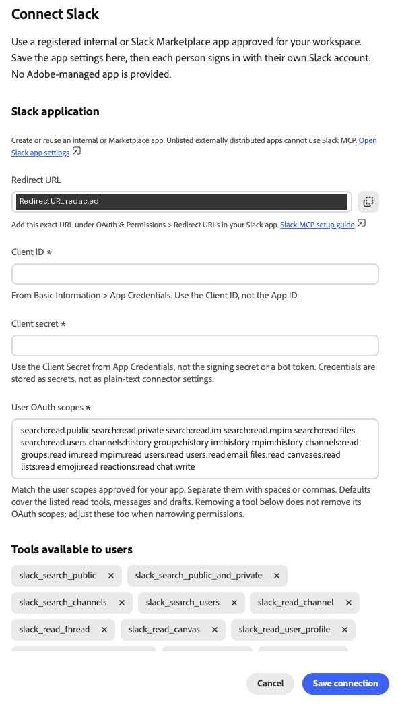

# Slack外部聯結器 {#slack}

使用[!DNL Slack]外部聯結器在Adobe CX Enterprise Coworker中處理[!DNL Slack]交談。 設定聯結器後，請要求Co-worker搜尋訊息和檔案、讀取通道和對話串，以及尋找人員。 如果管理員啟用這些工具，您也可以傳送訊息和回覆。 聯結器使用由[!DNL Slack]代管的正式遠端模型內容通訊協定(MCP)伺服器。

>[!AVAILABILITY]
>
>[!DNL Slack]外部聯結器為Beta版。 文件和功能可能會有所變更。

## 聯結器設定 {#connector-configuration}

聯結器組態程式有三個獨立的部分：

* **[!DNL Slack]應用程式準備：** [!DNL Slack]應用程式的擁有者已準備合格的應用程式、註冊Co-worker重新導向URL，並設定使用者範圍。 Adobe未提供受管理的[!DNL Slack]應用程式。
* **組織設定：**&#x200B;同事管理員會為整個組織設定一次聯結器。 管理員輸入應用程式認證，並選擇使用者OAuth範圍以及成員可以使用的工具。
* **成員登入：**&#x200B;每個成員都使用自己的[!DNL Slack]帳戶登入。 成員只能存取其[!DNL Slack]帳戶可存取的內容。

聯結器不使用共用機器人或共用[!DNL Slack]身分。 同事會以登入成員身分傳送訊息及回覆。 儲存組織設定不會登入任何成員或授予其他[!DNL Slack]存取權。 每個成員必須個別登入。

## 先決條件 {#prerequisites}

開始之前，請確定您具備下列條件：

* **同事存取：**&#x200B;在有[!DNL Slack]聯結器可用的組織中，具有管理組織聯結器的許可權的帳戶。
* **[!DNL Slack]應用程式：**&#x200B;已針對您的工作區核准的內部應用程式或[!DNL Slack Marketplace]應用程式。 您還需要應用程式擁有者，才能確認核准的使用者範圍並編輯應用程式設定。
* **應用程式認證：**&#x200B;透過您核准的處理認證程式共用的應用程式使用者端識別碼和使用者端密碼。
* **工具和範圍決定：**&#x200B;您的組織計畫啟用的讀取、傳訊和草稿工具，以及計畫要求的使用者OAuth範圍。
* **測試工作區或頻道：**&#x200B;檢查與同意測試成員之連線的地方。 請勿在客戶或生產管道中傳送測試訊息。

>[!IMPORTANT]
>
>切勿在熒幕擷圖、聊天或支援票證中分享使用者端秘密、存取權杖或其他認證。 只在設定對話方塊的安全欄位中輸入認證。

## 準備您的Slack應用程式 {#prepare-slack-app}

在您於Co-worker中設定聯結器之前，應用程式擁有者已準備[!DNL Slack]應用程式。 工作區或組織應用程式管理員可能也需要核准它。 如需[!DNL Slack]需求，請參閱[!DNL Slack]開發人員檔案中的[Slack MCP伺服器](https://docs.slack.dev/ai/slack-mcp-server/)。

### 選擇符合資格的應用程式 {#choose-eligible-app}

[!DNL Slack]僅支援在[!DNL Slack Marketplace]中發佈之內部自訂應用程式和應用程式的MCP伺服器。 散佈在您組織外部的未列出應用程式無法使用[!DNL Slack] MCP伺服器。 僅開啟公開發佈不會讓應用程式符合資格。

1. 選擇將擁有應用程式的工作區或組織，以及應用程式所有者。
1. 在[Slack應用程式管理](https://api.slack.com/apps)中，在該工作區中建立新的應用程式。 若要重複使用現有符合資格的應用程式，請先取得其擁有者的核准。
1. 在應用程式設定中，選取&#x200B;**[!UICONTROL 基本資訊]** > **[!UICONTROL 應用程式認證]**。 記下&#x200B;**[!UICONTROL 使用者端識別碼]**&#x200B;和&#x200B;**[!UICONTROL 使用者端密碼]**。

   在Co-worker中只輸入這兩個值。 請勿使用應用程式ID、簽署密碼、機器人權杖或應用程式層級權杖。

### 註冊重新導向URL {#register-redirect-url}

在您的[!DNL Slack]應用程式中註冊同事重新導向URL：

1. 在Co-worker中，開啟&#x200B;**[!UICONTROL 連線Slack]**&#x200B;對話方塊，如[設定組織的聯結器](#configure-organization)中所述。 複製&#x200B;**[!UICONTROL 重新導向URL]**&#x200B;的完整值。

   您可以開啟對話方塊，在完成或儲存設定之前複製URL。

1. 在[!DNL Slack]應用程式設定中，選取&#x200B;**[!UICONTROL OAuth與許可權]**。 在&#x200B;**[!UICONTROL 重新導向URL]**&#x200B;下，新增完整的重新導向URL，然後儲存。

請一律從您設定環境中的Co-worker對話方塊複製重新導向URL。 註冊確切的配置、主機名稱、連線埠（如果有的話）和路徑。 請勿自行建立URL，或重複使用其他環境的重新導向URL。 如果您使用多個環境，請個別註冊每個重新導向URL。

### 設定使用者範圍 {#set-user-scopes}

聯結器會使用使用者OAuth範圍，授權每個成員的帳戶。 它不使用機器人範圍。

1. 在[!DNL Slack]應用程式設定中，選取&#x200B;**[!UICONTROL OAuth與許可權]** > **[!UICONTROL 範圍]** > **[!UICONTROL 使用者權杖範圍]**。
1. 新增貴組織核准的使用者範圍。 將它們與Co-worker中的[預設範圍](#review-scopes)進行比較，並僅新增您計畫請求的範圍。

   預設範圍是Co-worker的預設功能集，不是[!DNL Slack]所需的最小值。 使用精細`search:read.*`範圍，而非較舊的`search:read`範圍。 在應用程式資訊清單中，使用者範圍屬於`oauth_config.scopes.user`，而非`oauth_config.scopes.bot`。

`chat:write`使用者範圍可讓同事以登入的成員身分傳送訊息。 如果貴組織不打算傳送訊息，請將其刪除。

您的工作區或[!DNL Slack]企業組織可能需要應用程式核准和範圍檢閱。 應用程式核准不會取代每個成員的同意。 僅允許[!DNL Slack Marketplace]個應用程式的原則可以封鎖內部應用程式。 如需詳細資訊，請參閱[管理您工作區的應用程式核准](https://slack.com/help/articles/222386767-Manage-app-approval-for-your-workspace)。

如果您的應用程式使用允許的IP位址限制，[!DNL Slack]也會將這些限制套用至MCP要求。 請聯絡您的Adobe代表以確認允許的地址。 請勿猜測IP位址範圍。 某些功能（例如語意搜尋）取決於您的[!DNL Slack]計畫。

### 檢閱不可逆應用程式設定 {#review-irreversible-settings}

同事使用使用者端ID和使用者端密碼作為機密的OAuth使用者端進行連線。 有些[!DNL Slack]應用程式設定無法還原，因此在變更前請先檢閱下列專案：

* **程式碼交換(PKCE)的校訂金鑰：**&#x200B;請勿在未確認的情況下開啟此聯結器的[!DNL Slack] PKCE設定。 此設定會將應用程式變更為公用使用者端的[!DNL Slack]份檔案，只有[!DNL Slack]個支援人員可以將其還原。 如需詳細資訊，請參閱[使用PKCE](https://docs.slack.dev/authentication/using-pkce/)。
* **語彙基元輪換：** [!DNL Slack]語彙基元輪換在您開啟後無法關閉。 在此應用程式開啟之前，請聯絡您的Adobe代表。 如需詳細資訊，請參閱[使用權杖輪換](https://docs.slack.dev/authentication/using-token-rotation/)。

### 不需要機器人功能 {#bot-features-not-required}

聯結器不需要機器人功能。 您不需要機器人權杖範圍、[!DNL Events API]要求URL、互動性要求URL、傳入webhook、斜線命令、[!DNL Socket Mode]或應用程式層級權杖。 如果現有應用程式將這些功能用於其他目的，請保留這些功能。

[!DNL Slack] MCP伺服器不支援動態使用者端註冊或伺服器傳送的事件(SSE)。 Co-worker會使用您註冊的應用程式和Streamable HTTP傳輸。

## 為您的組織設定聯結器 {#configure-organization}

管理員可讓組織中的所有人使用[!DNL Slack]聯結器。 組織頁面上的變更會套用至組織中的所有使用者。 完成[在成員登入前準備您的Slack應用程式](#prepare-slack-app)。

1. 開啟&#x200B;**[!UICONTROL 自訂]**，選取&#x200B;**[!UICONTROL 組織]**，然後選取&#x200B;**[!UICONTROL 外部聯結器]**。 在&#x200B;**[!UICONTROL Slack]**&#x200B;卡片上，選取&#x200B;**[!UICONTROL 設定]**。

   **[!UICONTROL 連線Slack]**&#x200B;對話方塊開啟。 聯結器使用固定的[!DNL Slack] MCP伺服器URL `https://mcp.slack.com/mcp`。 使用此設定的組織範圍，而非個人連線。

1. 請確定已在您的應用程式中註冊&#x200B;**[!UICONTROL Slack應用程式]**&#x200B;底下的&#x200B;**[!UICONTROL 重新導向URL]**，如[註冊重新導向URL](#register-redirect-url)中所述。 然後輸入您應用程式的&#x200B;**[!UICONTROL 使用者端識別碼]**&#x200B;和&#x200B;**[!UICONTROL 使用者端密碼]**。 這兩個欄位都是必填欄位。

   請勿輸入應用程式ID、簽署密碼或機器人權杖。 同事會將認證儲存為秘密，而非純文字聯結器設定。

   {width="500" zoomable="yes"}

1. 檢閱&#x200B;**[!UICONTROL 使用者OAuth範圍]**。 如需詳細資訊，請參閱[檢閱使用者OAuth範圍](#review-scopes)。

1. 在&#x200B;**[!UICONTROL 使用者可用的工具]**&#x200B;下，移除任何成員不應使用的工具。 至少必須保留一個工具。 如需詳細資訊，請參閱[可用的工具](#available-tools)。

1. 檢閱&#x200B;**[!UICONTROL 存取和許可權]**，然後選取&#x200B;**[!UICONTROL 儲存連線]**。 **[!UICONTROL Slack]**&#x200B;卡片顯示&#x200B;**[!UICONTROL 已儲存的組態]**。

   此對話方塊也會顯示&#x200B;**[!UICONTROL 驗證]**&#x200B;方法、**[!UICONTROL 連線]**&#x200B;型別和&#x200B;**[!UICONTROL 工具逾時]**。 當認證欄位或範圍清單為空時，Co-worker不會儲存設定。

   重新載入頁面，選取&#x200B;**[!UICONTROL 檢視組態]**，並確認組態和您的工具選擇已在成員登入前儲存。

   {width="500" zoomable="yes"}

儲存不會將您或任何成員登入[!DNL Slack]。 若要檢查連線，請依照[以成員身分登入](#sign-in-as-a-member)的說明，以您自己的身分登入。

### 檢閱使用者OAuth範圍 {#review-scopes}

**[!UICONTROL 使用者OAuth範圍]**&#x200B;欄位為必填。 以空格或逗號分隔範圍，並比對應用程式核准的使用者範圍。 依預設，欄位包含下列22個範圍：

```text
search:read.public search:read.private search:read.im search:read.mpim search:read.files search:read.users channels:history groups:history im:history mpim:history channels:read groups:read im:read mpim:read users:read users:read.email files:read canvases:read lists:read emoji:read reactions:read chat:write
```

您的工作區可能不會核准每個預設範圍。 與應用程式擁有者檢閱要求的範圍。

>[!IMPORTANT]
>
>預設範圍包括私人內容，例如私人頻道、群組訊息和直接訊息。 它們也包含`chat:write`，可讓同事以登入的成員身分傳送訊息和回覆。 明確決定貴組織是否啟用訊息傳送工具。 移除工具不會移除其OAuth範圍。 如果您不想讓成員傳送訊息，請移除`slack_send_message`工具和`chat:write`範圍。

工具選擇和OAuth範圍是獨立的。 縮小存取範圍時，請同時檢閱工具清單和範圍欄位。 啟用的工具不會給予成員超過其帳戶的[!DNL Slack]存取權。

### 可用的工具 {#available-tools}

[!DNL Slack]聯結器提供下列16種工具。 依預設，成員可以使用所有選項。

| 功能 | 工具 |
| --- | --- |
| 搜尋 | `slack_search_public` |
| 搜尋 | `slack_search_public_and_private` |
| 搜尋 | `slack_search_channels` |
| 搜尋 | `slack_search_users` |
| 讀取交談 | `slack_read_channel` |
| 讀取交談 | `slack_read_thread` |
| 讀取交談 | `slack_list_channel_members` |
| 讀取交談 | `slack_list_user_channels` |
| 讀取內容和設定檔 | `slack_read_canvas` |
| 讀取內容和設定檔 | `slack_read_user_profile` |
| 讀取內容和設定檔 | `slack_read_file` |
| 讀取內容和設定檔 | `slack_read_list` |
| Emoji和回應 | `slack_search_emojis` |
| Emoji和回應 | `slack_get_reactions` |
| 訊息和草稿 | `slack_send_message` |
| 訊息和草稿 | `slack_send_message_draft` |

聯結器不是唯讀的。 除非您移除`slack_send_message`工具，否則成員可以傳送訊息及回覆。 不包括頻道建立、排程訊息、檔案上傳、新增回應和畫布或清單變更。

## 以成員身分登入 {#sign-in-as-a-member}

管理員設定聯結器後，每個成員都會使用自己的[!DNL Slack]帳戶登入。 您不需要使用者端密碼即可登入。

1. 開啟&#x200B;**[!UICONTROL 自訂]**，選取&#x200B;**[!UICONTROL 使用者]**，然後選取&#x200B;**[!UICONTROL 外部聯結器]**。

1. 尋找&#x200B;**[!UICONTROL Slack]**&#x200B;卡片。 如果卡片顯示&#x200B;**[!UICONTROL 未設定]**&#x200B;且&#x200B;**[!UICONTROL 尚無法使用。 您的管理員需要設定此專案。]**，請要求您的管理員[設定聯結器](#configure-organization)。

   請勿索取或複製組織的使用者端密碼。

1. 管理員設定聯結器後，**[!UICONTROL Slack]**&#x200B;卡會顯示&#x200B;**[!UICONTROL 需要登入]**。 Select **[!UICONTROL 登入卡片]**。

   您也可以開啟&#x200B;**[!UICONTROL Slack]**&#x200B;聯結器詳細資料。 在您登入之前，**[!UICONTROL 連線]**&#x200B;區段顯示&#x200B;**[!UICONTROL 未登入]**，使用&#x200B;**[!UICONTROL 登入]**&#x200B;按鈕。

   {width="700" zoomable="yes"}

1. 使用您計畫使用的[!DNL Slack]帳戶和工作區完成[!DNL Slack]授權。 檢閱請求的許可權和任何工作區核准要求。

   >[!IMPORTANT]
   >
   >只有在您識別應用程式且您的組織核准所要求的存取權時，才繼續。

1. 返回同事並檢閱連線狀態。 Select **[!UICONTROL 測試連線]**，然後[在依賴連線之前，先檢查您的Slack存取權](#check-access)。

1. 請仔細檢閱傳訊動作。 同事會以您的[!DNL Slack]帳戶傳送郵件和回覆。

身為成員，您可以測試連線或登出，但無法變更組織設定。 您只能存取[!DNL Slack]和已授與範圍允許的內容。 此內容僅包含您自己的[!DNL Slack]帳戶可以存取的私人交談。

若要中斷您的[!DNL Slack]帳戶與聯結器的連線，請選取&#x200B;**[!UICONTROL 登出]**。

## 檢查您的Slack存取權 {#check-access}

若要確認聯結器可以讀取您的[!DNL Slack]內容，請開始聊天並輸入唯讀提示。 請確定您的管理員已啟用`slack_list_user_channels`工具。

範例提示：

* 「使用Slack時，列出最多五個我所屬的管道。 僅顯示管道名稱。 請勿傳送訊息、建立草稿或變更任何專案。」

如果貴組織啟用傳訊工具，請僅在專為測試而設的通道中測試傳送，並取得核准。 要求第二個成員個別登入，並確認每個成員只看到自己的[!DNL Slack]內容。

## 疑難排解存取權 {#troubleshoot-access}

如果設定、登入或存取失敗，請向您的管理員檢查下列專案：

| 問題 | 檢查內容 |
| --- | --- |
| 無法儲存設定 | 輸入使用者端ID和使用者端密碼，保留至少一個使用者OAuth範圍，並保留至少一個工具。 請勿輸入應用程式ID、簽署密碼或機器人權杖。 |
| **[!UICONTROL 重新導向URL]**&#x200B;遺失，或[!DNL Slack]報告重新導向不相符 | 比較來自Co-worker對話方塊的完整重新導向URL （包括配置、主機、連線埠和路徑），以及儲存在[!DNL Slack]應用程式中的&#x200B;**[!UICONTROL 重新導向URL]**。 如果URL遺失或值不同，請聯絡您的Adobe代表。 |
| [!DNL Slack]個登入或要求失敗 | 檢查應用程式核准、授予的使用者範圍、您用來登入的[!DNL Slack]帳戶和工作區，以及應用程式的任何IP位址限制。 如果要求持續失敗，請登出，然後重新登入。 |
| 讀取或傳送動作無法使用 | 檢查您組織的工具選擇、要求的和授與的範圍，以及成員的[!DNL Slack]許可權。 這些設定是獨立的。 |
| 成員無法變更應用程式設定 | 預期組織管理的連線會有此行為。 詢問管理員。 成員絕不輸入組織的使用者端密碼。 |
