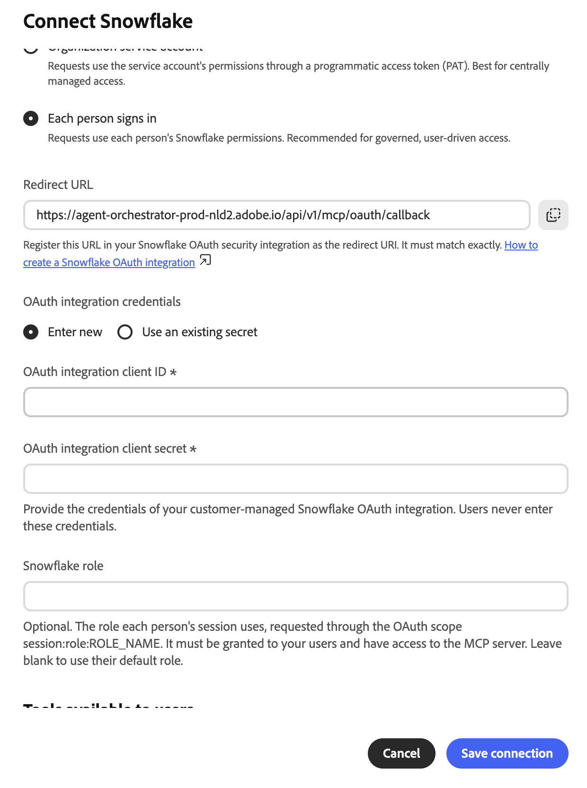
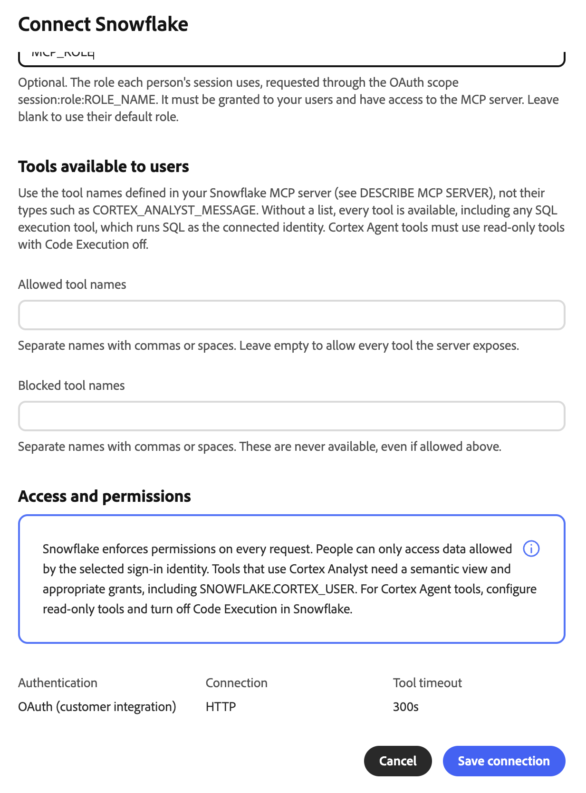
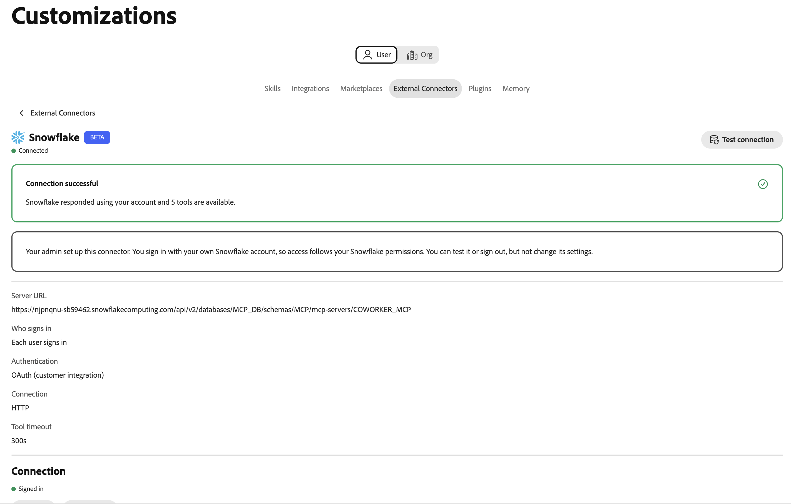

# Snowflake Cortex AI外部聯結器 {#snowflake}

使用[!DNL Snowflake Cortex AI]外部聯結器以簡單語言在Adobe CX Enterprise Coworker中詢問有關[!DNL Snowflake]資料的問題。 聯結器會將同事連結至您[!DNL Snowflake]帳戶中的[!DNL Snowflake]受管理模型內容通訊協定(MCP)伺服器。 Co-worker就可以使用伺服器公開的工具，例如[!DNL Cortex Analyst]、[!DNL Cortex Search]和SQL工具。

>[!AVAILABILITY]
>
>[!DNL Snowflake Cortex AI]外部聯結器為Beta版。 文件和功能可能會有所變更。

## 聯結器設定 {#connector-configuration}

聯結器組態程式有兩個獨立的部分：

* **組織設定：**&#x200B;管理員將同事連線到現有的[!DNL Snowflake] MCP伺服器，選擇人員登入的方式，並選取成員可以使用的工具。
* **成員存取：**&#x200B;成員使用具有共用組織身分或他們自己的[!DNL Snowflake]身分的連線，視登入選項而定。

管理員可選擇下列其中一個登入選項：

| 選項 | 管理員提供的內容 | 存取的運作方式 |
| --- | --- | --- |
| **[!UICONTROL 組織服務帳戶]** | 服務帳戶的[!DNL Snowflake]程式化存取權杖(PAT)。 | 所有成員都使用服務帳戶的許可權。 權杖到期或撤銷會影響所有成員。 |
| **[!UICONTROL 每個人登入]** | [!DNL Snowflake] OAuth整合的使用者端ID和使用者端密碼，以及選用的[!DNL Snowflake]角色。 | 每個成員都使用自己的[!DNL Snowflake]身分登入，而且存取遵循其[!DNL Snowflake]許可權。 |

這兩個選項都不會授與所選識別尚未擁有的[!DNL Snowflake]許可權。 [!DNL Snowflake]會針對每個請求強制執行許可權。

## 先決條件 {#prerequisites}

Co-worker連線到現有的[!DNL Snowflake] MCP伺服器。 它不會建立伺服器或其工具。 開始之前，請確定您具備下列條件：

* **對於組織設定：**&#x200B;具有在同事中管理組織聯結器的許可權的帳戶。
* **對於[!DNL Snowflake] MCP伺服器：**&#x200B;伺服器的完整HTTPS URL，包括其資料庫、結構描述和伺服器名稱。
* **服務帳戶選項：**&#x200B;專用服務帳戶的PAT。 服務帳戶角色應該只有MCP伺服器及其工具所需的許可權。
* **針對個人登入選項：** [!DNL Snowflake] OAuth與其使用者端ID和使用者端密碼整合。 您還需要一位可以註冊Co-worker重新導向URL並設定整合的[!DNL Snowflake]管理員。

>[!IMPORTANT]
>
>切勿在熒幕擷圖、聊天或支援票證中分享PAT、OAuth使用者端密碼或其他認證。 使用組織密碼和許可權最低的[!DNL Snowflake]身分。

### 設定您的Snowflake MCP伺服器 {#configure-snowflake-mcp-server}

在您設定聯結器之前，[!DNL Snowflake]管理員必須在[!DNL Snowflake]中完成下列工作：

1. 建立MCP伺服器並定義它公開的工具。
1. 將必要的角色存取權授與MCP伺服器、其工具和基礎物件。

   存取MCP伺服器不會自動授予存取權給每個工具或物件。

1. 為您打算使用的登入選項設定驗證：

   * 對於服務帳戶選項，請為服務帳戶建立PAT。
   * 針對個人登入選項，建立會發出重新整理權杖的OAuth整合。

如需指示，請參閱下列[!DNL Snowflake]檔案：

* [Snowflake管理的MCP伺服器](https://docs.snowflake.com/en/user-guide/snowflake-cortex/cortex-agents-mcp){target="_blank"}
* [建立MCP伺服器](https://docs.snowflake.com/en/sql-reference/sql/create-mcp-server){target="_blank"}
* [存取控制概觀](https://docs.snowflake.com/en/user-guide/security-access-control-overview){target="_blank"}
* [設定自訂使用者端的Snowflake OAuth](https://docs.snowflake.com/en/user-guide/oauth-custom){target="_blank"}
* [建立安全性整合(Snowflake OAuth)](https://docs.snowflake.com/en/sql-reference/sql/create-security-integration-oauth-snowflake){target="_blank"}
* [使用程式化存取權杖進行驗證](https://docs.snowflake.com/en/user-guide/programmatic-access-tokens){target="_blank"}

## 為您的組織設定聯結器 {#configure-organization}

管理員可讓組織中的所有人使用[!DNL Snowflake Cortex AI]聯結器。 組織頁面上的變更會套用至組織中的所有使用者。

1. 開啟&#x200B;**[!UICONTROL 自訂]**，選取&#x200B;**[!UICONTROL 組織]**，然後選取&#x200B;**[!UICONTROL 外部聯結器]**。 在&#x200B;**[!UICONTROL Snowflake Cortex AI]**&#x200B;卡上，選取&#x200B;**[!UICONTROL 設定]**。

1. 在&#x200B;**[!UICONTROL 連線Snowflake Cortex AI]**&#x200B;對話方塊中，在&#x200B;**[!UICONTROL 伺服器URL]**&#x200B;中輸入您[!DNL Snowflake] MCP伺服器的完整URL。 URL必須使用HTTPS並遵循此模式：

   ```text
   https://<account-host>/api/v2/databases/<database>/schemas/<schema>/mcp-servers/<server-name>
   ```

   使用您[!DNL Snowflake]帳戶和MCP伺服器的確切URL。 帳戶主機名稱不得包含底線，包括編碼底線(`%5F`)。 請勿在URL中包含認證。 Co-worker在儲存前會檢查HTTPS配置、主機和路徑。

1. 在&#x200B;**[!UICONTROL 誰登入？]**&#x200B;下，選取登入選項，然後完成其設定。

   * **[!UICONTROL 組織服務帳戶]：**&#x200B;要求會透過程式化存取權杖(PAT)使用服務帳戶的許可權。 使用此選項進行集中管理存取。 請使用具有範圍狹窄角色的專用服務帳戶，而非個人帳戶。

     ![連線Snowflake對話方塊中選取了組織服務帳戶，其中顯示[伺服器URL]欄位、[服務帳戶]權杖選項、[程式化存取權杖]欄位，以及警告，說明每個人都要依權杖擁有者的許可權執行。](./assets/snowflake/org-service-account.png){width="500" zoomable="yes"}

     | 設定 | 說明 |
     | --- | --- |
     | **[!UICONTROL 服務帳戶權杖]** | 選擇權杖的來源。 選取&#x200B;**[!UICONTROL 輸入新的]**&#x200B;以輸入PAT，或&#x200B;**[!UICONTROL 使用現有的密碼]**&#x200B;以重複使用已包含權杖的組織密碼。 現有密碼必須包含`Authorization`標頭的完整值，而不僅僅是原始權杖。 |
     | **[!UICONTROL 程式化存取權杖]** | 選取&#x200B;**[!UICONTROL 輸入新的]**&#x200B;時為必要。 為只有必要許可權的專用[!DNL Snowflake]服務帳戶建立Token。 如需指示，請在對話方塊中選取&#x200B;**[!UICONTROL 如何建立程式化存取權杖]**。 同事會將權杖儲存為組織機密。 |

     >[!IMPORTANT]
     >
     >使用此連線的每個人都需使用權杖所有者的許可權。 如果Token過期或遭撤銷，則所有成員的連線都將停止運作。

     建立和使用PAT可能會受到[!DNL Snowflake]網路和驗證原則的約束。 如果權杖建立或驗證遭到封鎖，請要求您的[!DNL Snowflake]管理員檢查這些原則。

   * **[!UICONTROL 每個登入者都會使用]：**&#x200B;要求使用每個使用者的[!DNL Snowflake]許可權。 使用此選項進行受管理、使用者導向的存取。

     {width="500" zoomable="yes"}

     | 設定 | 說明 |
     | --- | --- |
     | **[!UICONTROL 重新導向URL]** | 唯讀。 複製此URL，並在您的[!DNL Snowflake] OAuth安全性整合中將其註冊為重新導向URI。 值必須完全符合。 如需指示，請在對話方塊中選取&#x200B;**[!UICONTROL 如何建立Snowflake OAuth整合]**。 重新導向URL在不同環境中會有所不同，因此請一律從對話方塊複製。 |
     | **[!UICONTROL OAuth整合認證]** | 選擇認證來源。 選取&#x200B;**[!UICONTROL 輸入新的]**&#x200B;以輸入使用者端ID和使用者端密碼，或選取&#x200B;**[!UICONTROL 使用現有的密碼]**&#x200B;以選取包含這些密碼的組織密碼。 |
     | **[!UICONTROL OAuth整合使用者端ID]** | 選取&#x200B;**[!UICONTROL 輸入新的]**&#x200B;時為必要。 您客戶管理的[!DNL Snowflake] OAuth整合的使用者端ID。 |
     | **[!UICONTROL OAuth整合使用者端密碼]** | 選取&#x200B;**[!UICONTROL 輸入新的]**&#x200B;時為必要。 相同OAuth整合的使用者端密碼。 成員絕不輸入這些認證。 |
     | **[!UICONTROL Snowflake角色]** | 選填。 每個工作階段使用的角色，透過OAuth範圍`session:role:ROLE_NAME`要求。 角色必須授與您的成員，而且必須可以存取MCP伺服器。 將欄位保留空白以使用每個成員的預設角色。 |

     同事從帳戶URL衍生OAuth端點，並要求重新整理權杖。 設定OAuth整合以發佈重新整理權杖。 請求的範圍本身不會覆寫整合設定。

     同事將角色名稱轉換為大寫。 無法使用以小寫引號建立的角色。 如果OAuth整合封鎖角色，或成員沒有角色，登入或存取可能會失敗。

1. 在&#x200B;**[!UICONTROL 使用者可用的工具]**&#x200B;下，選擇成員可以使用的工具。 每個[!DNL Snowflake] MCP伺服器會定義自己的工具，所以對話方塊不會顯示固定的清單。 輸入在MCP伺服器中定義的工具名稱，而不是如`CORTEX_ANALYST_MESSAGE`之類的工具型別。 若要檢視工具名稱，請在[!DNL Snowflake]中執行`DESCRIBE MCP SERVER`。

   {width="500" zoomable="yes"}

   | 設定 | 說明 |
   | --- | --- |
   | **[!UICONTROL 允許的工具名稱]** | 成員可以使用的工具。 以逗號或空格分隔名稱。 將欄位保留空白可允許伺服器公開的每個工具，但封鎖的工具除外。 |
   | **[!UICONTROL 已封鎖的工具名稱]** | 成員永遠不能使用的工具。 以逗號或空格分隔名稱。 即使您也允許封鎖的工具，這些工具仍無法使用。 |

   >[!IMPORTANT]
   >
   >如果您將&#x200B;**[!UICONTROL 允許的工具名稱]**&#x200B;保留為空白，則成員可以使用每個工具，包括任何SQL執行工具。 SQL執行工具會執行SQL做為連線的識別。 檢閱伺服器上的工具定義，並僅允許貴組織需要的工具。

   工具說明不能取代[!DNL Snowflake]許可權或其他存取控制項。 針對[!DNL Cortex Analyst]工具，設定語意檢視和必要的授權，包括`SNOWFLAKE.CORTEX_USER`資料庫角色。 針對[!DNL Cortex Agent]工具，設定唯讀工具並關閉[!DNL Snowflake]中的程式碼執行。 成員無法變更工具選擇。

1. 檢閱&#x200B;**[!UICONTROL 存取和許可權]**，然後選取&#x200B;**[!UICONTROL 儲存連線]**。 **[!UICONTROL Snowflake Cortex AI]**&#x200B;卡片顯示&#x200B;**[!UICONTROL 已儲存的組態]**。

   選取&#x200B;**[!UICONTROL 檢視組態]**&#x200B;以檢閱伺服器URL、驗證型別和工具原則。 然後選取&#x200B;**[!UICONTROL 測試連線]**&#x200B;以檢查存取並探索伺服器工具。

   新[!DNL Snowflake]連線使用300秒的工具逾時。 沒有儲存逾時的舊連線可能會使用60秒的預設值。 檢查針對現有連線顯示的逾時。

成功的測試不會確認每個工具或[!DNL Snowflake]物件都可供每個成員使用。

## 使用聯結器作為成員 {#use-as-member}

管理員設定聯結器後，從您自己的&#x200B;**[!UICONTROL 自訂]**&#x200B;檢視開啟它。

1. 開啟&#x200B;**[!UICONTROL 自訂]**，選取&#x200B;**[!UICONTROL 使用者]**，然後選取&#x200B;**[!UICONTROL 外部聯結器]**。

   如果&#x200B;**[!UICONTROL Snowflake Cortex AI]**&#x200B;卡片顯示&#x200B;**[!UICONTROL 未設定]**，請要求您的管理員[設定聯結器](#configure-organization)。

1. 開啟&#x200B;**[!UICONTROL Snowflake Cortex AI]**。 成員的聯結器詳細資料是唯讀的。 您無法變更伺服器URL、認證或工具選擇。

1. 如果連線使用組織服務帳戶，則要求使用組織的身分。 您不需要登入。 切勿輸入或共用PAT。

1. 如果連線使用個人登入，請開始登入並使用預期的[!DNL Snowflake]帳戶進行驗證。 完成任何必要的單一登入(SSO)或多重驗證(MFA)步驟。 確認請求的組織、應用程式和角色（如果有的話）。

1. 如有需要，請選取&#x200B;**[!UICONTROL 測試連線]**。 成功的測試顯示&#x200B;**[!UICONTROL 連線成功]**&#x200B;以及可用的工具數目。

   {width="700" zoomable="yes"}

   在測試成功之前，詳細資訊可能只會顯示管理員允許的工具名稱，或提示您執行測試。 測試之後，每個工具都會顯示其說明。

   {width="700" zoomable="yes"}

範例中的工具是由一個[!DNL Snowflake] MCP伺服器所定義。 您看到的工具視您的伺服器和管理員選取的工具而定。

連線的驗證詳細資訊會顯示它使用的是PAT、電腦OAuth或每個人的OAuth。 若要中斷連線您的[!DNL Snowflake]帳戶，請選取&#x200B;**[!UICONTROL 登出]**。

**[!UICONTROL 已連線]**&#x200B;狀態無法保證存取特定工具或資料物件。 [!DNL Snowflake]授權、原則和選取的角色仍適用。

## 疑難排解存取權 {#troubleshoot-access}

如果設定、登入或存取失敗，請向您的管理員檢查下列專案：

| 問題 | 檢查內容 |
| --- | --- |
| 已拒絕伺服器URL | URL使用HTTPS和完整的`/api/v2/databases/<database>/schemas/<schema>/mcp-servers/<server-name>`路徑。 帳戶主機名稱沒有底線，且URL沒有認證。 |
| 無法建立或使用PAT | 服務帳戶的網路原則、驗證原則、權杖到期日和角色。 如果您使用現有的密碼，請確認它包含完整的`Authorization`標頭值。 |
| OAuth重新導向URL不相符 | [!DNL Snowflake] OAuth整合有來自相同同事環境的正確重新導向URL。 |
| 登入成功，但要求失敗 | 角色已授與成員，並由OAuth整合允許。 整合問題會重新整理權杖，且使用者端ID和密碼屬於預期的整合。 |
| 工具遺失或遭拒 | **[!UICONTROL 允許的工具名稱]**&#x200B;和&#x200B;**[!UICONTROL 封鎖的工具名稱]**&#x200B;設定、MCP伺服器上的工具可用性，以及[!DNL Snowflake]授與伺服器、工具和基礎物件的許可權。 |
| 工具呼叫逾時 | 聯結器詳細資料上的&#x200B;**[!UICONTROL 工具逾時]**。 新連線使用300秒。 沒有儲存逾時的較舊連線可能會使用60秒。 |
